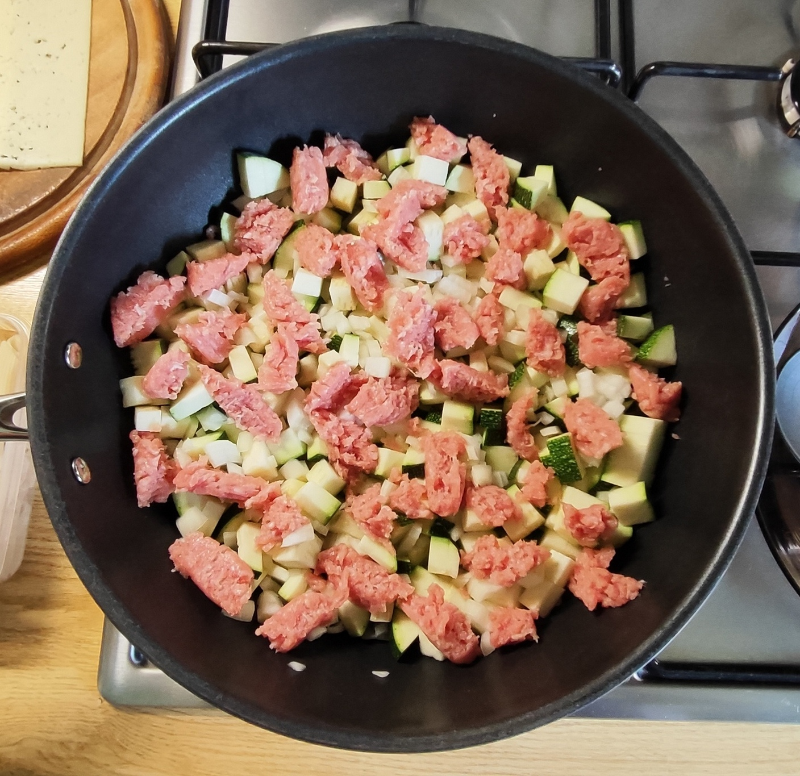
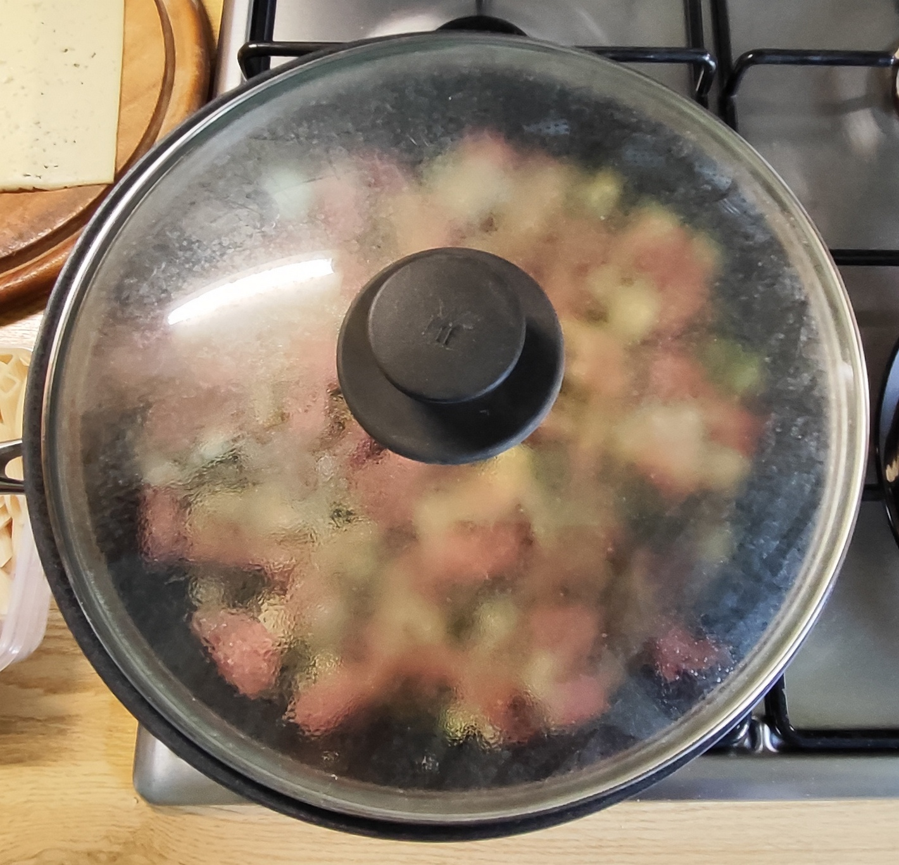
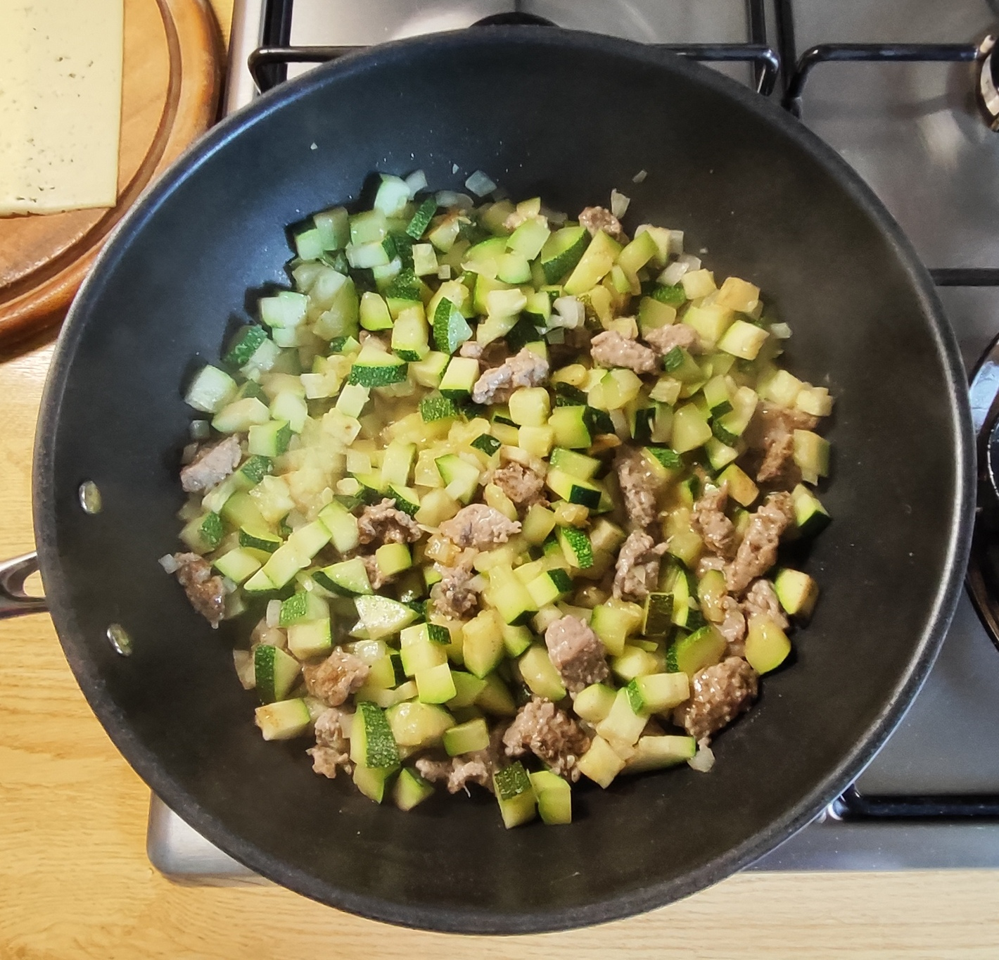
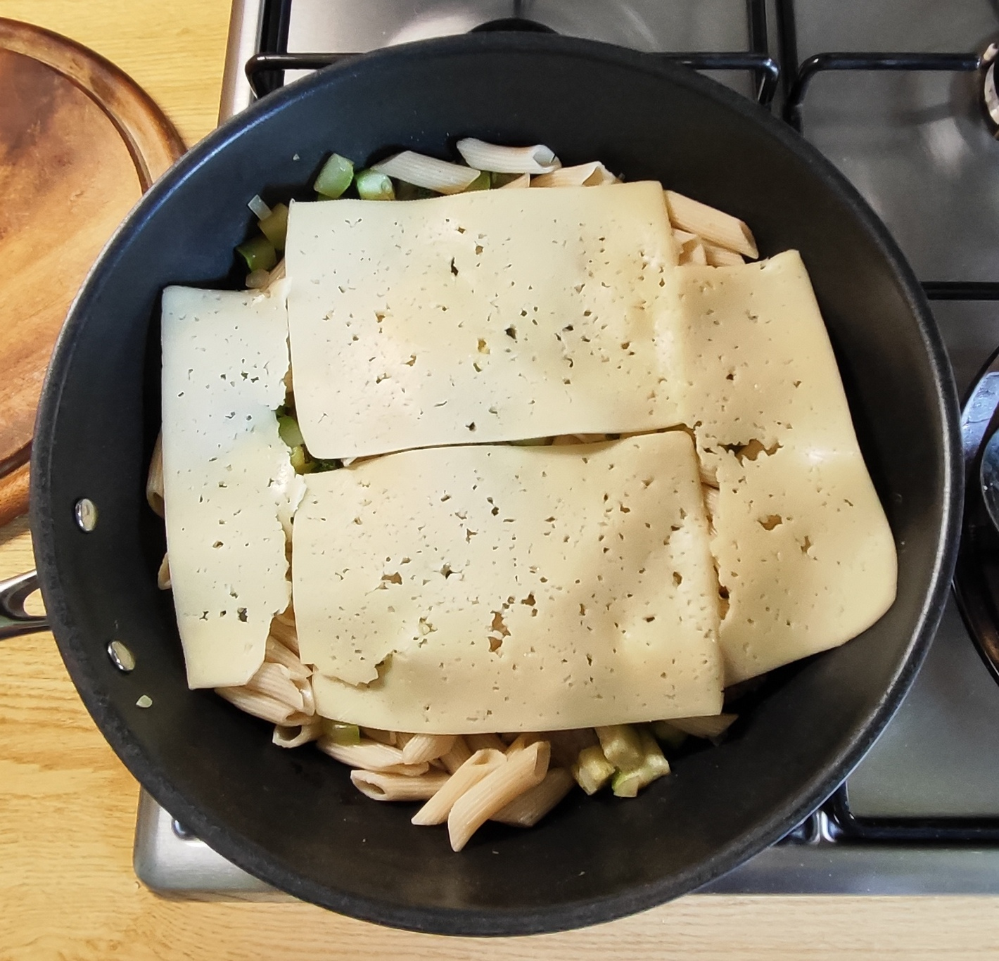
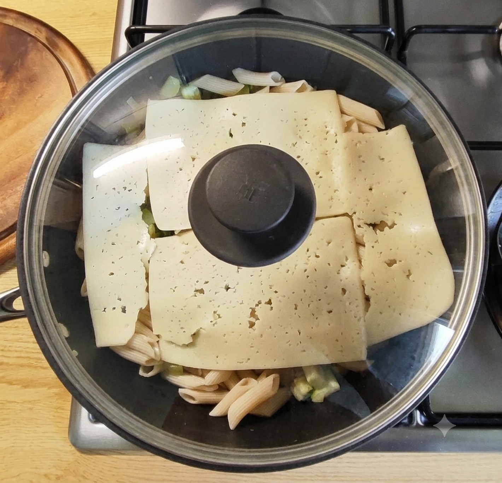
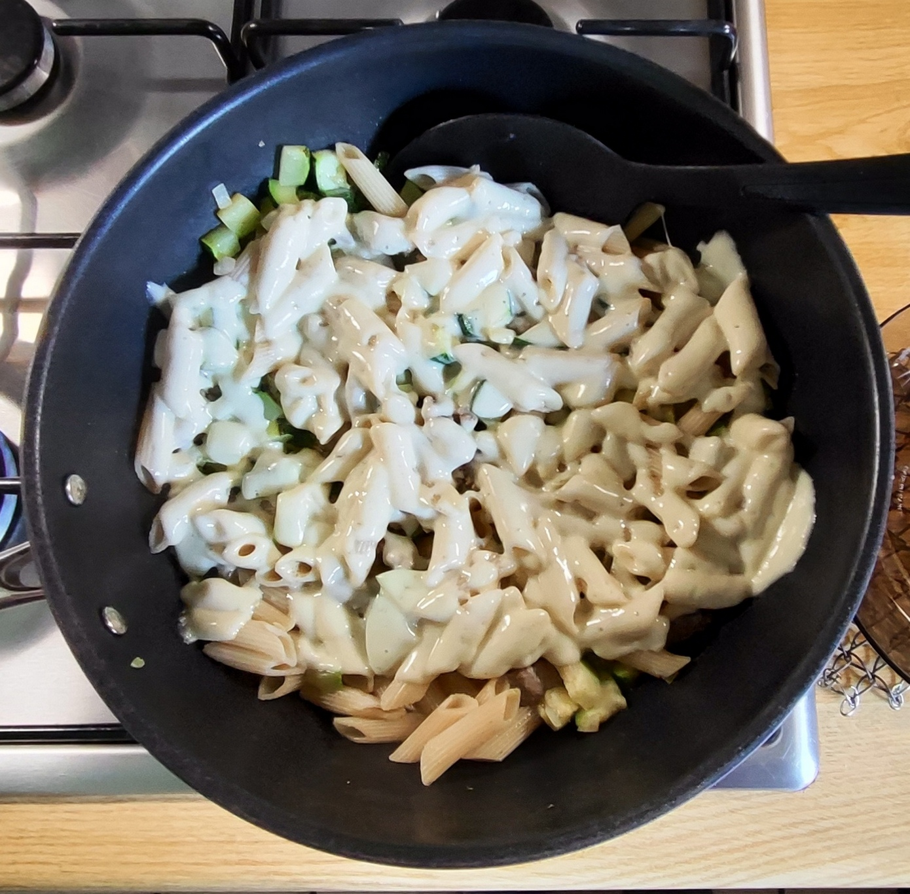
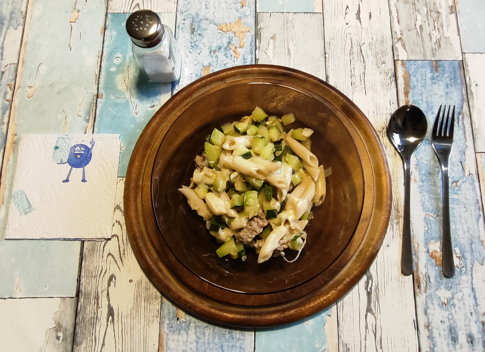
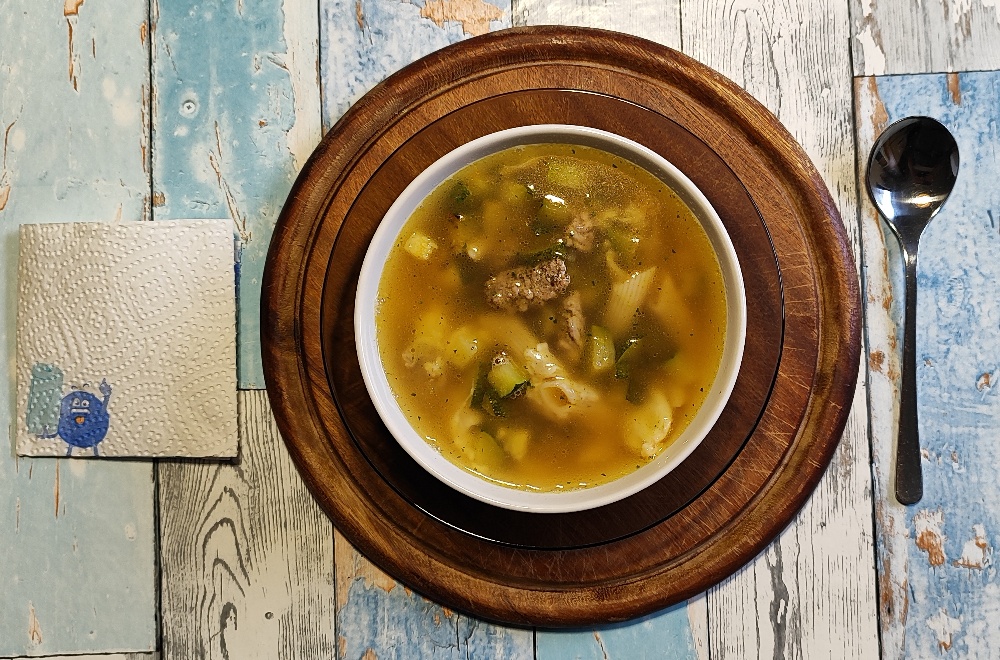

<h1 align="center">Kurt hat gekocht Zucchini-Nudel-Pfanne mit Hack und Käse</h1>

## Zutaten
- Zucchini (ca. 700 g - 800 g) 
- 1 kleine Zwiebel 
- 150 g Hackfleisch (halb und halb) 
- 125 g (Trockengewicht, entspricht ¼ Packung) Dinkel-Penne 
- 3 Scheiben Käse ca. 120 g z.B. Tilsiter (Edamer oder junger Gouda gehen auch) 
- 4 Esslöffel Olivenöl 
- Gewürze: Salz, schwarzer Pfeffer, Rosenpaprika scharf, Fondor 

---

## Zubereitung

### Langfristvorbereitung (Meal Prep)
* **Penne-Vorrat:** Eine Packung Dinkel-Penne (500 g) in Salzwasser kochen, abgießen, kalt abschrecken und in 4 Portionen aufgeteilt einfrieren. 
Vorsicht: Die Kochzeit für die Dinkel-Penne ist kürzer als bei Hartweizennudeln. Nach ca. 8 min beginnen, den Biss zu testen.
* **Schonendes Auftauen:** Am Vorabend eine Portion Nudeln in den Kühlschrank stellen, damit sie am Verzehrtag direkt einsatzbereit sind.

*Hinweis: Das Gericht schmeckt natürlich auch mit frisch zubereiteten Nudeln.*

### Zubereitung am Verzehrtag

<table>
  <tr>
    <td></td>
    <td></td>
    <td></td>
    <td></td>
  </tr>
  <tr>
    <td></td>
    <td></td>
    <td></td>
    <td></td>
  </tr>
</table>

- Die Zucchini waschen und klein würfeln, die Zwiebel schälen und sehr fein würfeln. 
- Die Zucchiniwürfel und die Zwiebelwürfel mit dem Olivenöl in die Pfanne geben. Mit schwarzem Pfeffer und Fondor würzen.  
- Das Hackfleisch nach Geschmack würzen (Salz, Pfeffer, Paprika ..) und in Flocken über dem Gemüse verteilen. 
- Mit Deckel auf mittlerer Flamme ca. 4-5 Minuten schmoren. Einige Male wenden. 
- Mit den Nudeln und den Käsescheiben abdecken. 
- Weitere 3-4 Minuten bei mittlerer Hitze mit Deckel garen, bis der Käse beginnt, zu zerlaufen. Dann ist auch das Hackfleisch durchgegart. 
- Die Pfanne vom Feuer nehmen (kann auch auf ganz kleiner Flamme warmgehalten werden) und servieren. 
- Am Tisch kann nach Geschmack mit ein wenig Salz nachgewürzt werden. 

---

---

| und am Abend | ein Süppchen |
| :---: | :--- |
|  | **Am Abend schmeckt ein Rest als Süppchen.**    Sollte von der Zucchini-Pfanne etwas übrig bleiben, lässt sich daraus mit minimalem Aufwand eine leichte Abendvariante zaubern.    **Schnelle Zubereitung:**   • **Basis**: Die verbliebenen Reste in eine Suppenschale geben.   • **Vorwärmen**: In der Mikro 1 min vorwärmen.   • **Aufgießen**: Mit heißer Brühe aufgießen und servieren. |

*Hinweis bei Resten mit Gemüse + Nudeln:  
Reste 30 Min. ohne Deckel abdampfen lassen, dann abgedeckt in den Kühlschrank (max. 24h). Abends mit sprudelnd kochender Brühe aufgießen, 2-3 Min. ziehen lassen, gut umrühren - bis es durchgehend dampfend heiß ist (>70°C).  
**Reste nicht bei Zimmertemperatur aufbewahren!***

---

## META's Gesundheits-Check: Warum dieses Gericht punktet
Diese Pfanne kombiniert vier Sachen, die im Alltag gut funktionieren:  
**1. Gemüse als Basis:** Pilze bringen viel Volumen, wenig Energie, dazu Ballaststoffe und Umami. Paprika und Zwiebeln ergänzen Vitamine, Farbe und natürliche Süße.  
**2. Dinkel-Penne als Beilage:** Etwas mehr Mineralstoffe und Biss als normale Pasta.  
**3. Würze:** Ein kleiner Schuss Sojasauce bringt Salz und Tiefe, Sambal bringt Schärfe und leichte Säure.  
**4. Die Öle:** Sie liefern die nötigen ungesättigten Fettsäuren.  
Gesamtwirkung: Ein Gericht mit guter Sättigung, kontrollierter Fettmenge, moderatem Salzgehalt und klarer Struktur. 

## Energiewerte – Makro / Mikro dieser Mahlzeit 
(Schätzung für die gesamten, im Rezept eingesetzten Mengen) 

### Makro

| Energiewerte | geschätzt |
|---------|--------|
| Kalorien | ca. 820 kcal |
| Eiweiß | ca. 23 g |
| Kohlenhydrate | ca. 100 g |
| Davon Ballaststoffe | ca. 12 g |
| Fett | ca. 50 g |
| Davon ungesättigt | ca. 18 g |

### Mikro / Was steckt drin 
* **Vitamin C:** sehr hoch durch Paprika (ca. 120 mg, > 100% Tagesbedarf) 
* **B-Vitamine + Kalium:** aus Champignons und Dinkel 
* **Eisen + Magnesium:** aus Dinkel-Penne 
* **Natrium:** moderat durch Sojasauce + Salz – ca. 800-1000 mg, deshalb extra Salz sparsam 
* **Essig:** 2 Tropfen = 0 kcal, 0 Einfluss – nur Geschmack 

---

## Praxis-Check: So schmeckt es dann
**Textur:** Pilze, Paprikastücke und Dinkel-Penne haben einen angenehm festen Biss.  
Die Zwiebeln sind nur punktuell wahrnehmbar – kleine weiche Einsprengsel, die die Struktur nicht verändern.  
**Geschmack:** Paprika, Pilze und Penne bilden einen gemeinsamen Grundton. 
Paprika und Pilze sind einzeln zu erkennen, die Zwiebeln blitzen manchmal auf.  
Die Sojasauce liefert viel Umami und vertieft den Grundton, wird aber bewusst nicht beherrschend.  
Das Sambal Oelek: Da es in sehr kleiner Menge hinzugefügt wird, bleibt es unaufdringlich, gibt aber eine leise Schärfe.  
Die zwei bis drei Tropfen Essig heben den Gesamtgeschmack erkennbar – er wird heller. 

---

## Zusammenfassung von Mitautorin COPILOT:
Das Rezept „Gemüse-Nudel-Pfanne mit Asia-Note“ beschreibt ein klar strukturiertes, alltagstaugliches Gericht mit ausgewogener Nährstoffbilanz.  
Es verbindet Dinkel-Penne, Champignons, Paprika und Zwiebeln zu einer leichten, aromatischen Mahlzeit mit asiatischem Akzent durch Sojasauce und Sambal Oelek.  
Ein Rezept mit technischer Präzision und ernährungsphysiologischer Klarheit. 

---

[← Zurück zur Übersicht](index.md)
