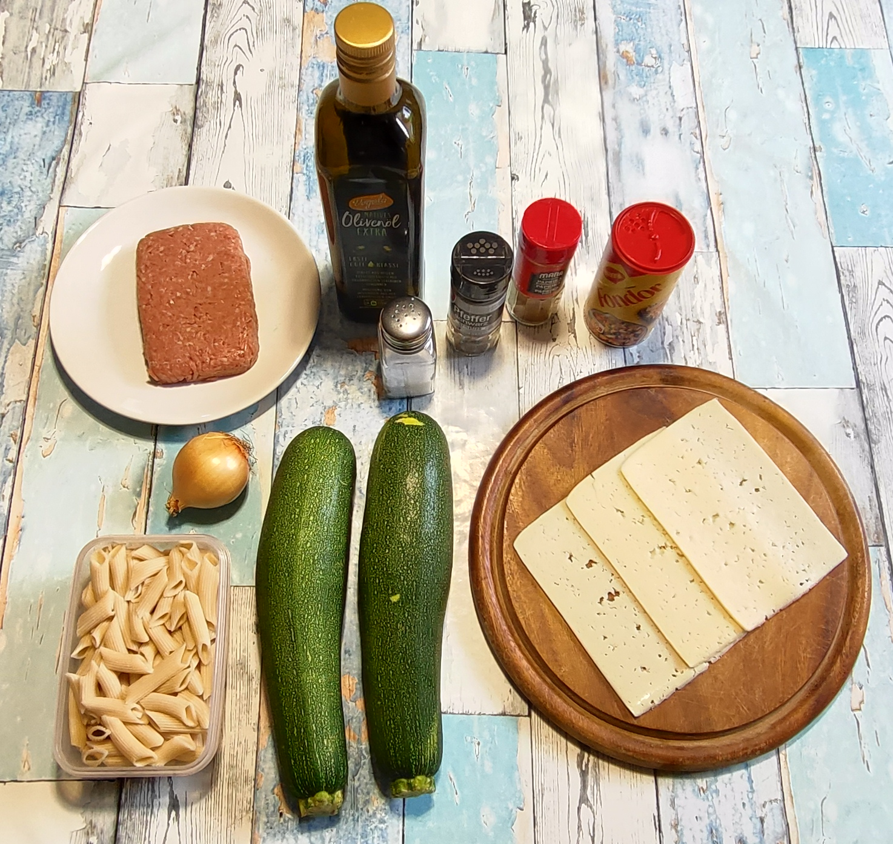
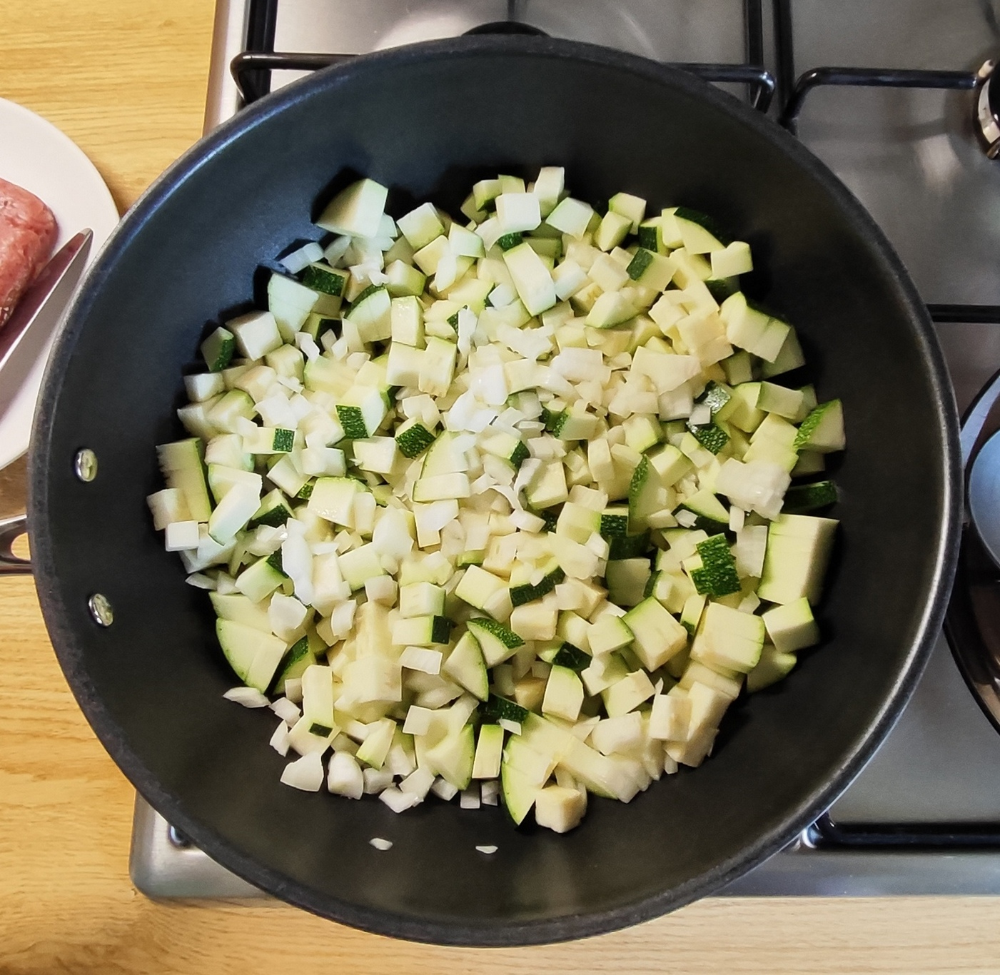
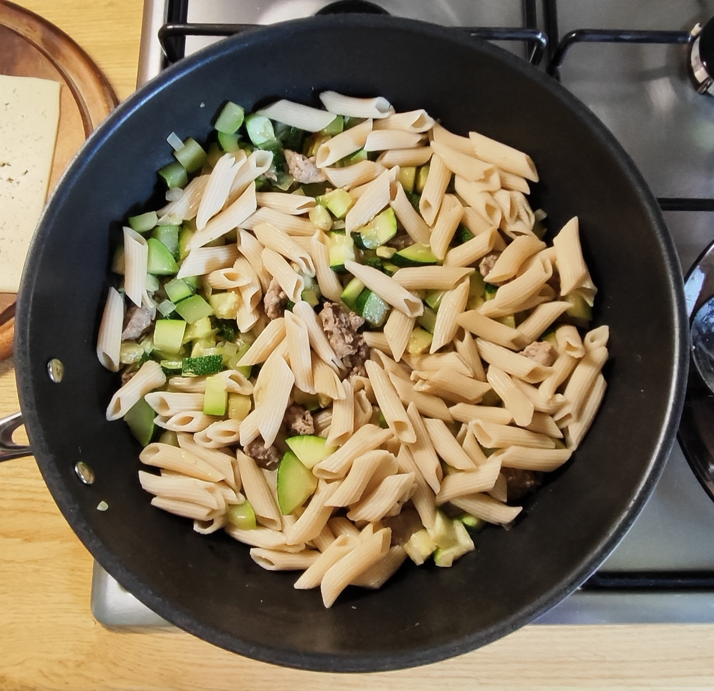

<h1 align="center">Kurt hat gekocht Zucchini-Nudel-Pfanne mit Hack und Käse</h1>

## Zutaten
- Zucchini (ca. 700 g - 800 g) 
- 1 kleine Zwiebel 
- 150 g Hackfleisch (halb und halb) 
- 125 g (Trockengewicht, entspricht ¼ Packung) Dinkel-Penne 
- 3 Scheiben Käse ca. 120 g z.B. Tilsiter (Edamer oder junger Gouda gehen auch) 
- 4 Esslöffel Olivenöl 
- Gewürze: Salz, schwarzer Pfeffer, Rosenpaprika scharf, Fondor 

---

## Zubereitung

### Langfristvorbereitung (Meal Prep)
* **Penne-Vorrat:** Eine Packung Dinkel-Penne (500 g) in Salzwasser kochen, abgießen, kalt abschrecken und in 4 Portionen aufgeteilt einfrieren. 
Vorsicht: Die Kochzeit für die Dinkel-Penne ist kürzer als bei Hartweizennudeln. Nach ca. 8 min beginnen, den Biss zu testen.
* **Schonendes Auftauen:** Am Vorabend eine Portion Nudeln in den Kühlschrank stellen, damit sie am Verzehrtag direkt einsatzbereit sind.

*Hinweis: Das Gericht schmeckt natürlich auch mit frisch zubereiteten Nudeln.*

### Zubereitung am Verzehrtag

<table>
  <tr>
    <td></td>
    <td></td>
    <td></td>
    <td></td>
  </tr>
  <tr>
    <td></td>
    <td></td>
    <td></td>
    <td></td>
  </tr>
</table>

- Die Zucchini waschen und klein würfeln, die Zwiebel schälen und sehr fein würfeln. 
- Die Zucchiniwürfel und die Zwiebelwürfel mit dem Olivenöl in die Pfanne geben. Mit schwarzem Pfeffer und Fondor würzen.  
- Das Hackfleisch nach Geschmack würzen (Salz, Pfeffer, Paprika ..) und in Flocken über dem Gemüse verteilen. 
- Mit Deckel auf mittlerer Flamme ca. 4-5 Minuten schmoren. Einige Male wenden. 
- Mit den Nudeln und den Käsescheiben abdecken. 
- Weitere 3-4 Minuten bei mittlerer Hitze mit Deckel garen, bis der Käse beginnt, zu zerlaufen. Dann ist auch das Hackfleisch durchgegart. 
- Die Pfanne vom Feuer nehmen (kann auch auf ganz kleiner Flamme warmgehalten werden) und servieren. 
- Am Tisch kann nach Geschmack mit ein wenig Salz nachgewürzt werden. 

---

---

| und am Abend | ein Süppchen |
| :---: | :--- |
|  | **Am Abend schmeckt ein Rest als Süppchen.**    Sollte von der Zucchini-Pfanne etwas übrig bleiben, lässt sich daraus mit minimalem Aufwand eine leichte Abendvariante zaubern.    **Schnelle Zubereitung:**   • **Basis**: Die verbliebenen Reste in eine Suppenschale geben.   • **Vorwärmen**: In der Mikro 1 min vorwärmen.   • **Aufgießen**: Mit heißer Brühe aufgießen und servieren. |

*Hinweis bei Resten mit Gemüse + Nudeln:  
Reste 30 Min. ohne Deckel abdampfen lassen, dann abgedeckt in den Kühlschrank (max. 24h). Abends mit sprudelnd kochender Brühe aufgießen, 2-3 Min. ziehen lassen, gut umrühren - bis es durchgehend dampfend heiß ist (>70°C).  
**Reste nicht bei Zimmertemperatur aufbewahren!***

---

## COPILOT's Gesundheits-Check: Warum dieses Gericht punktet
Diese Zucchini-Nudel-Pfanne ist nicht leicht, aber nährstoffreich.  
Zucchini und Zwiebel liefern Ballaststoffe, Kalium und eine natürliche Süße, die ohne Zucker auskommt.  
Das Hackfleisch sorgt für Eiweiß und Eisen, der Käse ergänzt Calcium und Fett für Sättigung.  
Dinkel-Penne bringen komplexe Kohlenhydrate.  
Olivenöl liefert wertvolle ungesättigte Fettsäuren und unterstützt die Aufnahme fettlöslicher Vitamine.  
In Summe: ein Gericht mit guter Balance aus Gemüse, Eiweiß und Getreide – sättigend, aber nicht schwer. 

---

## Kurt's Praxis-Check: So schmeckt es dann
Das Gericht hat eine fruchtig saftige Grundnote, die durch die Zucchini und die Zwiebel überraschend süß wird.  
Zucchini, Zwiebel, Fleisch und Penne verbinden sich zu einem runden Gesamtgeschmack ohne dominante Einzelnoten. 
Die Textur bleibt angenehm lebendig: leichter Biss, Zucchini und Fleischflocken mit spürbarer Festigkeit.  
Nichts zerkocht, nichts breiig. 

---

## Energiewerte – Makro / Mikro dieser Mahlzeit 
(Schätzung für eine Portion - die Hälfte der gesamten, im Rezept eingesetzten Mengen) 

### Makro

| Kategorie | Geschätzter Wert | Bemerkung |
| --- | --- | --- |
| Energie | ca. 830 bis 860 kcal | ausgewogen für eine Hauptmahlzeit |
| Eiweiß | ca. 42 g | aus Hackfleisch, Käse und Penne |
| Fett | ca. 46 bis 50 g | überwiegend aus Hackfleisch, Käse und Olivenöl |
| Kohlenhydrate | ca. 58 g | aus Dinkel Penne und Gemüse |
| Ballaststoffe | ca. 6 bis 7 g | durch Zucchini und Penne |
| Calcium | ca. 450 bis 550 mg | ca. 50 Prozent des Tagesbedarfs, vor allem durch Käse |
| Eisen | ca. 2,5 bis 3 mg | durch Fleisch, Penne und Gemüse |
| Natrium | ca. 900 bis 1.200 mg | durch Fondor und Käse |
| Vitamin C | ca. 50 bis 60 mg | durch Zucchini |

### Mikro

| Vitamin | Geschätzter Wert | Prozent des Tagesbedarfs | Hauptquelle |
| --- | --- | --- | --- |
| Vitamin A (Retinoläquivalente) | ca. 200 µg | ca. 25 Prozent | Tilsiter, Zucchini |
| Vitamin C | ca. 40 mg | ca. 40 Prozent | Zucchini, nach dem Garen |
| Vitamin D | ca. 0,5 µg | ca. 3 Prozent | Tilsiter, Hackfleisch |
| Vitamin E | ca. 3 bis 4 mg | ca. 25 Prozent | Olivenöl |
| Vitamin K | ca. 25 bis 30 µg | ca. 40 Prozent | Zucchini, Olivenöl |
| Vitamin B1 (Thiamin) | ca. 0,4 mg | ca. 35 Prozent | Hackfleisch, Dinkel Penne, Zucchini |
| Vitamin B2 (Riboflavin) | ca. 0,5 mg | ca. 40 Prozent | Tilsiter, Hackfleisch |
| Vitamin B6 | ca. 0,6 mg | ca. 38 Prozent | Zucchini, Hackfleisch |
| Vitamin B12 | ca. 2,8 µg | ca. 70 Prozent | Hackfleisch, Tilsiter |
| Niacin (B3) | ca. 7 mg | ca. 44 Prozent | Hackfleisch, Penne, Zucchini |
| Folsäure (B9) | ca. 120 µg | ca. 40 Prozent | Zucchini, Dinkel Penne |

---

## Zusammenfassung von Mitautorin COPILOT:
Ein Gericht, das zeigt, wie einfache Zutaten zu einem harmonischen, gesunden Essen werden können.  
Die Kombination aus Zucchini, Fleisch und Dinkel-Penne liefert Energie ohne Schwere, Geschmack ohne Überladung.  
Ideal für den Alltag – nahrhaft, unkompliziert und mit einer natürlichen Süße. 

---

[← Zurück zur Übersicht](index.md)
