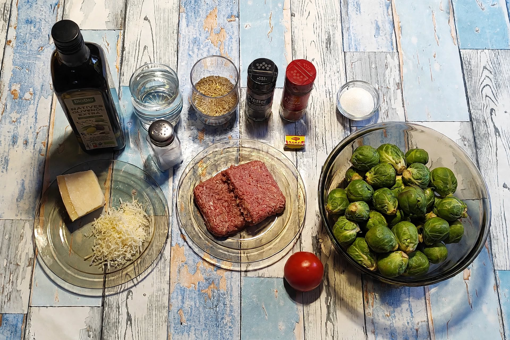
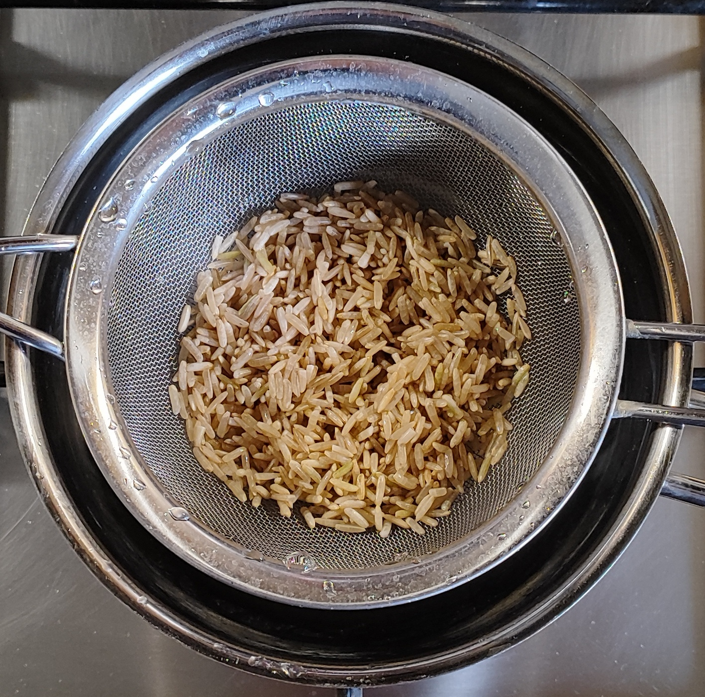
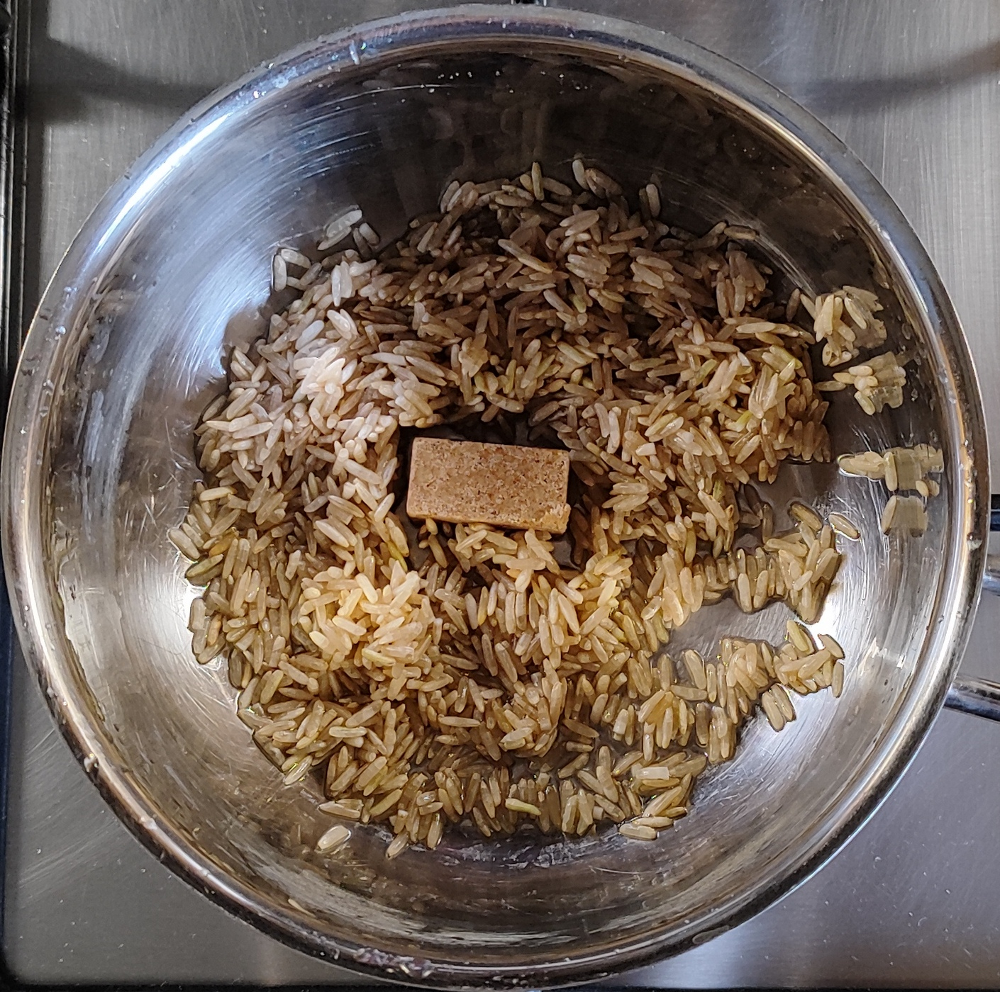
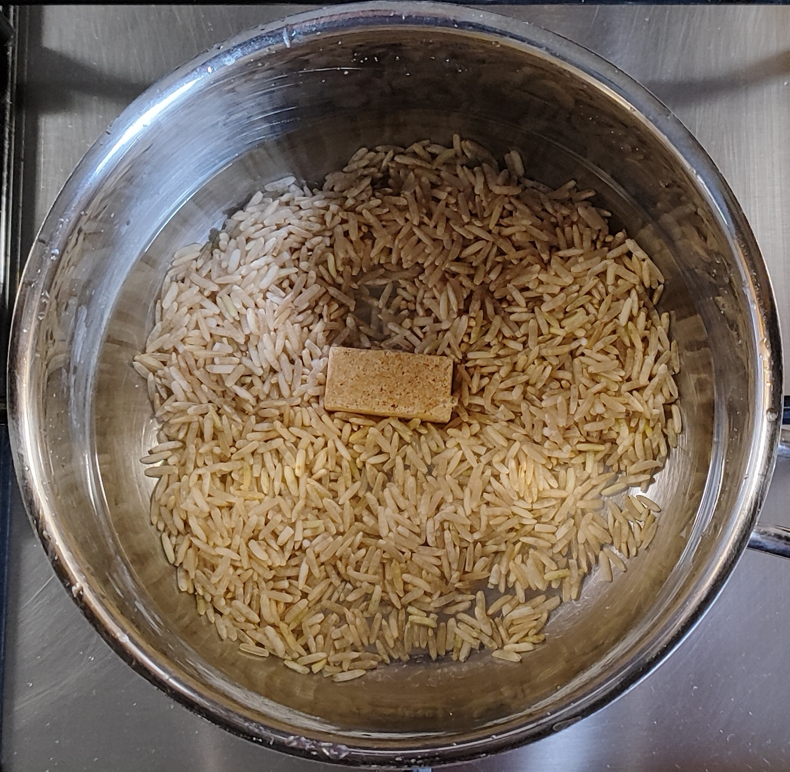
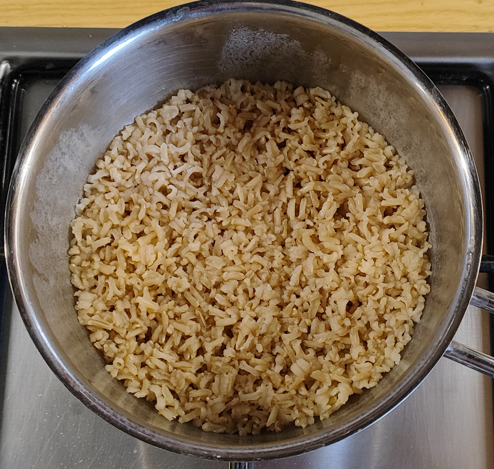
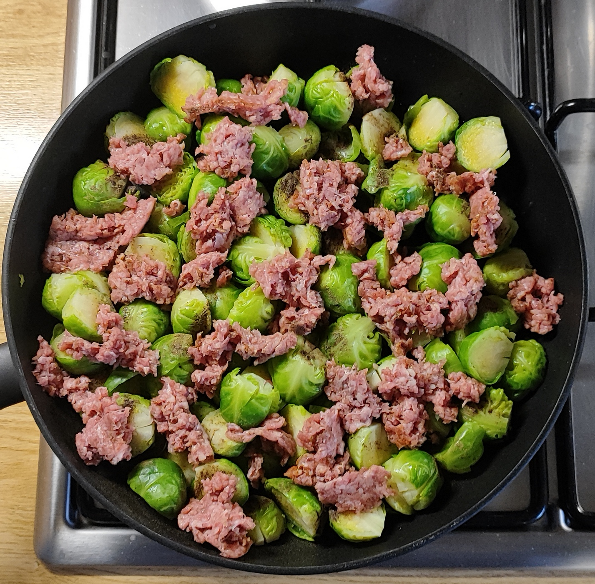
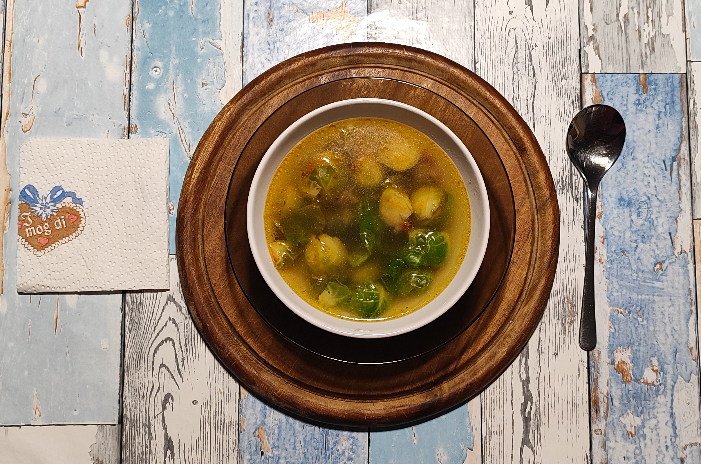

<h1 align="center">Kurt hat gekocht Rosenkohl-Pfanne mit Hack und Reis</h1>
 

## Zutaten für 2 Portionen

- Rosenkohl (ca. 800 g) 
- 1 mittelgroße Tomate 
- Ca. 170 g Hackfleisch (halb und halb) 
- 60 g Naturreis (anderer Reis geht auch) als Sättigungs- und Geschmackbeilage 
- 300 ml Wasser und ein Brühwürfel (für den Reis) 
- 2 Esslöffel Zucker (für das Blanchier Wasser) 
- 2 Esslöffel Olivenöl  
- Gewürze: Schwarzer Pfeffer, Paprika rosenscharf, Salz  
- Ca. 20 g Parmesan  

## Zubereitung

### Der Reis

<table>
  <tr>
    <td></td>
    <td></td>
    <td></td>
    <td></td>
    <td></td>
    <td></td>
  </tr>
  <tr>
    <td align="center">Wässern</td>
    <td align="center">Abspülen</td>
    <td align="center">Brühwürfel dazu</td>
    <td align="center">Wasser dazu</td>
    <td align="center">Köcheln</td>
    <td align="center">Die Brühe ist aufgenommen</td>
  </tr>
</table>

- Den Reis vorab ca. 1/2 Stunde wässern und gründlich abspülen.  
- Reis, Brühwürfel und Wasser in einen Topf geben.  
- Bei kleiner Hitze abgedeckt ca. 40 - 45 Minuten mit Deckel köcheln lassen, bis die Flüssigkeit vollständig aufgenommen wurde. Nicht rühren.
- Das Ergebnis: Die gesamte Brühe ist aufgenommen, der Naturreis ist locker und körnig – genau wie im letzten Bild dokumentiert.

#### *Eine Begründung für diese Methode findest du [hier](32-quellmethode-reis.md)*

---

### Das Gemüse blanchieren

- Den Rosenkohl putzen, schälen und an der Wurzel kreuzweise einschneiden. 
- Wasser zum Sieden bringen, den Zucker zugeben und die Röschen hineinschütten. 
- Ca. 8 Minuten blanchieren / vorgaren. Ab und zu rühren. 
- Den Rosenkohl in ein Sieb abgießen und mit kaltem Wasser abbrausen, bis er noch etwa handwarm ist. 

<table>
  <tr>
    <td></td>
    <td></td>
  </tr>
  <tr>
    <td align="center">Das Wasser siedet, Zucker dazu</td>
    <td align="center">Rosenkohl dazu</td>
  </tr>
</table>

### Das Pfannenfinish 
 
- Das Öl in der Pfanne erhitzen. 
- Die Rosenkohl-Röschen halbieren und in die Pfanne geben. Mit Pfeffer würzen. 
- Das Hackfleisch würzen (Salz, Pfeffer, Paprikapulver, ..) und in Flocken darüber verteilen. 
- Bei großer Hitze kurz anbraten. Alles vermengen und bei mittlerer Hitze ca. 5 min (dann ist der Rosenkohl noch bissfest und das Hack ist gar). Öfter wenden.
- Nicht viel länger schmoren, sonst wird das Hackfleisch trocken.
- Ein Deckel beschleunigt den Garprozess, verhindert jedoch Röstaromen. 
- Die Tomate klein würfeln. 
- Kurz vor Ende der Pfannenzeit die Tomatenstückchen unterheben und kurz mitgaren lassen. 
- Sollte die Pfanne zwischendurch zu trocken werden, etwas Wasser zugeben. 

<table>
  <tr>
    <td></td>
    <td></td>
    <td></td>
  </tr>
</table>

<table>
  <tr>
    <td></td>
    <td align="center"><i>und so sollte es dann aussehen  das Gemüse hat noch einen guten Biss  der Reis ist nicht verklebt  die Fleischstücke sind saftig  am Boden hat sich ein wenig Sauce aus Gemüsesaft und dem Fleischsud gesammelt</i></td>
  </tr>
</table>

#### Servieren und mit ein wenig Parmesan bestreuen. 
*Ein zusätzliches Nachwürzen mit Salz sollte nicht erforderlich sein.*

---

## META‘s Gesundheits-Check: Warum dieses Gericht punktet 
**Dieses Gericht punktet durch seine Zusammensetzung**  
**Rosenkohl** als Hauptzutat liefert Ballaststoffe, sekundäre Pflanzenstoffe und Vitamine und sorgt für ein hohes Gemüsevolumen bei überschaubarer Energiedichte.   
**Die kleine Portion Reis** in Brühe ergänzt das Gericht als Sättigungsbeilage und hält die Kohlenhydratmenge bewusst niedrig.   
**Hackfleisch** in kleiner Menge steuert Eiweiß und Eisen bei und unterstützt die Sättigung, ohne das Gemüse zu verdrängen.   
**Olivenöl** liefert vorwiegend einfach ungesättigte Fettsäuren und hilft dem Körper, fettlösliche Vitamine aus dem Gemüse aufzunehmen.   
**Tomate und Parmesan** kommen in kleiner Menge dazu und ergänzen Vitamine, Mineralstoffe und Eiweiß.   
**Das Servieren** auf dem Stövchen hält das Gericht warm und unterstützt ein langsames, entspanntes Essen.   
Eine ausgewogene Mahlzeit mit viel Gemüse, moderater Beilage und kleiner Eiweißportion. 

---

## Kurt's Praxis Check: So schmeckt es dann 
Das Auge isst mit.  
Ich starte mit einem dieser lecker grünen Röschen. Viel Biss (vielleicht beim nächsten Mal etwas länger blanchieren), gar nicht bitter, sondern angenehm kohlig/gemüsig.   
Ich nehme ein weiteres Röschen und etwas Reis dazu.  
Hui, das zündet. Der Kohl wird vom starken Umami im Reis wie auf einer Welle getragen.   
Eine Fleischflocke dazu, gut gewürzt, die behauptet sich.   
Bissen für Bissen – lecker geht es weiter. 

---

<h3 style="font-family: sans-serif; font-size: 18px; font-weight: bold; margin-bottom: 15px;">Makronährstoffe (für eine Portion):</h3>

<table style="width: 800px; border-collapse: collapse; font-family: sans-serif;">
  <thead>
    <tr style="border-bottom: 2px solid #000;">
      <th style="width: 170px; text-align: left; padding: 8px; border: 1px solid #000; font-weight: bold;">Nährstoff</th>
      <th style="width: 170px; text-align: center; padding: 8px; border: 1px solid #000; font-weight: bold;">Menge (1 Portion)</th>
      <th style="text-align: left; padding: 8px; border: 1px solid #000; font-weight: bold;">Anmerkung</th>
    </tr>
  </thead>
  <tbody>
    <tr>
      <td style="padding: 8px; border: 1px solid #000; font-weight: bold;">Kalorien</td>
      <td style="text-align: center; padding: 8px; border: 1px solid #000;">ca. 580 kcal</td>
      <td style="padding: 8px; border: 1px solid #000;">Mit ca. 170 g Hack gemischt für 2 Portionen</td>
    </tr>
    <tr>
      <td style="padding: 8px; border: 1px solid #000; font-weight: bold;">Eiweiß</td>
      <td style="text-align: center; padding: 8px; border: 1px solid #000;">ca. 35 g</td>
      <td style="padding: 8px; border: 1px solid #000;">Hauptsächlich aus Hackfleisch und Parmesan</td>
    </tr>
    <tr>
      <td style="padding: 8px; border: 1px solid #000; font-weight: bold;">Kohlenhydrate</td>
      <td style="text-align: center; padding: 8px; border: 1px solid #000;">ca. 60 g</td>
      <td style="padding: 8px; border: 1px solid #000;">Hauptsächlich aus Reis, kleiner Teil aus Rosenkohl und Tomate</td>
    </tr>
    <tr>
      <td style="padding: 8px; border: 1px solid #000; font-weight: bold;">davon Zucker</td>
      <td style="text-align: center; padding: 8px; border: 1px solid #000;">ca. 10 g</td>
      <td style="padding: 8px; border: 1px solid #000;">Nur der im Gericht verbleibende Anteil. Zucker aus dem Blanchierwasser wird größtenteils abgegossen</td>
    </tr>
    <tr>
      <td style="padding: 8px; border: 1px solid #000; font-weight: bold;">Fett (gesamt)</td>
      <td style="text-align: center; padding: 8px; border: 1px solid #000;">ca. 26 g</td>
      <td style="padding: 8px; border: 1px solid #000;">Hack mit 18 g Fett pro 100 g, plus Olivenöl und Parmesan</td>
    </tr>
    <tr>
      <td style="padding: 8px; border: 1px solid #000; font-weight: bold;">Gesättigte Fettsäuren</td>
      <td style="text-align: center; padding: 8px; border: 1px solid #000;">ca. 9 g</td>
      <td style="padding: 8px; border: 1px solid #000;">Hauptsächlich aus Hackfleisch und Parmesan, Hack mit 7,4 g pro 100 g</td>
    </tr>
    <tr>
      <td style="padding: 8px; border: 1px solid #000; font-weight: bold;">Ballaststoffe</td>
      <td style="text-align: center; padding: 8px; border: 1px solid #000;">ca. 16 g</td>
      <td style="padding: 8px; border: 1px solid #000;">Hauptsächlich aus Rosenkohl und Reis</td>
    </tr>
    <tr>
      <td style="padding: 8px; border: 1px solid #000; font-weight: bold;">Salz</td>
      <td style="text-align: center; padding: 8px; border: 1px solid #000;">ca. 3 g</td>
      <td style="padding: 8px; border: 1px solid #000;">Aus der Würzung des Hack, aus Brühwürfel und Parmesan</td>
    </tr>
  </tbody>
</table>

<h3 style="font-family: sans-serif; font-size: 18px; font-weight: bold; margin-bottom: 15px;">Mikronährstoffe (Vitamine &amp; Mineralstoffe)</h3>

<table style="width: 800px; border-collapse: collapse; font-family: sans-serif;">
  <thead>
    <tr style="border-bottom: 2px solid #000;">
      <th style="width: 170px; text-align: left; padding: 8px; border: 1px solid #000; font-weight: bold;">Nährstoff</th>
      <th style="width: 170px; text-align: center; padding: 8px; border: 1px solid #000; font-weight: bold;">Menge (1 Portion)</th>
      <th style="text-align: left; padding: 8px; border: 1px solid #000; font-weight: bold;">Deckungsbeitrag pro Tag</th>
    </tr>
  </thead>
  <tbody>
    <tr>
      <td style="padding: 8px; border: 1px solid #000; font-weight: bold;">Vitamin C</td>
      <td style="text-align: center; padding: 8px; border: 1px solid #000;">ca. 150 mg</td>
      <td style="padding: 8px; border: 1px solid #000;">ca. 135 %, sehr hoch durch 400 g Rosenkohl pro Portion, trotz Verlust beim Blanchieren</td>
    </tr>
    <tr>
      <td style="padding: 8px; border: 1px solid #000; font-weight: bold;">Vitamin A (als Beta-Carotin)</td>
      <td style="text-align: center; padding: 8px; border: 1px solid #000;">ca. 160 µg</td>
      <td style="padding: 8px; border: 1px solid #000;">ca. 20 %, hauptsächlich aus Rosenkohl und Tomate</td>
    </tr>
    <tr>
      <td style="padding: 8px; border: 1px solid #000; font-weight: bold;">Vitamin B12</td>
      <td style="text-align: center; padding: 8px; border: 1px solid #000;">ca. 1,9 µg</td>
      <td style="padding: 8px; border: 1px solid #000;">ca. 48 %, hauptsächlich aus Hackfleisch und Parmesan</td>
    </tr>
    <tr>
      <td style="padding: 8px; border: 1px solid #000; font-weight: bold;">B-Vitamine (B2 &amp; B3 / Niacin)</td>
      <td style="text-align: center; padding: 8px; border: 1px solid #000;">B2 ca. 0,6 mg, Niacin ca. 8 mg</td>
      <td style="padding: 8px; border: 1px solid #000;">B2 ca. 43 %, Niacin ca. 50 %, aus Hack, Rosenkohl und Reis</td>
    </tr>
    <tr>
      <td style="padding: 8px; border: 1px solid #000; font-weight: bold;">Vitamin D</td>
      <td style="text-align: center; padding: 8px; border: 1px solid #000;">ca. 0,5 µg</td>
      <td style="padding: 8px; border: 1px solid #000;">ca. 3 %, sehr niedrig, in diesem Gericht fast nicht vorhanden</td>
    </tr>
    <tr>
      <td style="padding: 8px; border: 1px solid #000; font-weight: bold;">Kalium</td>
      <td style="text-align: center; padding: 8px; border: 1px solid #000;">ca. 2.200 mg</td>
      <td style="padding: 8px; border: 1px solid #000;">ca. 55 %, hauptsächlich aus Rosenkohl, Reis und Tomate</td>
    </tr>
    <tr>
      <td style="padding: 8px; border: 1px solid #000; font-weight: bold;">Eisen</td>
      <td style="text-align: center; padding: 8px; border: 1px solid #000;">ca. 8 mg</td>
      <td style="padding: 8px; border: 1px solid #000;">ca. 60 %, aus Rosenkohl und Hackfleisch, pflanzliches Eisen wird mit Vitamin C aus dem Rosenkohl besser aufgenommen</td>
    </tr>
    <tr>
      <td style="padding: 8px; border: 1px solid #000; font-weight: bold;">Zink</td>
      <td style="text-align: center; padding: 8px; border: 1px solid #000;">ca. 6 mg</td>
      <td style="padding: 8px; border: 1px solid #000;">ca. 60 %, hauptsächlich aus Hackfleisch und Rosenkohl</td>
    </tr>
  </tbody>
</table>

---

<table>
  <tr>
    <td align="center"><b>Und am Abend ein Süppchen</b></td>
    <td align="center">Blitzschnelle Zubereitung</td>
  </tr>
  <tr>
    <td></td>
    <td align="center"><i>Sollte von der Rosenkohl-Pfanne etwas übrig bleiben, lässt sich daraus mit minimalem Aufwand eine leichte Abendvariante zaubern.  Den Rest in eine Suppenschale 
geben und bedeckt im Kühlschrank aufbewahren.  Am Abend kurz in der Mikro vorwärmen, mit heißer Brühe aufgießen und genießen.</i></td>
  </tr>
</table>

***Hinweis zum Aufbewahren:***   
*Gekochtes zügig abkühlen lassen und innerhalb von zwei Stunden in den Kühlschrank stellen.  
Dort bleibt die Rosenkohl-Pfanne einen lang Tag gut.   
Am Abend nur die Portion aufwärmen, die gegessen wird. Gerichte nicht mehrmals aufwärmen.*
 
---

## Zusammenfassung von Mitautorin META

Dieses Rezept kombiniert viel Gemüse, Reis als Beilage, einer kleinen Portion Hack, einer Tomate und Parmesan.   
Dabei musste eine Frage beantwortet werden: Salzwasser oder Zuckerwasser. Und die Antwort war nicht entweder oder, sondern beides an der richtigen Stelle.   
Zuckerwasser für den Rosenkohl, damit er hell und angenehm kohlig bleibt, Salzwasser im übertragenen Sinn für den Reis in Brühe, damit er intensiv und umami wird.   
Entstanden ist eine ausgewogene Mahlzeit, die sättigt, nach mehr schmeckt, und am Abend als Reste-Süppchen zu Ende gegessen werden kann.  
 
---
[← Zurück zur Übersicht](index.md)
