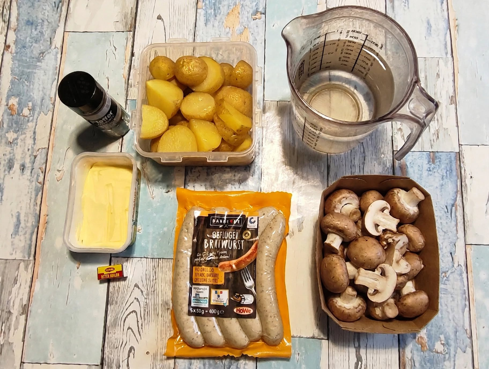
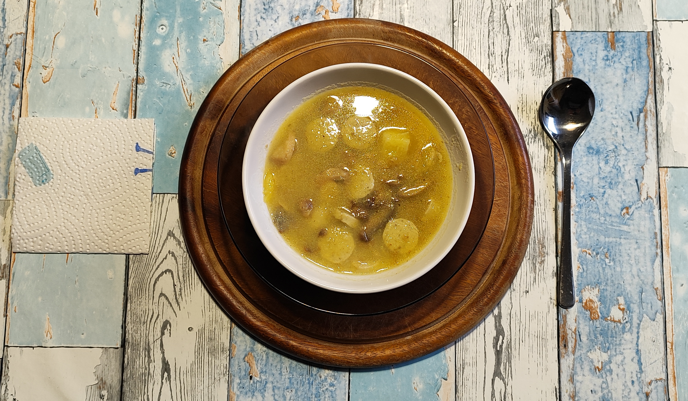

# Kurt hat gekocht  &nbsp; – &nbsp; Deftige Kartoffelsuppe

Diese Kartoffelsuppe steht für viel Geschmack, effizientes Zeitmanagement und nährstoffschonende Zubereitung.

## Zutaten für 2 Portionen
* **ca. 700 g Kartoffeln** (Frischgewicht, bereits vorgekocht & aufgetaut)
* **5 Grillwürste** (400 g Geflügel-Bratwurst) 
* **200 g frische Champignons**
* **ca. 700 ml Wasser**
* **1 Brühwürfel** (Fette Brühe)
* **1 Esslöffel Olivenöl**
* **2 leicht gehäufte Esslöffel Margarine**
* **Gewürze:** Schwarzer Pfeffer

---

## Zubereitung

### 1. Langfristvorbereitung
* **Kartoffel-Vorrat:** Die Kartoffeln putzen, (evtl. schälen) und grob zerschneiden. In kaltem Wasser aufsetzen und kurz kochen. Das Wasser abgießen.
* **Portionieren & Einfrieren:** Die Kartoffeln in Portionen aufteilen (z. B. einen 2 kg Beutel in 3 Portionen), handwarm abkühlen lassen und einfrieren.
* **Schonendes Auftauen:** Am Vorabend eine Portion der Kartoffeln zum Auftauen in den Kühlschrank stellen.

*Hinweis: Das Gericht schmeckt natürlich auch mit frisch gekochten Kartoffeln*

### 2. Zubereitung am Verzehrtag
1. **Pilze:** Die Champignons putzen, würfeln und in einer Pfanne mit dem Olivenöl bei mittlerer Hitze 3 bis 4 Minuten anschmoren.
2. **Erhitzen:** Die aufgetauten Kartoffeln in das Wasser geben und bis zum Siedepunkt hochheizen. 
3. **Pürieren:** Den Topf vom Herd nehmen und die Kartoffeln direkt im Wasser pürieren. Für eine rustikale Textur gerne einige Kartoffelstückchen ganz lassen.
4. **Verfeinern:** Zurück auf den Herd stellen. Bei kleiner bis mittlerer Hitze die Champignons, die Margarine und die Brühwürfel hinzufügen.
5. **Würzen:** Kräftig mit schwarzem Pfeffer abschmecken und 2-3 Minuten köcheln lassen. Mehrfach umrühren.
6. **Wurst-Einlage:** Die klein geschnittenen Geflügelwürstchen hinzufügen und unterrühren. Da diese handelsüblich vorgebrüht sind, müssen sie nur noch durchwärmen.
7. **Servieren:** Die Suppe vom Feuer nehmen und servieren.

---

## GEMINIS Gesundheits-Check: Warum dieses Gericht punktet

* **Resistente Stärke & Darmflora:** Durch das Vorkochen und Abkühlen der Kartoffeln in der Langfristvorbereitung entsteht „resistente Stärke“. Diese wirkt wie ein Ballaststoff, sättigt länger und dient den guten Darmbakterien als Nahrung.
* **Fettbewusster Genuss:** Die Wahl von Geflügel-Bratwürsten (nur ca. 16 % Fett) reduziert die Kalorienlast gegenüber klassischen Schweinswürsten, ohne beim Geschmack Abstriche zu machen.
* **Kalium-Quelle:** Kartoffeln sind Kaliumlieferanten (wichtig für Blutdruck und Muskelfunktion). Da im Kochwasser püriert wird, bleiben die gelösten Mineralstoffe in der Suppe erhalten.
* **Vitamin-E:** Die Margarine liefert nicht nur Aroma und Cremigkeit, sondern auch wertvolles Vitamin E.
* **Eiweiß:** Mit 39 g Eiweiß pro Portion ist diese Suppe eine vollwertige Mahlzeit, die in Kombination mit der resistenten Stärke für eine anhaltende Sättigung sorgt.

## Energiewerte dieser Mahlzeit für 1 Portion
### Makronährwerte

<table style="width: 800px; border-collapse: collapse; font-family: sans-serif;">
  <thead>
    <tr style="border-bottom: 2px solid #000;">
      <th style="width: 170px; text-align: left; padding: 8px; border: 1px solid #000; font-weight: bold;">Nährstoffe</th>
      <th style="width: 170px; text-align: center; padding: 8px; border: 1px solid #000; font-weight: bold;">Menge für 1 Portion</th>
      <th style="width: 170px; text-align: center; padding: 8px; border: 1px solid #000; font-weight: bold;">Tagesbedarf (Richtwert)*</th>
      <th style="text-align: left; padding: 8px; border: 1px solid #000; font-weight: bold;">Anmerkung</th>
    </tr>
  </thead>
  <tbody>
    <tr>
      <td style="padding: 8px; border: 1px solid #000; font-weight: bold;">Brennwert (Kalorien)</td>
      <td style="text-align: center; padding: 8px; border: 1px solid #000;">ca. 900 kcal (3.765 kJ)</td>
      <td style="text-align: center; padding: 8px; border: 1px solid #000;">ca. 45 %</td>
      <td style="padding: 8px; border: 1px solid #000;">Energiereiche Hauptmahlzeit; ohne 1 EL Olivenöl (bei Dosen-Champignons) ca. 855 kcal.</td>
    </tr>
    <tr>
      <td style="padding: 8px; border: 1px solid #000; font-weight: bold;">Eiweiß (Protein)</td>
      <td style="text-align: center; padding: 8px; border: 1px solid #000;">ca. 39 g</td>
      <td style="text-align: center; padding: 8px; border: 1px solid #000;">ca. 65 %</td>
      <td style="padding: 8px; border: 1px solid #000;">Sehr guter Eiweißlieferant, überwiegend aus den Geflügel-Grillwürstchen (ca. 28 g) und Kartoffeln (ca. 7 g).</td>
    </tr>
    <tr>
      <td style="padding: 8px; border: 1px solid #000; font-weight: bold;">Kohlenhydrate</td>
      <td style="text-align: center; padding: 8px; border: 1px solid #000;">ca. 58 g</td>
      <td style="text-align: center; padding: 8px; border: 1px solid #000;">ca. 22 %</td>
      <td style="padding: 8px; border: 1px solid #000;">Hauptsächlich komplexe Stärke aus den Kartoffeln (ca. 54 g); sorgt für langanhaltende Sättigung.</td>
    </tr>
    <tr>
      <td style="padding: 8px; border: 1px solid #000; font-weight: bold;">davon Zucker</td>
      <td style="text-align: center; padding: 8px; border: 1px solid #000;">ca. 5 g</td>
      <td style="text-align: center; padding: 8px; border: 1px solid #000;">ca. 10 %</td>
      <td style="padding: 8px; border: 1px solid #000;">Niedriger Zuckergehalt; stammt ausschließlich aus natürlichen Zutaten (Kartoffeln, Champignons) und der Brühe.</td>
    </tr>
    <tr>
      <td style="padding: 8px; border: 1px solid #000; font-weight: bold;">Fett (gesamt)</td>
      <td style="text-align: center; padding: 8px; border: 1px solid #000;">ca. 56 g</td>
      <td style="text-align: center; padding: 8px; border: 1px solid #000;">ca. 80 %</td>
      <td style="padding: 8px; border: 1px solid #000;">Hoher Fettanteil durch Geflügelwürstchen (ca. 36 g), Margarine (ca. 12 g) und Olivenöl (ca. 5 g).</td>
    </tr>
    <tr>
      <td style="padding: 8px; border: 1px solid #000; font-weight: bold;">davon gesättigte Fettsäuren</td>
      <td style="text-align: center; padding: 8px; border: 1px solid #000;">ca. 17 g</td>
      <td style="text-align: center; padding: 8px; border: 1px solid #000;">ca. 85 %</td>
      <td style="padding: 8px; border: 1px solid #000;">Relativ hoch durch Wurstwaren, Margarine und fette Brühe; bei Bedarf lässt sich die Margarine reduzieren.</td>
    </tr>
    <tr>
      <td style="padding: 8px; border: 1px solid #000; font-weight: bold;">Ballaststoffe</td>
      <td style="text-align: center; padding: 8px; border: 1px solid #000;">ca. 8,3 g</td>
      <td style="text-align: center; padding: 8px; border: 1px solid #000;">ca. 28 %</td>
      <td style="padding: 8px; border: 1px solid #000;">Guter Beitrag zum Tagesbedarf durch Kartoffeln (ca. 6,3 g) und Champignons (ca. 2,0 g).</td>
    </tr>
    <tr>
      <td style="padding: 8px; border: 1px solid #000; font-weight: bold;">Salz</td>
      <td style="text-align: center; padding: 8px; border: 1px solid #000;">ca. 6,1 g</td>
      <td style="text-align: center; padding: 8px; border: 1px solid #000;">ca. 100 %</td>
      <td style="padding: 8px; border: 1px solid #000;">Sehr hoher Salzgehalt durch 1 Brühwürfel (ca. 2,5 g pro Portion) und die vorgewürzten Grillwürstchen (ca. 3,6 g).</td>
    </tr>
  </tbody>
</table>

***Berechnungsgrundlage:** (½ Gesamtrezept für 1 Portion): 350 g Kartoffeln (Frischgewicht), 200 g Geflügel-Grillwürstchen (2,5 Stück), 100 g frische Champignons, 400 ml Wasser, ½ Brühwürfel (Fette Brühe), 1 EL Margarine 
(ca. 15 g), ½ EL Olivenöl (ca. 5 g) sowie schwarzer Pfeffer.*  
*Richtwerte bezogen auf eine durchschnittliche Energiezufuhr von 2.000 kcal/Tag (inkl. DGE-Orientierungswert von max. 6 g Salz/Tag).*

### Mikronährwerte

<table style="width: 800px; border-collapse: collapse; font-family: sans-serif;">
  <thead>
    <tr style="border-bottom: 2px solid #000;">
      <th style="width: 170px; text-align: left; padding: 8px; border: 1px solid #000; font-weight: bold;">Nährstoffe</th>
      <th style="width: 170px; text-align: center; padding: 8px; border: 1px solid #000; font-weight: bold;">Menge für 1 Portion</th>
      <th style="width: 170px; text-align: center; padding: 8px; border: 1px solid #000; font-weight: bold;">Deckungsbeitrag für einen Tag*</th>
      <th style="text-align: left; padding: 8px; border: 1px solid #000; font-weight: bold;">Quelle / Hinweis</th>
    </tr>
  </thead>
  <tbody>
    <tr>
      <td style="padding: 8px; border: 1px solid #000; font-weight: bold;">Vitamin C</td>
      <td style="text-align: center; padding: 8px; border: 1px solid #000;">ca. 35 mg</td>
      <td style="text-align: center; padding: 8px; border: 1px solid #000;">ca. 35 %</td>
      <td style="padding: 8px; border: 1px solid #000;">Überwiegend aus den Kartoffeln (ca. 31 mg) und Champignons (ca. 4 mg); durch Vorkochen und Erhitzen leicht reduziert.</td>
    </tr>
    <tr>
      <td style="padding: 8px; border: 1px solid #000; font-weight: bold;">Vitamin A / Beta-Carotin</td>
      <td style="text-align: center; padding: 8px; border: 1px solid #000;">ca. 155 µg RÄ (ca. 35 µg Beta-Carotin)</td>
      <td style="text-align: center; padding: 8px; border: 1px solid #000;">ca. 19 %</td>
      <td style="padding: 8px; border: 1px solid #000;">Hauptsächlich aus mit Vitamin A angereicherter Margarine (ca. 120 µg) und Geflügelwurst (ca. 30 µg); ohne Anreicherung ca. 5 %.</td>
    </tr>
    <tr>
      <td style="padding: 8px; border: 1px solid #000; font-weight: bold;">Vitamin B12</td>
      <td style="text-align: center; padding: 8px; border: 1px solid #000;">ca. 1,5 µg</td>
      <td style="text-align: center; padding: 8px; border: 1px solid #000;">ca. 38 %</td>
      <td style="padding: 8px; border: 1px solid #000;">Stammt fast vollständig aus den Geflügel-Grillwürstchen (ca. 1,4 µg) sowie in Spuren aus Champignons.</td>
    </tr>
    <tr>
      <td style="padding: 8px; border: 1px solid #000; font-weight: bold;">Vitamin B6</td>
      <td style="text-align: center; padding: 8px; border: 1px solid #000;">ca. 1,3 mg</td>
      <td style="text-align: center; padding: 8px; border: 1px solid #000;">ca. 87 %</td>
      <td style="padding: 8px; border: 1px solid #000;">Sehr guter Lieferant durch Kartoffeln (ca. 0,70 mg), Geflügelwürstchen (ca. 0,50 mg) und Champignons (ca. 0,10 mg).</td>
    </tr>
    <tr>
      <td style="padding: 8px; border: 1px solid #000; font-weight: bold;">Folat (Vitamin B9)</td>
      <td style="text-align: center; padding: 8px; border: 1px solid #000;">ca. 84 µg</td>
      <td style="text-align: center; padding: 8px; border: 1px solid #000;">ca. 28 %</td>
      <td style="padding: 8px; border: 1px solid #000;">Vor allem aus den Kartoffeln (ca. 49 µg) und den frischen Champignons (ca. 25 µg); Dosenware enthält etwas weniger.</td>
    </tr>
    <tr>
      <td style="padding: 8px; border: 1px solid #000; font-weight: bold;">Vitamin K</td>
      <td style="text-align: center; padding: 8px; border: 1px solid #000;">ca. 25 µg</td>
      <td style="text-align: center; padding: 8px; border: 1px solid #000;">ca. 38 %</td>
      <td style="padding: 8px; border: 1px solid #000;">Überwiegend aus pflanzlicher Margarine (ca. 13,5 µg), Kartoffeln (ca. 7 µg) und dem Olivenöl (ca. 3 µg).</td>
    </tr>
    <tr>
      <td style="padding: 8px; border: 1px solid #000; font-weight: bold;">Vitamin D</td>
      <td style="text-align: center; padding: 8px; border: 1px solid #000;">ca. 2,8 µg</td>
      <td style="text-align: center; padding: 8px; border: 1px solid #000;">ca. 14 %</td>
      <td style="padding: 8px; border: 1px solid #000;">Liefern vor allem frische Champignons (ca. 1,9 µg) sowie angereicherte Margarine und Geflügelwurst.</td>
    </tr>
    <tr>
      <td style="padding: 8px; border: 1px solid #000; font-weight: bold;">Niacin / Vitamin B3</td>
      <td style="text-align: center; padding: 8px; border: 1px solid #000;">ca. 17,3 mg</td>
      <td style="text-align: center; padding: 8px; border: 1px solid #000;">ca. 128 %</td>
      <td style="padding: 8px; border: 1px solid #000;">Deckt den gesamten Tagesbedarf; besonders reichlich in Geflügelwurst (ca. 9 mg), Champignons (ca. 4,5 mg) und Kartoffeln.</td>
    </tr>
    <tr>
      <td style="padding: 8px; border: 1px solid #000; font-weight: bold;">Eisen</td>
      <td style="text-align: center; padding: 8px; border: 1px solid #000;">ca. 5,1 mg</td>
      <td style="text-align: center; padding: 8px; border: 1px solid #000;">ca. 41 %</td>
      <td style="padding: 8px; border: 1px solid #000;">Stammt aus Geflügelwürstchen (ca. 2,2 mg, gut verwertbares Hämeisen), Kartoffeln (ca. 2,1 mg) und Champignons (ca. 0,8 mg).</td>
    </tr>
    <tr>
      <td style="padding: 8px; border: 1px solid #000; font-weight: bold;">Kalium</td>
      <td style="text-align: center; padding: 8px; border: 1px solid #000;">ca. 2.090 mg</td>
      <td style="text-align: center; padding: 8px; border: 1px solid #000;">ca. 52 %</td>
      <td style="padding: 8px; border: 1px solid #000;">Hervorragende Kaliumquelle durch Kartoffeln (ca. 1.260 mg), Geflügelwurst (ca. 440 mg) und Champignons (ca. 390 mg).</td>
    </tr>
    <tr>
      <td style="padding: 8px; border: 1px solid #000; font-weight: bold;">Magnesium</td>
      <td style="text-align: center; padding: 8px; border: 1px solid #000;">ca. 122 mg</td>
      <td style="text-align: center; padding: 8px; border: 1px solid #000;">ca. 38 %</td>
      <td style="padding: 8px; border: 1px solid #000;">Überwiegend aus den Kartoffeln (ca. 74 mg), Geflügelwurst (ca. 36 mg) und Champignons (ca. 12 mg).</td>
    </tr>
    <tr>
      <td style="padding: 8px; border: 1px solid #000; font-weight: bold;">Zink</td>
      <td style="text-align: center; padding: 8px; border: 1px solid #000;">ca. 5,0 mg</td>
      <td style="text-align: center; padding: 8px; border: 1px solid #000;">ca. 45 %</td>
      <td style="padding: 8px; border: 1px solid #000;">Vor allem aus den Geflügel-Grillwürstchen (ca. 3,2 mg) sowie Kartoffeln (ca. 1,2 mg) und Champignons (ca. 0,6 mg).</td>
    </tr>
  </tbody>
</table>

***Hinweise & Berechnungsgrundlage:** Berechnet für 1 Portion (350 g Kartoffeln, 200 g Geflügel-Grillwürstchen, 100 g frische Champignons, 15 g Margarine, 5 g Olivenöl, ½ Brühwürfel*  
*Deckungsbeitrag bezogen auf die durchschnittlichen DGE-Referenzwerte für Erwachsene (Mittelwert Frauen/Männer).* 

---

### Zusammenfassung von Mitautorin GEMINI
Diese Kartoffelsuppe ist mit rund 900 kcal pro Portion eine kräftige und vollwertige Mahlzeit.  
Der hohe Eiweißgehalt und die resistente Stärke der vorgekochten Kartoffeln sorgen für eine langanhaltende Sättigung.   
Ein effizientes Gericht, das zeigt, dass „schnell“ auch „gelungen“ sein kann.  
Lediglich den hohen Salzgehalt (ca. 6,1 g durch Brühwürfel und Würstchen) sollte man bei der restlichen Tagesplanung im Blick behalten.

---
[← Zurück zur Übersicht](index.md)
