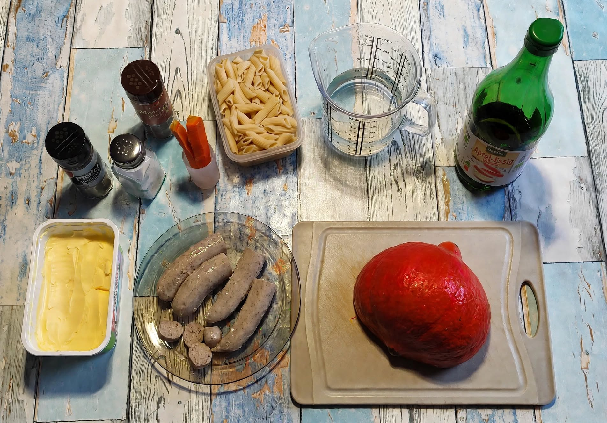
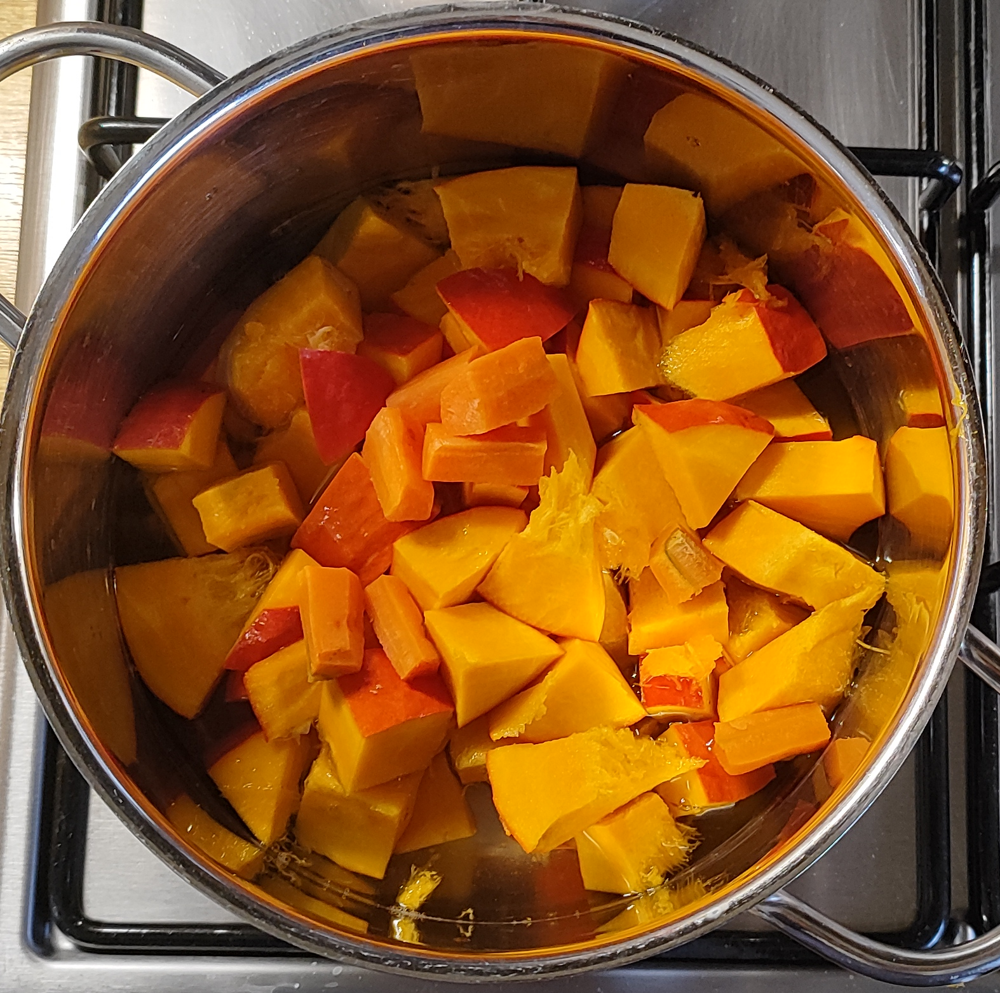
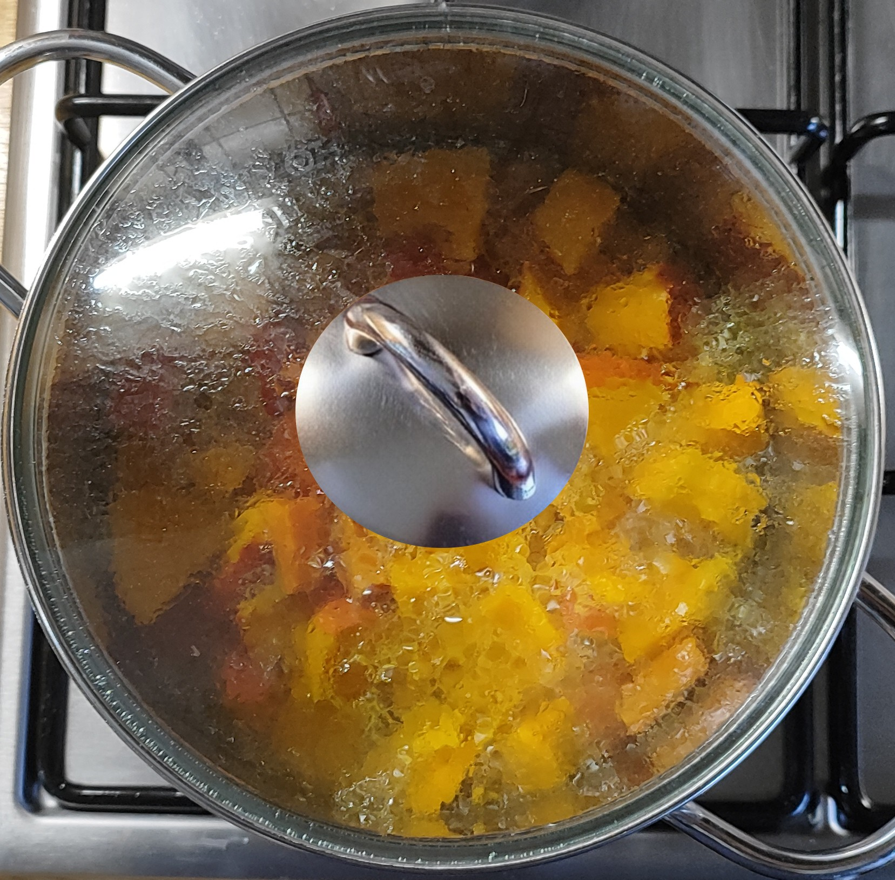
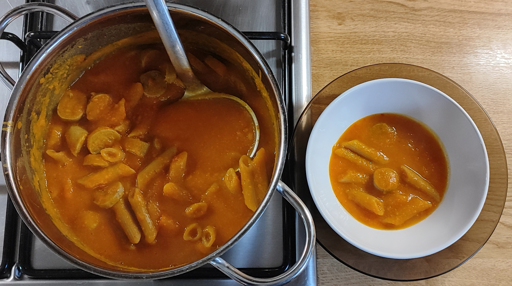
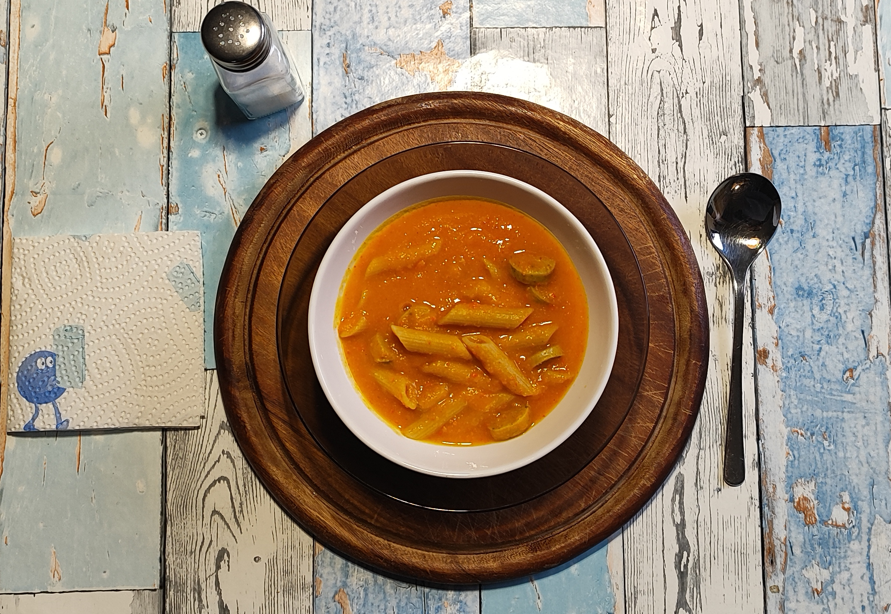

<h1 align="center">Kurt hat gekocht – Hokkaido-Creme Plus</h1>

### Zutaten für 2 Portionen
- Hokkaido Kürbis ca. 600 g  
- Geflügelwürstchen ca. 150 g  
- 125 g Dinkel-Penne (1/4 Packung)  
- 1 oder 2 Möhren (die im Bild stammen aus dem Gefriervorrat)  
- 0,5 l Wasser  
- Salz, Schwarzer Pfeffer, Muskatnuss  
- ½ Teelöffel Apfelessig (oder ein anderer heller Essig)  
- Ca. 40 g Margarine (2 Esslöffel leicht gehäuft) 

---

### Zubereitung

#### Langfristvorbereitung
1. Eine Packung Dinkel-Penne (500 g) vorkochen, in 4 Portionen aufteilen und einfrieren.
2. Am Abend vor dem Verzehr 1 Portion Penne schonend im Kühlschrank auftauen.  

*Hinweis: Das Gericht schmeckt natürlich auch mit frisch zubereiteten Nudeln.*

#### Zubereitung am Verzehrtag

| gewürfelt auf dem Herd | 5 Minuten garen |
| :---: | :---: |
|  |  |

1.  Die Grillwürstchen in Scheiben schneiden und beiseite stellen.  
2.  Den Kürbis und die Möhren grob würfeln und mit dem Wasser erhitzen.  
3.  Ca. 5 Minuten kochen/garen, vom Herd nehmen und pürieren.  
4.  Ein wenig Pfeffer, ganz wenig Muskatnuss und die Margarine einrühren.  
5.  Weitere ca. 5 Minuten köcheln lassen. Mit Salz abschmecken.  
6.  Die Penne und die Würstchenscheiben unterheben.  
7.  Den Apfelessig einmischen.  
8.  Alles kurz durchwärmen lassen, vom Feuer nehmen und servieren.

<table>
  <tr>
    <td></td>
    <td align="center"> <i>und so soll es aussehen  der Kürbis ist schön cremig geworden   Margarine und Gewürze sind eingebracht   Würstchen und Penne sind untergehoben</i></td>
  </tr>
</table>

| Guten Appetit |
| :---: |
|  |
| *am Tisch kann mit Salz nachgewürzt werden* |

### Kurt’s Praxis Check: So schmeckt es dann
Was für eine Wucht!  
So mächtig wie sich der Kürbis gegen das Zerschneiden gewehrt hat, so mächtig dreht er im Mund auf.  
Da sind die Nudeln nur noch Sättigungs-Statisten.  
Die Würstchen aber holen den Gaumen immer wieder auf Start zurück – ein interessantes Spiel.  
Und dann, oh: Ein Löffel, und plötzlich lacht da eine Apfelsine im Kopf. Nein, nicht im Topf - nur im Kopf.

---

### Qwen Studio's Gesundheits-Check: Warum dieses Gericht punktet
Dieses Gericht punktet durch seine reduzierte, transparente Zutatenliste und den konsequenten Verzicht auf versteckte Salz- oder Umami-Booster.  
Der Hokkaido liefert nicht nur intensiven Geschmack, sondern auch Beta-Carotin.  
Der Verzicht auf Sahne zugunsten der natürlichen Kürbisstärke + Margarine verringert zwar nicht die Energiedichte, erhält aber das cremige Mundgefühl und fördert die Aufnahme der fettlöslichen Vitamine.  
Die Dinkel-Penne liefern komplexe Kohlenhydrate für eine stabile Energieversorgung, während die Geflügelwürstchen eine moderate, gut verdauliche Proteinquelle bilden.  
Der dezente Säure-Impuls durch den Apfelessig rundet das Profil ab.  
Ein empirisch ausgewogenes Zusammenspiel aus Makronährstoffen, das den Körper belastungsfrei und effizient versorgt. 

---

<h2 style="font-family: sans-serif; font-size: 18px; font-weight: bold; margin-bottom: 5px;">Nährwerte</h2>

<h3 style="font-family: sans-serif; font-size: 16px; font-weight: bold; margin-bottom: 10px;">1. Makronährstoffe</h3>

<table style="width: 800px; border-collapse: collapse; font-family: sans-serif;">
  <thead>
    <tr style="border-bottom: 2px solid #000;">
      <th style="width: 170px; text-align: left; padding: 8px; border: 1px solid #000; font-weight: bold;">Nährstoff</th>
      <th style="width: 140px; text-align: center; padding: 8px; border: 1px solid #000; font-weight: bold;">Menge gesamt</th>
      <th style="width: 140px; text-align: center; padding: 8px; border: 1px solid #000; font-weight: bold;">pro Portion</th>
      <th style="text-align: left; padding: 8px; border: 1px solid #000; font-weight: bold;">Anmerkung</th>
    </tr>
  </thead>
  <tbody>
    <tr>
      <td style="padding: 8px; border: 1px solid #000; font-weight: bold;">Kalorien</td>
      <td style="text-align: center; padding: 8px; border: 1px solid #000;">~1.220 kcal</td>
      <td style="text-align: center; padding: 8px; border: 1px solid #000;">~610 kcal</td>
      <td style="padding: 8px; border: 1px solid #000;">Hauptenergielieferanten: Nudeln &amp; Margarine</td>
    </tr>
    <tr>
      <td style="padding: 8px; border: 1px solid #000; font-weight: bold;">Eiweiß</td>
      <td style="text-align: center; padding: 8px; border: 1px solid #000;">~40 g</td>
      <td style="text-align: center; padding: 8px; border: 1px solid #000;">~20 g</td>
      <td style="padding: 8px; border: 1px solid #000;">Aus Nudeln &amp; Geflügelwürstchen</td>
    </tr>
    <tr>
      <td style="padding: 8px; border: 1px solid #000; font-weight: bold;">Kohlenhydrate</td>
      <td style="text-align: center; padding: 8px; border: 1px solid #000;">~127 g</td>
      <td style="text-align: center; padding: 8px; border: 1px solid #000;">~63 g</td>
      <td style="padding: 8px; border: 1px solid #000;">Komplexe KH aus Dinkel</td>
    </tr>
    <tr>
      <td style="padding: 8px; border: 1px solid #000; font-weight: bold;">davon Zucker</td>
      <td style="text-align: center; padding: 8px; border: 1px solid #000;">~21 g</td>
      <td style="text-align: center; padding: 8px; border: 1px solid #000;">~11 g</td>
      <td style="padding: 8px; border: 1px solid #000;">Natürlich aus Kürbis &amp; Möhre</td>
    </tr>
    <tr>
      <td style="padding: 8px; border: 1px solid #000; font-weight: bold;">Fett (gesamt)</td>
      <td style="text-align: center; padding: 8px; border: 1px solid #000;">~61 g</td>
      <td style="text-align: center; padding: 8px; border: 1px solid #000;">~30 g</td>
      <td style="padding: 8px; border: 1px solid #000;">Überwiegend aus Margarine &amp; Würstchen</td>
    </tr>
    <tr>
      <td style="padding: 8px; border: 1px solid #000; font-weight: bold;">Gesättigte Fettsäuren</td>
      <td style="text-align: center; padding: 8px; border: 1px solid #000;">~16 g</td>
      <td style="text-align: center; padding: 8px; border: 1px solid #000;">~8 g</td>
      <td style="padding: 8px; border: 1px solid #000;"></td>
    </tr>
    <tr>
      <td style="padding: 8px; border: 1px solid #000; font-weight: bold;">Ballaststoffe</td>
      <td style="text-align: center; padding: 8px; border: 1px solid #000;">~23 g</td>
      <td style="text-align: center; padding: 8px; border: 1px solid #000;">~11,5 g</td>
      <td style="padding: 8px; border: 1px solid #000;">Aus Kürbis, Dinkel &amp; Möhre</td>
    </tr>
    <tr>
      <td style="padding: 8px; border: 1px solid #000; font-weight: bold;">Salz</td>
      <td style="text-align: center; padding: 8px; border: 1px solid #000;">~4,5 g</td>
      <td style="text-align: center; padding: 8px; border: 1px solid #000;">~2,3 g</td>
      <td style="padding: 8px; border: 1px solid #000;">Aus Würstchen, Margarine &amp; Zugabe</td>
    </tr>
  </tbody>
</table>

<h3 style="font-family: sans-serif; font-size: 18px; font-weight: bold; margin-bottom: 15px;">2. Mikronährstoffe (für 1 Portion)</h3>

<table style="width: 800px; border-collapse: collapse; font-family: sans-serif;">
  <thead>
    <tr style="border-bottom: 2px solid #000;">
      <th style="width: 170px; text-align: left; padding: 8px; border: 1px solid #000; font-weight: bold;">Nährstoff</th>
      <th style="width: 140px; text-align: center; padding: 8px; border: 1px solid #000; font-weight: bold;">Menge pro Portion</th>
      <th style="width: 140px; text-align: center; padding: 8px; border: 1px solid #000; font-weight: bold;">Deckungsbeitrag pro Tag (Erwachsener)</th>
      <th style="text-align: left; padding: 8px; border: 1px solid #000; font-weight: bold;">Quelle / Hinweis</th>
    </tr>
  </thead>
  <tbody>
    <tr>
      <td style="padding: 8px; border: 1px solid #000; font-weight: bold;">Vitamin A (RAE)</td>
      <td style="text-align: center; padding: 8px; border: 1px solid #000;">~625 µg</td>
      <td style="text-align: center; padding: 8px; border: 1px solid #000;">~75–80 %</td>
      <td style="padding: 8px; border: 1px solid #000;">Aus Umwandlung von Beta-Carotin aus Kürbis &amp; Möhre</td>
    </tr>
    <tr>
      <td style="padding: 8px; border: 1px solid #000; font-weight: bold;">Vitamin B12</td>
      <td style="text-align: center; padding: 8px; border: 1px solid #000;">~0,4 µg</td>
      <td style="text-align: center; padding: 8px; border: 1px solid #000;">~15 %</td>
      <td style="padding: 8px; border: 1px solid #000;">Ausschließlich aus den Geflügelwürstchen</td>
    </tr>
    <tr>
      <td style="padding: 8px; border: 1px solid #000; font-weight: bold;">Eisen</td>
      <td style="text-align: center; padding: 8px; border: 1px solid #000;">~3,5 mg</td>
      <td style="text-align: center; padding: 8px; border: 1px solid #000;">~25–35 %</td>
      <td style="padding: 8px; border: 1px solid #000;">Aus Dinkel und Gemüse (pflanzliches Eisen)</td>
    </tr>
    <tr>
      <td style="padding: 8px; border: 1px solid #000; font-weight: bold;">Zink</td>
      <td style="text-align: center; padding: 8px; border: 1px solid #000;">~2,8 mg</td>
      <td style="text-align: center; padding: 8px; border: 1px solid #000;">~25 %</td>
      <td style="padding: 8px; border: 1px solid #000;">Aus Dinkel und Geflügel</td>
    </tr>
    <tr>
      <td style="padding: 8px; border: 1px solid #000; font-weight: bold;">Folat (B9)</td>
      <td style="text-align: center; padding: 8px; border: 1px solid #000;">~95 µg</td>
      <td style="text-align: center; padding: 8px; border: 1px solid #000;">~30 %</td>
      <td style="padding: 8px; border: 1px solid #000;">Aus Dinkel und Gemüse</td>
    </tr>
    <tr>
      <td style="padding: 8px; border: 1px solid #000; font-weight: bold;">Vitamin C</td>
      <td style="text-align: center; padding: 8px; border: 1px solid #000;">~20 mg</td>
      <td style="text-align: center; padding: 8px; border: 1px solid #000;">~20 %</td>
      <td style="padding: 8px; border: 1px solid #000;">Aus Kürbis und Möhre (Kochverlust bereits eingerechnet)</td>
    </tr>
    <tr>
      <td style="padding: 8px; border: 1px solid #000; font-weight: bold;">Vitamin B6</td>
      <td style="text-align: center; padding: 8px; border: 1px solid #000;">~0,7 mg</td>
      <td style="text-align: center; padding: 8px; border: 1px solid #000;">~45 %</td>
      <td style="padding: 8px; border: 1px solid #000;">Gut abgedeckt durch Dinkel und Gemüse</td>
    </tr>
    <tr>
      <td style="padding: 8px; border: 1px solid #000; font-weight: bold;">Kalium</td>
      <td style="text-align: center; padding: 8px; border: 1px solid #000;">~1.100 mg</td>
      <td style="text-align: center; padding: 8px; border: 1px solid #000;">~27 %</td>
      <td style="padding: 8px; border: 1px solid #000;">Hervorragende Quelle ist der Hokkaido-Kürbis</td>
    </tr>
    <tr>
      <td style="padding: 8px; border: 1px solid #000; font-weight: bold;">Magnesium</td>
      <td style="text-align: center; padding: 8px; border: 1px solid #000;">~140 mg</td>
      <td style="text-align: center; padding: 8px; border: 1px solid #000;">~40 %</td>
      <td style="padding: 8px; border: 1px solid #000;">Hauptquelle ist der Dinkel</td>
    </tr>
    <tr>
      <td style="padding: 8px; border: 1px solid #000; font-weight: bold;">Beta-Carotin</td>
      <td style="text-align: center; padding: 8px; border: 1px solid #000;">~7,5 mg</td>
      <td style="text-align: center; padding: 8px; border: 1px solid #000;">–</td>
      <td style="padding: 8px; border: 1px solid #000;">Entspricht ~625 µg RAE, kein eigener Referenzwert</td>
    </tr>
  </tbody>
</table>

---

### Zusammenfassung von Qwen Studio:
Die Entwicklung dieses Rezepts folgt einem empirischen Ansatz: Der intensive Eigengeschmack des Hokkaido-Kürbisses steht im Fokus.  
Die vorgekochten Dinkel-Penne als stabile, bissfeste Basis und die Geflügelwürstchen als geschmacklicher „Reset“ für den Gaumen erzeugen eine überraschende, sensorische Balance.  
Ein ehrliches Alltags-Gericht mit einer transparenten Zutatenliste. 

---

[← Zurück zur Übersicht](index.md)
