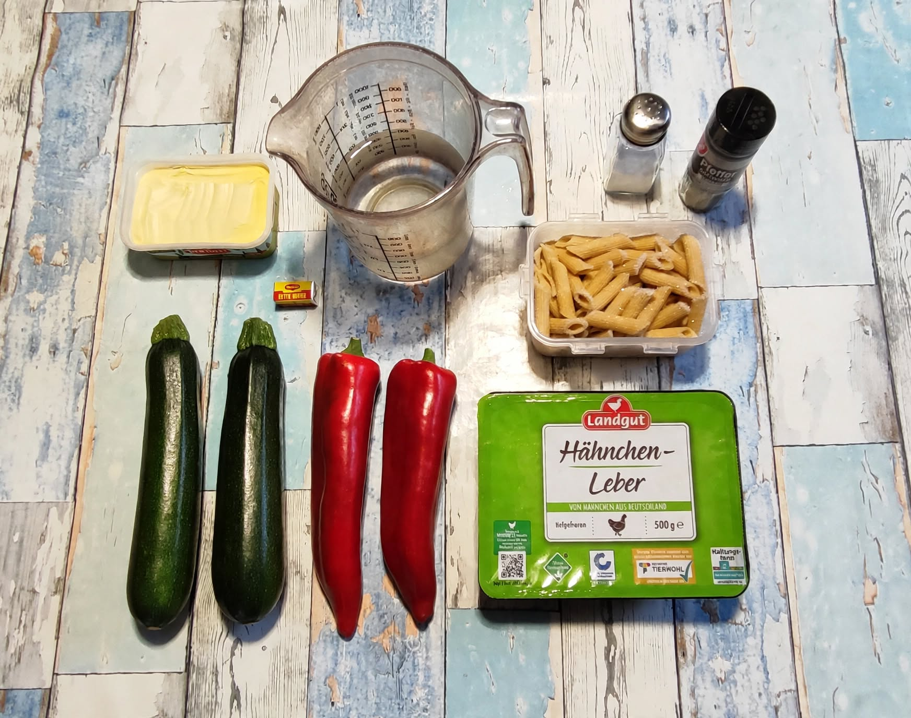
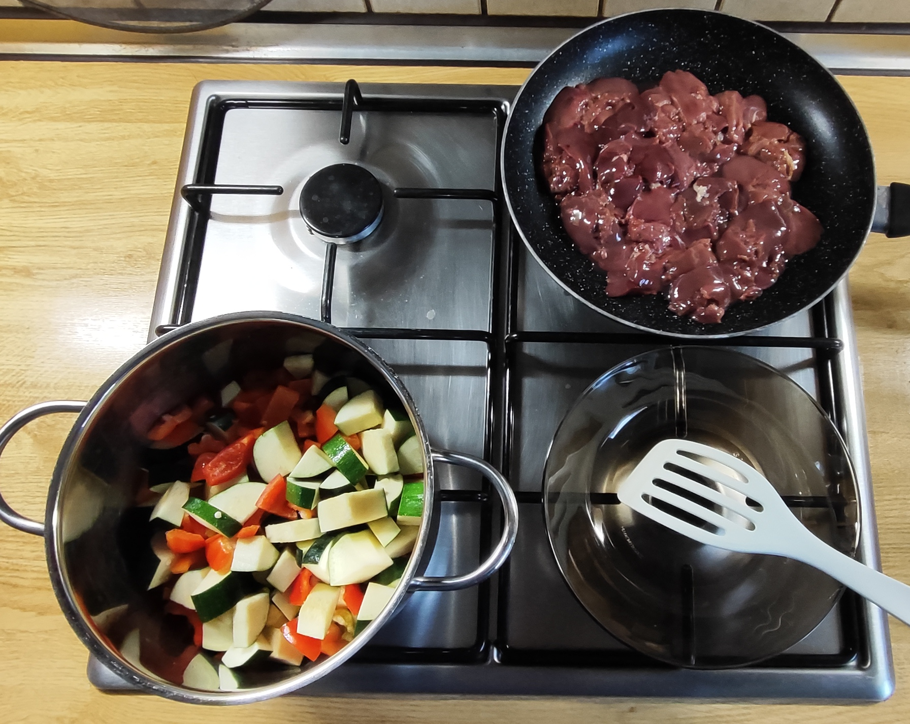
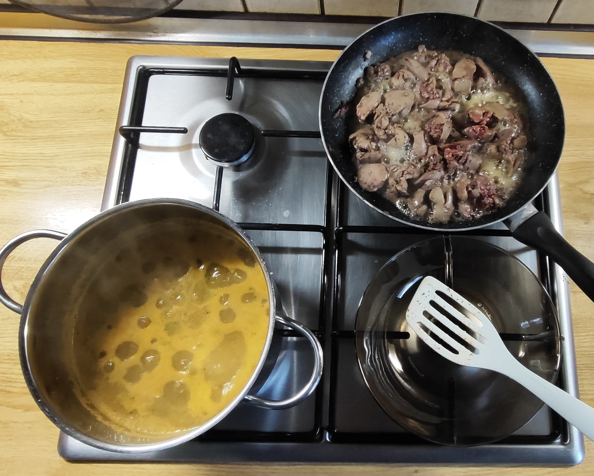
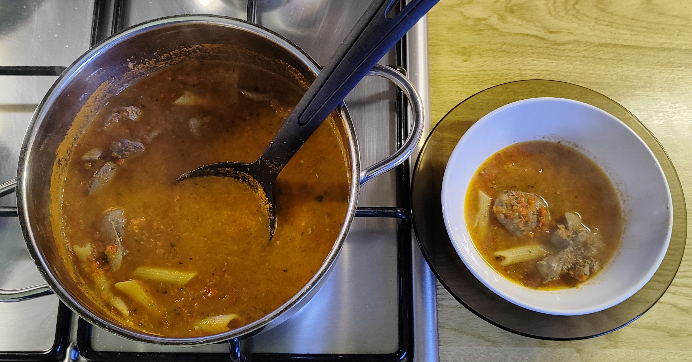
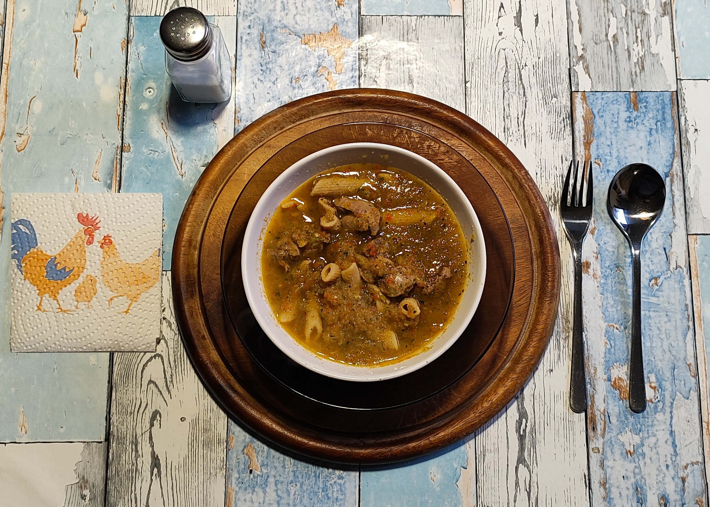

<h1 align="center">Kurt hat gekocht Zucchini-Paprika-Creme mit Leber</h1>

### Zutaten für 2 Portionen
* Zucchini ca. 400 g
* Rote Paprika ca. 300 g
* Geflügelleber 500 g
* 125 g Vollkornpenne (1/4 Packung)
* 0,5 l Wasser
* 1 Brühwürfel (für 500 ml)
* Schwarzer Pfeffer, Salz
* ca. 40 g Margarine (2 Esslöffel leicht gehäuft)

---

### Zubereitung

#### Langfristvorbereitung
1. Eine Packung Vollkornpenne (500 g) vorkochen, in 4 Portionen aufteilen und einfrieren.
2. Am Abend vor dem Verzehr 1 Portion Penne und eine Packung Leber schonend im Kühlschrank auftauen.  

*Hinweis: Das Gericht schmeckt natürlich auch mit frisch zubereiteten Nudeln.*

#### Zubereitung am Verzehrtag

| gerade auf dem Herd | das Gemüse ist püriert und die Leber ist jetzt gar |
| :---: | :---: |
|  |  |

1. Leber sehr gründlich mit Wasser spülen.
2. Zucchini und Paprika waschen, grob würfeln und mit dem Wasser erhitzen.
3. Die Leber in einer Pfanne auf kleiner bis mittlerer Flamme ca. 10 min durchgaren. Öfter wenden.
4. Das Gemüse kurz aufkochen, vom Herd nehmen und pürieren.
5. Die Creme dann auf kleiner Flamme köcheln. Mehrmals rühren.
6. Pfeffer, den zerdrückten Brühwürfel und die Margarine einrühren.
7. Die Vollkornpenne und die gegarte Leber unterheben.
8. Vom Feuer nehmen und servieren.

<table>
  <tr>
    <td></td>
    <td align="center"> <i>und so soll es aussehen  die Creme ist leicht sämig  die Gewürze sind gleichmäßig vermischt  Leber und Vollkornpennte sind untergehoben</i></td>
  </tr>
</table>

| Guten Appetit |
| :---: |
|  |
| *am Tisch kann mit ein wenig Salz nachgewürzt werden* |

### Perplexity's Gesundheits-Check: Warum dieses Gericht punktet
Dieses Rezept kombiniert Gemüse, Leber und Vollkorn für eine nährstoffreiche Mahlzeit, die den Körper optimal versorgt.
* **Vitamin A, Eisen, B12 durch Leber:** Geflügelleber liefert sehr viel Vitamin A (Retinol), Eisen und B12. Wegen des hohen Vitamin A Gehaltes gilt für Schwangere: Leber nur selten und in kleinen Mengen, ärztlich abklären. Für alle anderen als gelegentliche Hauptmahlzeit, nicht täglich.
* **Zucchini und Paprika liefern Beta-Carotin und Vitamin C:** Beta-Carotin kann im Körper zu Vitamin A umgewandelt werden, Vitamin C bleibt durch kurzes Aufkochen weitgehend erhalten.
* **Schonendes Garen ohne Röstaromen:** Gemüse wird nur kurz aufgekocht und püriert, Leber bei kleiner Flamme mit Deckel gegart. Keine Röstaromen, bewusst zart.
* **Eisen und Zink aus Leber:** Hochbioverfügbares Eisen und Zink.
* **Fettlösliche Vitamine:** Ein Stich Margarine hilft, fettlösliche Vitamine (A, E, K) aufzunehmen.
* **Vollkorn-Sättigung:** Penne bringen Ballaststoffe und komplexe Kohlenhydrate.  

---

### Kurt’s Praxis Check: So schmeckt es dann

Cremig, sämig und ein wenig süß. Im Hintergrund eine kräftige Umami Tiefe.  
Und dann kommt die Leber.  
Mit jedem Kauen tritt sie stärker hervor und entfaltet ihren typischen Geschmack. Ein überraschendes Erlebnis.  
Die Vollkornnudeln geben Volumen und eine kleine Getreidenote dazu.  
Und mit dem nächsten Löffel wiederholt sich das – das mag ich.

---

<h2 style="font-family: sans-serif; font-size: 18px; font-weight: bold; margin-bottom: 5px;">Nährwerte für die gesamte Zutatenmenge</h2>

<h3 style="font-family: sans-serif; font-size: 16px; font-weight: bold; margin-bottom: 10px;">1. Makronährstoffe</h3>
<table style="width: 800px; border-collapse: collapse; font-family: sans-serif; margin-bottom: 30px;">
  <thead>
    <tr style="background-color: #e6e6e6;">
      <th style="width: 170px; text-align: left; padding: 8px; border: 1px solid #000; font-weight: bold;">Nährstoff</th>
      <th style="width: 170px; text-align: left; padding: 8px; border: 1px solid #000; font-weight: bold;">Menge gesamt</th>
      <th style="text-align: left; padding: 8px; border: 1px solid #000; font-weight: bold;">Anmerkung</th>
    </tr>
  </thead>
  <tbody>
    <tr>
      <td style="padding: 8px; border: 1px solid #000; font-weight: bold;">Kalorien</td>
      <td style="padding: 8px; border: 1px solid #000;">ca. 1.470 bis 1.500 kcal</td>
      <td style="padding: 8px; border: 1px solid #000;">ca. 595 kcal Leber + ca. 440 kcal Penne (125 g trocken) + ca. 161 kcal Zucchini und Paprika + ca. 287 kcal Margarine (40 g) + ca. 10 kcal Brühe</td>
    </tr>
    <tr>
      <td style="padding: 8px; border: 1px solid #000; font-weight: bold;">Eiweiß</td>
      <td style="padding: 8px; border: 1px solid #000;">ca. 108 bis 112 g</td>
      <td style="padding: 8px; border: 1px solid #000;">Hauptsächlich Hähnchenleber (ca. 85 g) + Vollkornpenne (ca. 17 g) + wenig Gemüse (ca. 8 g)</td>
    </tr>
    <tr>
      <td style="padding: 8px; border: 1px solid #000; font-weight: bold;">Kohlenhydrate</td>
      <td style="padding: 8px; border: 1px solid #000;">ca. 124 bis 129 g</td>
      <td style="padding: 8px; border: 1px solid #000;">125 g Vollkornpenne (ca. 92 g) + Paprika (ca. 18 g) + Zucchini (ca. 12 g) + Leber und Brühe (ca. 5 g)</td>
    </tr>
    <tr>
      <td style="padding: 8px; border: 1px solid #000; font-weight: bold;">davon Zucker</td>
      <td style="padding: 8px; border: 1px solid #000;">ca. 22 bis 26 g</td>
      <td style="padding: 8px; border: 1px solid #000;">Natürlich aus Paprika (ca. 13 g) + Zucchini (ca. 10 g) + kleiner Rest aus Penne</td>
    </tr>
    <tr>
      <td style="padding: 8px; border: 1px solid #000; font-weight: bold;">Fett (gesamt)</td>
      <td style="padding: 8px; border: 1px solid #000;">ca. 60 bis 64 g</td>
      <td style="padding: 8px; border: 1px solid #000;">ca. 32 g aus Margarine (40 g) + ca. 24 g aus Leber + ca. 4 g aus Penne + ca. 2 g aus Gemüse</td>
    </tr>
    <tr>
      <td style="padding: 8px; border: 1px solid #000; font-weight: bold;">Gesättigte Fettsäuren</td>
      <td style="padding: 8px; border: 1px solid #000;">ca. 15 bis 18 g</td>
      <td style="padding: 8px; border: 1px solid #000;">Überwiegend aus Leber (ca. 8 g) und Margarine (ca. 6 bis 8 g, je nach Sorte)</td>
    </tr>
    <tr>
      <td style="padding: 8px; border: 1px solid #000; font-weight: bold;">Ballaststoffe</td>
      <td style="padding: 8px; border: 1px solid #000;">ca. 20 bis 23 g</td>
      <td style="padding: 8px; border: 1px solid #000;">Vollkornpenne (ca. 12 g) + Paprika (ca. 6 g) + Zucchini (ca. 4 g)</td>
    </tr>
  </tbody>
</table>

<h3 style="font-family: sans-serif; font-size: 16px; font-weight: bold; margin-bottom: 10px;">2. Mikronährstoffe</h3>

<table style="width: 800px; border-collapse: collapse; font-family: sans-serif;">
  <thead>
    <tr style="background-color: #e6e6e6;">
      <th style="width: 170px; text-align: left; padding: 8px; border: 1px solid #000; font-weight: bold;">Nährstoffe</th>
      <th style="width: 150px; text-align: left; padding: 8px; border: 1px solid #000; font-weight: bold;">Menge gesamt</th>
      <th style="width: 180px; text-align: left; padding: 8px; border: 1px solid #000; font-weight: bold;">Deckungsbeitrag / Tag (Erwachsener)</th>
      <th style="text-align: left; padding: 8px; border: 1px solid #000; font-weight: bold;">Quelle / Hinweis</th>
    </tr>
  </thead>
  <tbody>
    <tr>
      <td style="padding: 8px; border: 1px solid #000; font-weight: bold;">Vitamin A (Retinol)</td>
      <td style="padding: 8px; border: 1px solid #000;">ca. 16.000 bis 17.500 µg RE</td>
      <td style="padding: 8px; border: 1px solid #000;">ca. 1.650 bis 2.100 %</td>
      <td style="padding: 8px; border: 1px solid #000;">Aus 500 g Hähnchenleber, extrem hoch, Hinweis Schwangerschaft</td>
    </tr>
    <tr>
      <td style="padding: 8px; border: 1px solid #000; font-weight: bold;">Vitamin B12</td>
      <td style="padding: 8px; border: 1px solid #000;">ca. 80 bis 100 µg</td>
      <td style="padding: 8px; border: 1px solid #000;">ca. 2.000 bis 2.500 %</td>
      <td style="padding: 8px; border: 1px solid #000;">Nur aus Hähnchenleber</td>
    </tr>
    <tr>
      <td style="padding: 8px; border: 1px solid #000; font-weight: bold;">Eisen</td>
      <td style="padding: 8px; border: 1px solid #000;">ca. 45 bis 52 mg</td>
      <td style="padding: 8px; border: 1px solid #000;">ca. 450 bis 520 % (Mann) / 300 bis 350 % (Frau)</td>
      <td style="padding: 8px; border: 1px solid #000;">Hochbioverfügbar aus Hähnchenleber, Vitamin C aus Paprika fördert Aufnahme</td>
    </tr>
    <tr>
      <td style="padding: 8px; border: 1px solid #000; font-weight: bold;">Zink</td>
      <td style="padding: 8px; border: 1px solid #000;">ca. 25 bis 29 mg</td>
      <td style="padding: 8px; border: 1px solid #000;">ca. 250 bis 290 %</td>
      <td style="padding: 8px; border: 1px solid #000;">Hauptsächlich Leber, plus Vollkornpenne und Gemüse</td>
    </tr>
    <tr>
      <td style="padding: 8px; border: 1px solid #000; font-weight: bold;">Folat (B9)</td>
      <td style="padding: 8px; border: 1px solid #000;">ca. 3.000 bis 3.300 µg</td>
      <td style="padding: 8px; border: 1px solid #000;">ca. 1.000 bis 1.100 %</td>
      <td style="padding: 8px; border: 1px solid #000;">Überwiegend Leber, Rest Paprika / Zucchini / Penne</td>
    </tr>
    <tr>
      <td style="padding: 8px; border: 1px solid #000; font-weight: bold;">Vitamin C</td>
      <td style="padding: 8px; border: 1px solid #000;">ca. 420 bis 520 mg</td>
      <td style="padding: 8px; border: 1px solid #000;">ca. 420 bis 520 %</td>
      <td style="padding: 8px; border: 1px solid #000;">Nach kurzem Aufkochen und Pürieren, aus 300 g roter Paprika + Zucchini + Leber</td>
    </tr>
    <tr>
      <td style="padding: 8px; border: 1px solid #000; font-weight: bold;">Vitamin B6</td>
      <td style="padding: 8px; border: 1px solid #000;">ca. 5,0 bis 6,0 mg</td>
      <td style="padding: 8px; border: 1px solid #000;">ca. 310 bis 430 %</td>
      <td style="padding: 8px; border: 1px solid #000;">Leber + Paprika + Zucchini + Vollkornpenne</td>
    </tr>
    <tr>
      <td style="padding: 8px; border: 1px solid #000; font-weight: bold;">Kalium</td>
      <td style="padding: 8px; border: 1px solid #000;">ca. 3.200 bis 3.600 mg</td>
      <td style="padding: 8px; border: 1px solid #000;">ca. 80 bis 90 %</td>
      <td style="padding: 8px; border: 1px solid #000;">Zucchini + Paprika + Leber + Penne + Brühe</td>
    </tr>
    <tr>
      <td style="padding: 8px; border: 1px solid #000; font-weight: bold;">Magnesium</td>
      <td style="padding: 8px; border: 1px solid #000;">ca. 250 bis 290 mg</td>
      <td style="padding: 8px; border: 1px solid #000;">ca. 70 bis 95 %</td>
      <td style="padding: 8px; border: 1px solid #000;">Vollkornpenne + Leber + Gemüse</td>
    </tr>
    <tr>
      <td style="padding: 8px; border: 1px solid #000; font-weight: bold;">Beta-Carotin</td>
      <td style="padding: 8px; border: 1px solid #000;">ca. 4.800 bis 5.600 µg</td>
      <td style="padding: 8px; border: 1px solid #000;">ca. 45 bis 60 % als Vorstufe für Vitamin A</td>
      <td style="padding: 8px; border: 1px solid #000;">Aus Paprika und Zucchini</td>
    </tr>
  </tbody>
</table>

---

### Zusammenfassung von Mitautorin Perplexity:
*Ich teile die Gesamtmenge in 2 Portionen*  
Mit 700-750 kcal ist das Gericht eine proteinstarke Hauptmahlzeit (mit 55 g Eiweiß aus Leber und Penne).  
Dabei maximiert diese Gemüse-Leber-Kombo Mikronährstoffe bei bester Bioverfügbarkeit.

> **Tipp für Leberskeptiker:**
> Durch das Garen bei kleiner Flamme bleibt die Geflügelleber in ihrem Aroma zurückhaltend.   Während die Zucchini-Paprika-Creme den ersten Moment am Gaumen bestimmt, tritt die sanfte, braun‑raue Lebernote erst beim Kauen hervor. Ein besonderes Geschmackserlebnis - perfekt für alle, die sich behutsam an Innereien herantasten möchten.

---

[← Zurück zur Übersicht](index.md)
