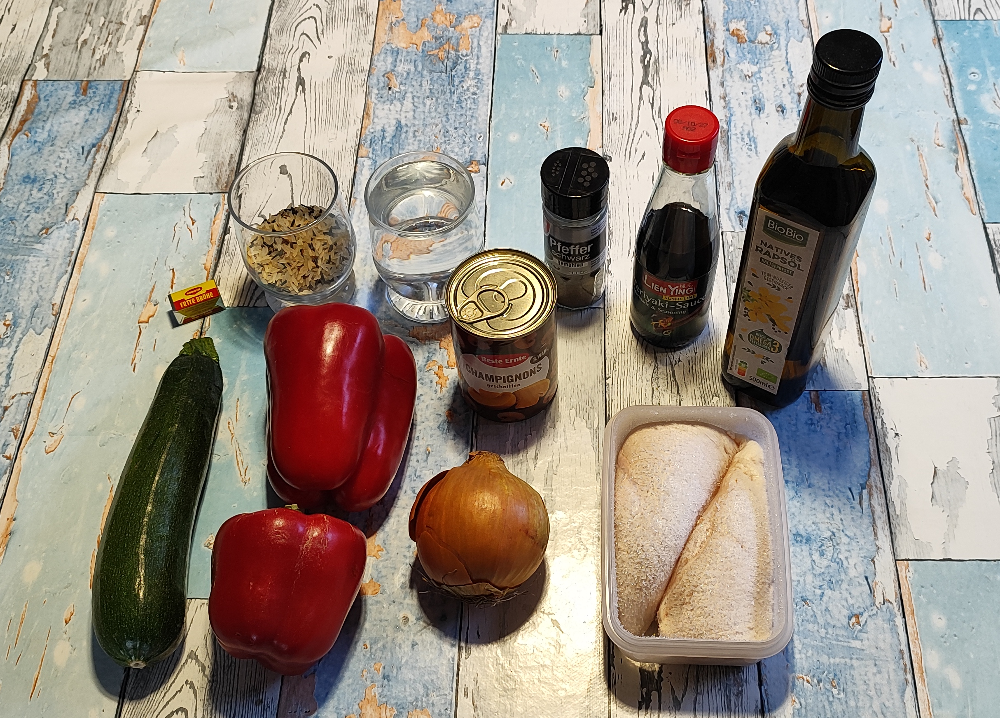
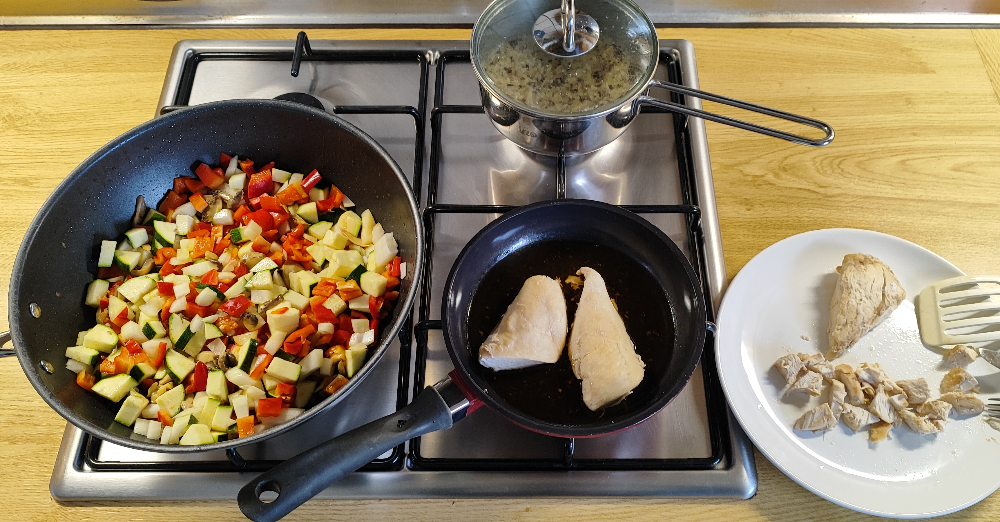
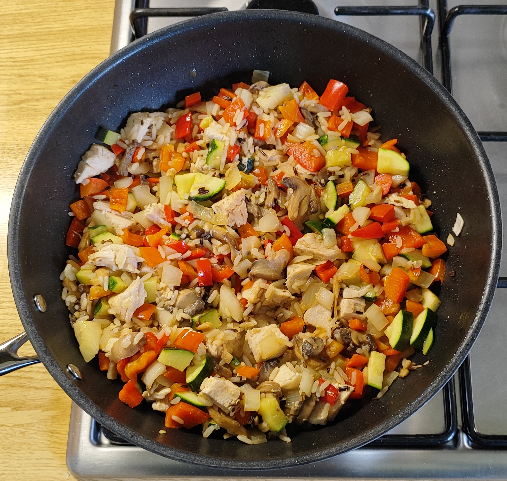
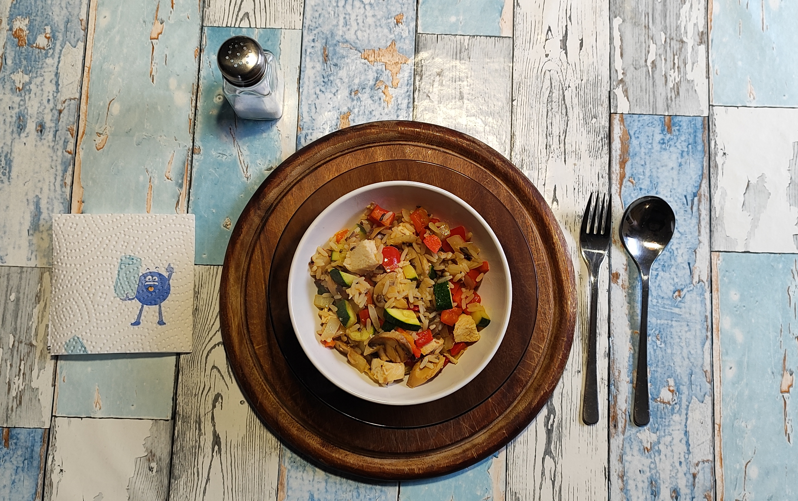

<h1 align="center">Kurt hat gekocht &nbsp; – &nbsp; Vier-Gemüse-Pfanne mit Reis und Hähnchenbrust</h1>
 

### Zutaten für 2 Portionen
* **Geflügel**: 300-400 g Hähnchenbrustfilet (tiefgefroren)
* **Gemüse**: 2 rote Paprika, 1 Zucchini, 1 Gemüsezwiebel, 200 g Champignons
* **3 EL Rapsöl** (Olivenöl geht auch)
* **Sättigungsbeilage**: 60 g Reis (ich nehme gerne Parboiled Langkorn & Wildreis)
* **Flüssigkeiten**: 300 ml Wasser für den Reis 
* **Würze:** 1 Brühwürfel, Teriyaki-Sauce, schwarzer Pfeffer

---

### Zubereitung

| Zubereitung | | Fertiges Gericht im Wok |
| :---: | :---: | :---: |
|  | &nbsp; |  |

#### 1. Das Hähnchen (Sanftes Garen)
- Die tiefgefrorenen Filets in eine Pfanne legen und großzügig mit Teriyaki-Sauce beträufeln.
- Bei geschlossenem Deckel auf kleinster Stufe ca. 45-55 Minuten (je nach Dicke der Filets) langsam garen. Zwischendurch wenden.
- Nach etwa 40 Minuten die Filets halbieren und auf der Schnittfläche fertig garen.

---

#### 2. Der Reis (Quellmethode)
- Den Reis vorab ca. 1 Stunde wässern und gründlich abspülen.
- Den Brühwürfel und den Reis ins Wasser geben und bei kleiner Hitze abgedeckt ca. 30 Minuten köcheln lassen, bis die Flüssigkeit vollständig aufgenommen wurde.
#### Details mit Begründung findest du [hier](32-quellmethode-reis.md)

---

#### 3. Das Gemüse & Finish
- Die Pilze putzen, würfeln und im Rapsöl in einer Wok-Pfanne kurz anschmoren.
- Das restliche Gemüse (geputzt und gewürfelt) hinzugeben und für weitere 7 - 8 Minuten bei mittlerer Hitze garen. Mit Pfeffer würzen.
- Zum Schluss die gewürfelten Hähnchenfilets samt Sud sowie den fertig gekochten Reis unter das Gemüse heben.

> **Hinweis**: Durch die Brühwürfel und die Teriyaki-Sauce ist zusätzliches Salzen nicht erforderlich.  

### GEMINIS Gesundheits-Check: Warum dieses Gericht punktet
Dieses Gericht überzeugt durch eine kluge Kombination aus langsamen Kohlenhydraten und einer schonenden Zubereitung:

* **Optimale Nährstoffaufnahme**: Die 3 Esslöffel Rapsöl sind essenziell, um die fettlöslichen Vitamine (wie das Beta-Carotin aus der roten Paprika) für den Körper bioverfügbar zu machen.
* **Aminosäuren-Profil**: Das magere Hähnchenbrustfilet liefert hochwertige, essenzielle Aminosäuren.
* **B-Vitamine & Folsäure**: Die Champignons steuern wichtige B-Vitamine (insbesondere B2 und B3) bei, während die rote Paprika als Vitamin-C-Bombe das Immunsystem unterstützt.
* **Vorteil der Reis-Wässerung**: Das einstündige Wässern dient der Reinigung und schwemmt überschüssige Stärke sowie mögliche Rückstände (wie anorganisches Arsen) aus. Zudem verbessert es die Textur.
* **Aroma & Mineralstoffe durch Brühe**: Da der Reis die Brühe komplett aufnimmt, bleiben alle gelösten Mineralstoffe im Korn erhalten.
* **Sensorik & Ballaststoffe**: Der Wildreis liefert nussige Noten und erhöht durch seine dunkle Schale den Anteil an Ballaststoffen.

---

### Nährwerte für eine Portion ( = Hälfte der Zutatenmengen)
#### Makronährstoffe

<table style="width: 800px; border-collapse: collapse; font-family: sans-serif;">
  <thead>
    <tr style="border-bottom: 2px solid #000;">
      <th style="width: 170px; text-align: left; padding: 8px; border: 1px solid #000; font-weight: bold;">Nährstoff</th>
      <th style="width: 170px; text-align: center; padding: 8px; border: 1px solid #000; font-weight: bold;">Menge</th>
      <th style="text-align: left; padding: 8px; border: 1px solid #000; font-weight: bold;">Anmerkung</th>
    </tr>
  </thead>
  <tbody>
    <tr>
      <td style="padding: 8px; border: 1px solid #000;">Kalorien</td>
      <td style="text-align: center; padding: 8px; border: 1px solid #000;">ca. 540 - 580 kcal</td>
      <td style="padding: 8px; border: 1px solid #000;">Hauptenergie aus Hähnchen, Rapsöl und Reis</td>
    </tr>
    <tr>
      <td style="padding: 8px; border: 1px solid #000;">Eiweiß</td>
      <td style="text-align: center; padding: 8px; border: 1px solid #000;">ca. 44 - 48 g</td>
      <td style="padding: 8px; border: 1px solid #000;">Hauptsächlich aus dem Hähnchenbrustfilet, etwas aus Reis und Champignons</td>
    </tr>
    <tr>
      <td style="padding: 8px; border: 1px solid #000;">Kohlenhydrate</td>
      <td style="text-align: center; padding: 8px; border: 1px solid #000;">ca. 38 - 42 g</td>
      <td style="padding: 8px; border: 1px solid #000;">Aus Reis, Paprika, Zwiebel und Teriyaki-Sauce</td>
    </tr>
    <tr>
      <td style="padding: 8px; border: 1px solid #000;">davon Zucker</td>
      <td style="text-align: center; padding: 8px; border: 1px solid #000;">ca. 12 - 15 g</td>
      <td style="padding: 8px; border: 1px solid #000;">Natürlicher Fruchtzucker aus roter Paprika, Zwiebel und Zucchini</td>
    </tr>
    <tr>
      <td style="padding: 8px; border: 1px solid #000;">Fett (gesamt)</td>
      <td style="text-align: center; padding: 8px; border: 1px solid #000;">ca. 16 - 18 g</td>
      <td style="padding: 8px; border: 1px solid #000;">Aus dem Rapsöl und Rest aus Hähnchen</td>
    </tr>
    <tr>
      <td style="padding: 8px; border: 1px solid #000;">Gesättigte Fettsäuren</td>
      <td style="text-align: center; padding: 8px; border: 1px solid #000;">ca. 1,8 - 2,5 g</td>
      <td style="padding: 8px; border: 1px solid #000;">Sehr gering, da Rapsöl hauptsächlich ungesättigt ist</td>
    </tr>
    <tr>
      <td style="padding: 8px; border: 1px solid #000;">Ballaststoffe</td>
      <td style="text-align: center; padding: 8px; border: 1px solid #000;">ca. 5 - 6 g</td>
      <td style="padding: 8px; border: 1px solid #000;">Aus Paprika, Zucchini, Champignons und Wildreis-Anteil</td>
    </tr>
  </tbody>
</table>

#### Mikronährstoffe

<table style="width: 800px; border-collapse: collapse; font-family: sans-serif;">
  <thead>
    <tr style="border-bottom: 2px solid #000;">
      <th style="width: 170px; text-align: left; padding: 8px; border: 1px solid #000; font-weight: bold;">Nährstoff</th>
      <th style="width: 170px; text-align: center; padding: 8px; border: 1px solid #000; font-weight: bold;">Menge</th>
      <th style="text-align: left; padding: 8px; border: 1px solid #000; font-weight: bold;">Deckungsbeitrag pro Tag</th>
    </tr>
  </thead>
  <tbody>
    <tr>
      <td style="padding: 8px; border: 1px solid #000;">Vitamin C</td>
      <td style="text-align: center; padding: 8px; border: 1px solid #000;">ca. 190 - 220 mg</td>
      <td style="padding: 8px; border: 1px solid #000;">Ca. 200 - 240 % (Hervorragender Spitzenwert aus der roten Paprika und Zucchini)</td>
    </tr>
    <tr>
      <td style="padding: 8px; border: 1px solid #000;">Vitamin A (als Beta-Carotin)</td>
      <td style="text-align: center; padding: 8px; border: 1px solid #000;">ca. 500 - 650 µg</td>
      <td style="padding: 8px; border: 1px solid #000;">Ca. 60 - 80 % (Hauptsächlich aus Beta-Carotin der roten Paprika)</td>
    </tr>
    <tr>
      <td style="padding: 8px; border: 1px solid #000;">Vitamin B12</td>
      <td style="text-align: center; padding: 8px; border: 1px solid #000;">ca. 0,4 - 0,6 µg</td>
      <td style="padding: 8px; border: 1px solid #000;">Ca. 15 - 25 % (Exklusiv aus dem Hähnchenfleisch)</td>
    </tr>
    <tr>
      <td style="padding: 8px; border: 1px solid #000;">B-Vitamine (B2 / B3 / B6)</td>
      <td style="text-align: center; padding: 8px; border: 1px solid #000;">Gut abgedeckt</td>
      <td style="padding: 8px; border: 1px solid #000;">Aus Hähnchen, Champignons, Paprika und Reis</td>
    </tr>
    <tr>
      <td style="padding: 8px; border: 1px solid #000;">Vitamin D</td>
      <td style="text-align: center; padding: 8px; border: 1px solid #000;">ca. 0,2 - 0,5 µg</td>
      <td style="padding: 8px; border: 1px solid #000;">Ca. 0 - 5 % (Nur Spuren aus Hähnchen, kein Vitamin D wenn Champignons nicht UV-bestrahlt wurden)</td>
    </tr>
    <tr>
      <td style="padding: 8px; border: 1px solid #000;">Kalium</td>
      <td style="text-align: center; padding: 8px; border: 1px solid #000;">ca. 1400 - 1600 mg</td>
      <td style="padding: 8px; border: 1px solid #000;">Ca. 35 - 40 % (Sehr gut für Herz und Blutdruck; aus Paprika, Zucchini, Champignons und Hähnchen)</td>
    </tr>
    <tr>
      <td style="padding: 8px; border: 1px solid #000;">Eisen</td>
      <td style="text-align: center; padding: 8px; border: 1px solid #000;">ca. 2,5 - 3,2 mg</td>
      <td style="padding: 8px; border: 1px solid #000;">Ca. 18 - 25 % (Gut verfügbar aus Hähnchen, unterstützt durch das Vitamin C)</td>
    </tr>
    <tr>
      <td style="padding: 8px; border: 1px solid #000;">Zink</td>
      <td style="text-align: center; padding: 8px; border: 1px solid #000;">ca. 2,2 - 2,8 mg</td>
      <td style="padding: 8px; border: 1px solid #000;">Ca. 20 - 28 %</td>
    </tr>
    <tr>
      <td style="padding: 8px; border: 1px solid #000;">Salz (Kochsalz)</td>
      <td style="text-align: center; padding: 8px; border: 1px solid #000;">ca. 2,2 - 2,8 g</td>
      <td style="padding: 8px; border: 1px solid #000;">Ca. 45 - 55 % der empfohlenen Tageshöchstmenge (aus Brühwürfel und Teriyaki-Sauce)</td>
    </tr>
  </tbody>
</table>

---

### Zusammenfassung von Mitautorin GEMINI
Die „Gemüsepfanne mit Reis“ zeigt, wie mit einfachen Mitteln eine hohe Nährstoffdichte erreicht werden kann.  
Besonders hervorzuheben ist die Methode, das Fleisch tiefgekühlt und langsam im eigenen Sud mit Teriyaki-Sauce zu garen – das erhält die Saftigkeit und spart Fett beim Anbraten.  
Es entsteht ein Gericht, das ohne zusätzliches Nachwürzen eine komplexe, herzhafte Tiefe besitzt.

---
[← Zurück zur Übersicht](index.md)
