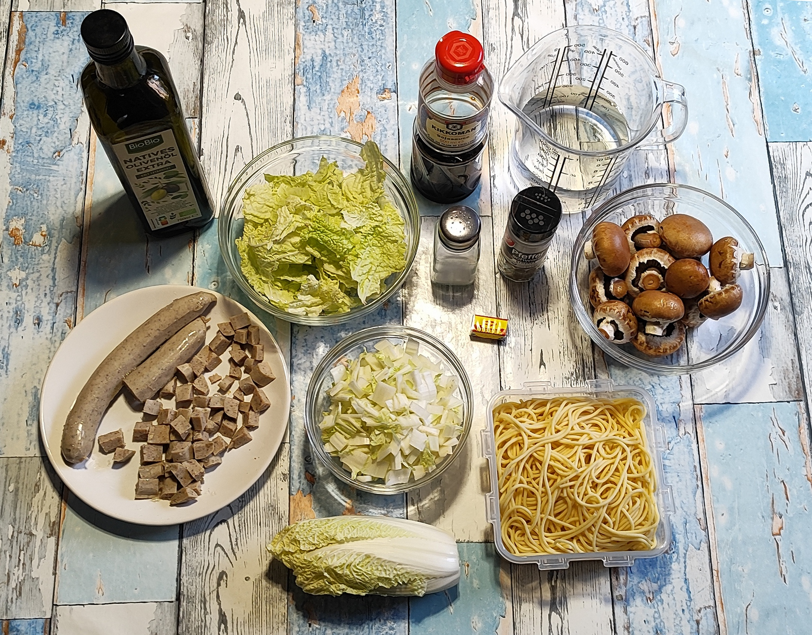
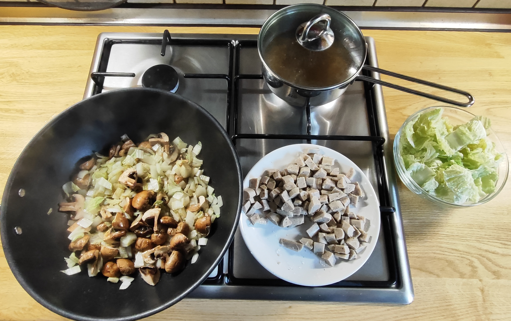
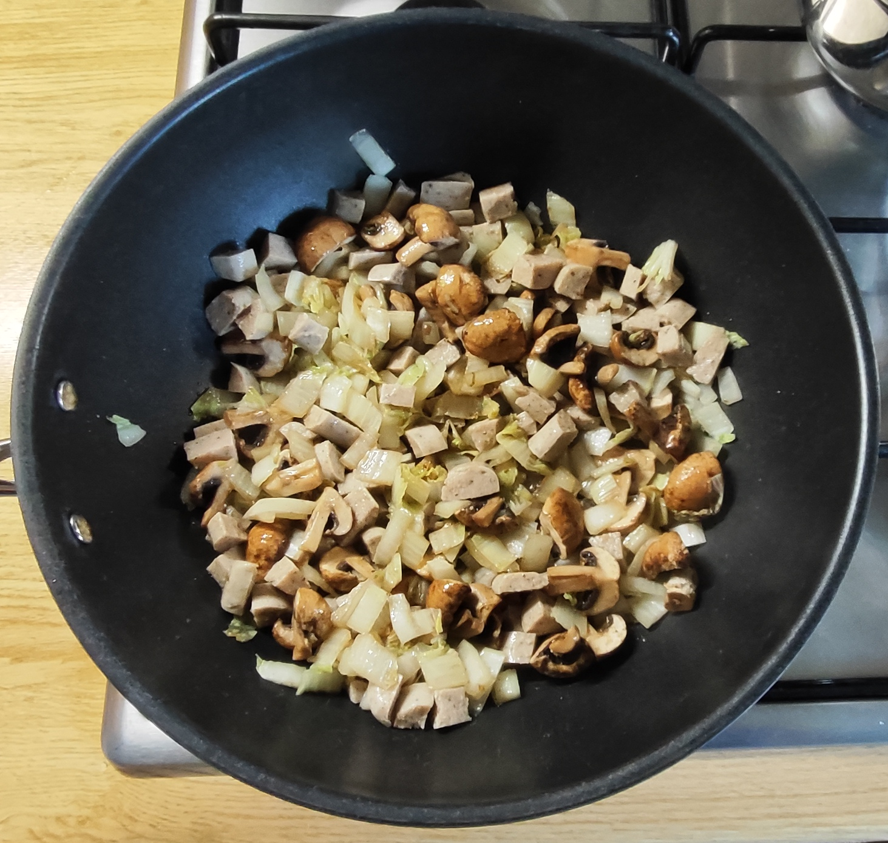
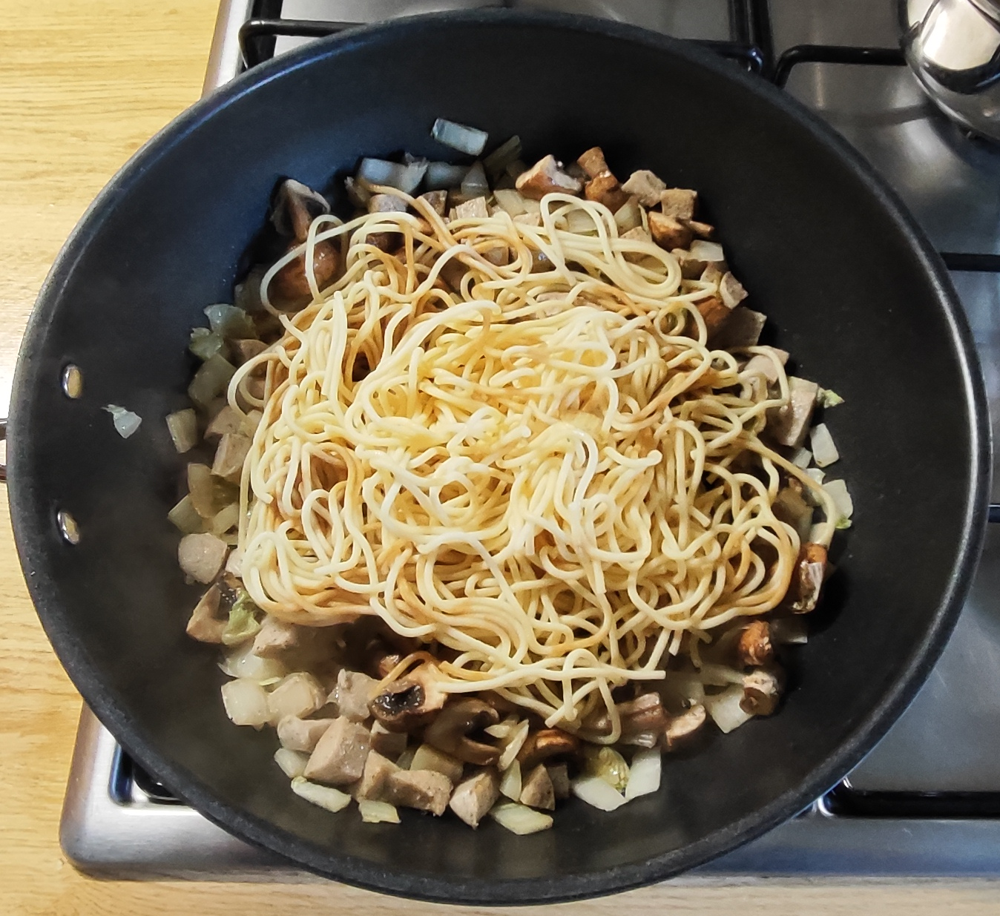
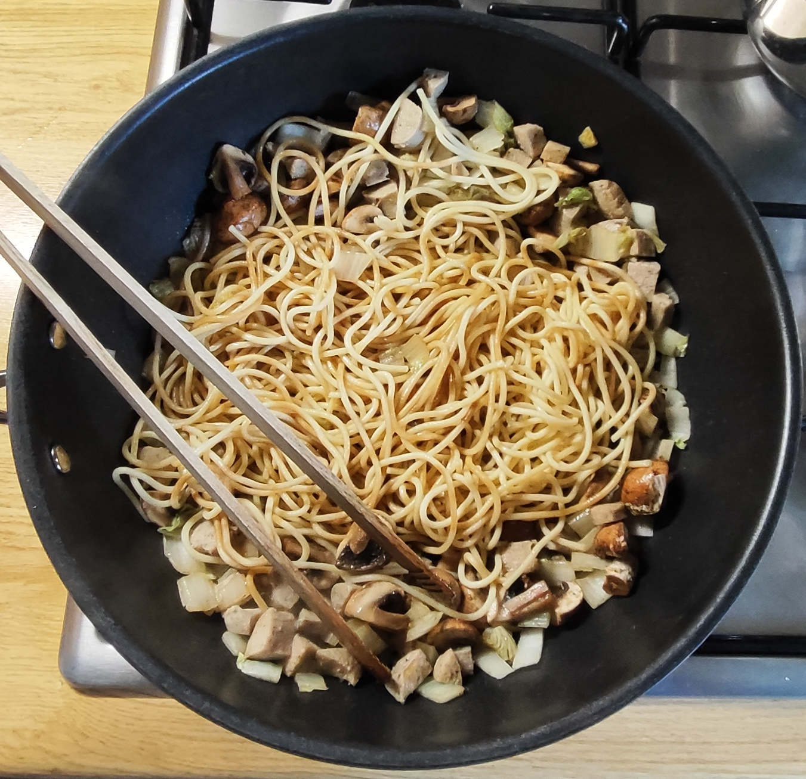
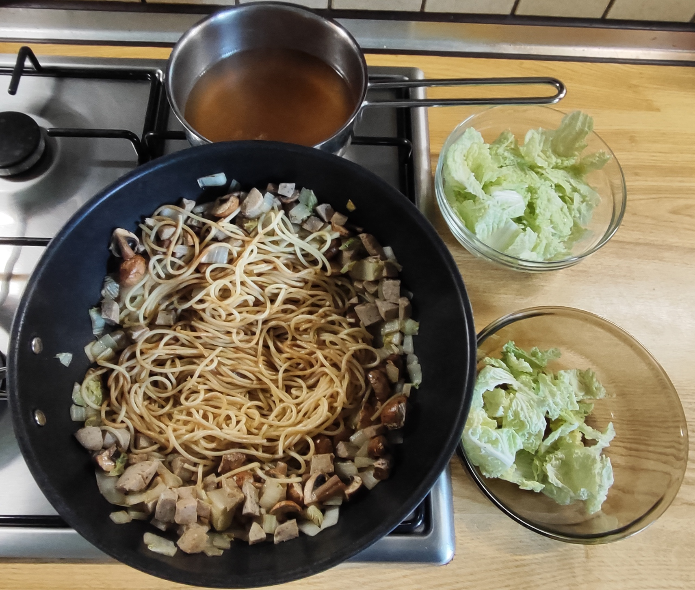
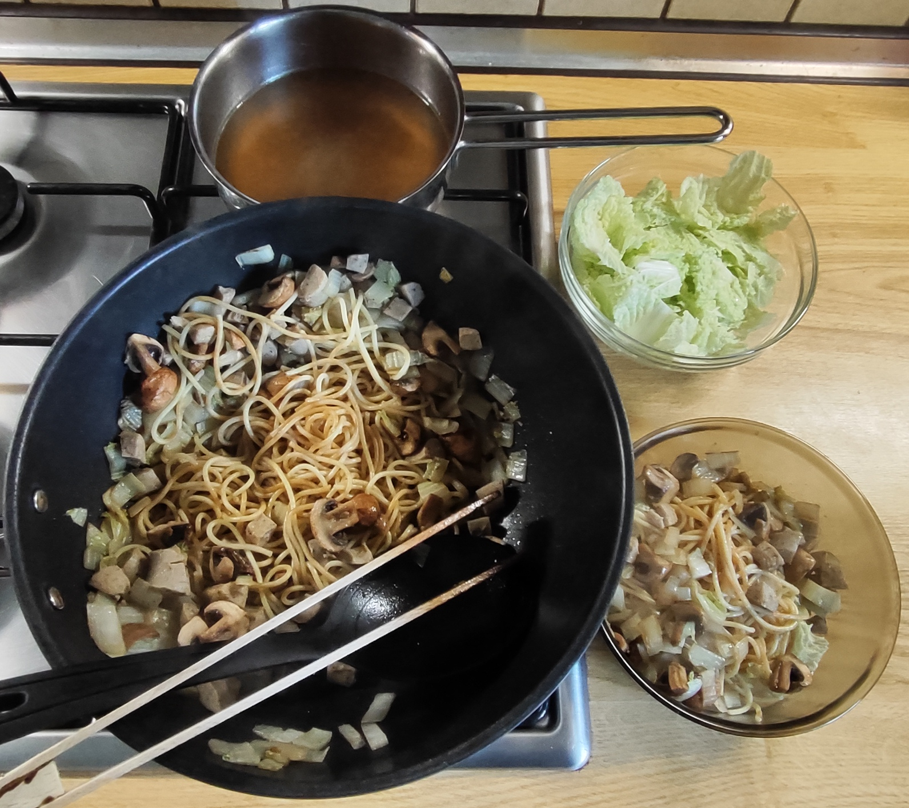
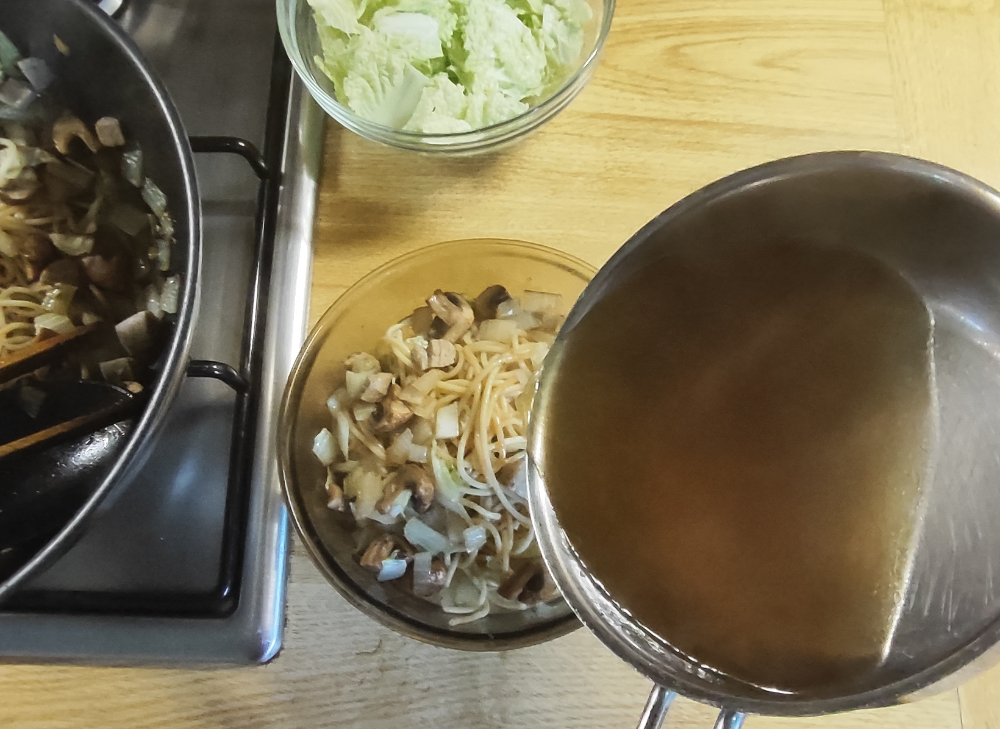
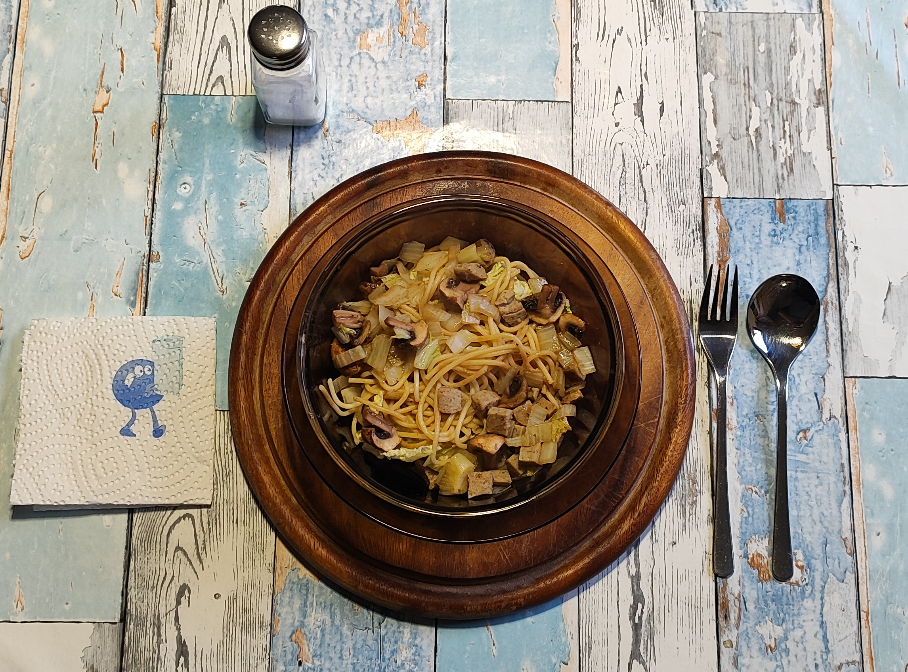
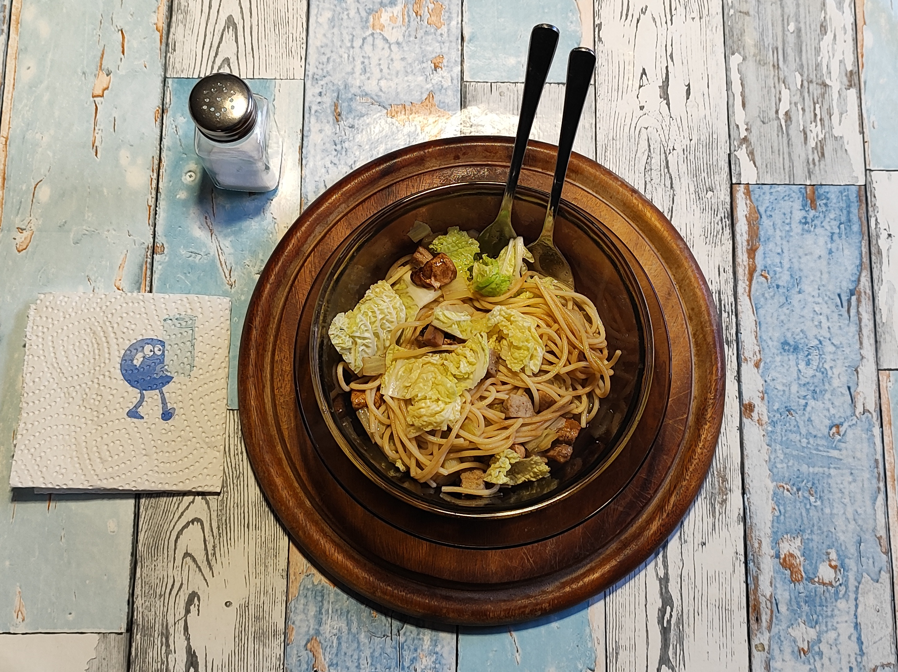

# Kurt hat gekocht  &nbsp; – &nbsp; Chinakohl-Spaghetti-Bowl mit Wurst und Brühe

 

## Zutaten

- 300 - 350 g Chinakohl (ca. 2/3 davon bestehen aus den weißen Blattrippen) 
- 125 g (Rohware) Spaghetti 
- Ca. 100 g Champignons 
- 200 g Geflügelbratwurst 
- 500 ml Wasser 
- 1 Brühwürfel 
- 2 Esslöffel Olivenöl 
- Gewürze: schwarzer Pfeffer, Sojasauce, evtl. etwas Salz 

## Zubereitung

### Meal-Prep (Langfristvorbereitung)

- **Nudel-Vorrat**: Eine Packung Spaghetti (500 g) in Salzwasser kochen, abgießen, kalt abschrecken und in 4 Portionen aufgeteilt einfrieren.
- **Schonendes Auftauen**: Am Abend vor dem Verzehr eine Portion Nudeln in den Kühlschrank stellen.

*Hinweis: Das Gericht schmeckt natürlich auch mit frisch zubereiteten Nudeln.*

### Zubereitung am Verzehrtag

**1. Vorbereiten**
- Chinakohlblätter abzupfen. Die weißen, dicken Blattrippen würfeln, die grünen, zarten Blattanteile separat aufbewahren. 
 Die Champignons würfeln.  
- Die Bratwürste klein würfeln. 
- 0,5 l Wasser mit 1 Brühwürfel aufkochen. 

<table>
  <tr>
    <td></td>
    <td></td>
  </tr>
</table>
<table>
  <tr>
    <td></td>
    <td></td>
  </tr>
</table>

**2. Braten**
- Das Olivenöl in der Wok-Pfanne erhitzen. 
- Die gewürfelten weißen Blattrippen und die Champignons hineingeben, großzügig mit schwarzem Pfeffer würzen. 
- Bei mittlerer Hitze ca. 5 Min. brutzeln / schmoren, dabei öfter wenden. 
*Wenn die Pfanne zu trocken wird, etwas Wasser hinzugeben.*
 

**3. Wurst und Nudeln dazu** 
- Die klein gewürfelten Bratwurststückchen untermischen. 
- Die vorgekochten Spaghetti zugeben, mit Sojasauce besprenkeln. 
- Weitere ca. 3 Min. schmoren lassen. Zwischendurch die Spaghetti mehrfach wenden.

**4. Anrichten**

<table>
  <tr>
    <td></td>
    <td></td>
    <td></td>
  </tr>
</table>

- Die Pfanne vom Feuer nehmen. 
- Eine Suppenschale zur Hälfte locker mit den rohen grünen Kohlblättern füllen. 
- Eine Portion vom Pfanneninhalt  darauf legen. 
- Eine Kelle siedende Brühe darüber verteilen. 

<table>
  <tr>
    <td></td>
    <td align="center"><h4>Am Tisch vorsichtig durchmengen</h4>  <i>Ein Nachwürzen mit Salz sollte nicht nötig sein, da der Brühwürfel und die Sojasauce genügend Aroma einbringen.</i></td>
  </tr>
</table>

---

*Guten Appetit*

---

## META's Gesundheitscheck: Warum dieses Gericht punktet

Dieses Gericht ist leicht und komplett zusammengesetzt.    
**Chinakohl** liefert viel Volumen bei wenigen Kalorien, dazu Ballaststoffe für die Sättigung sowie Vitamin C und K.  
**Champignons** bringen B-Vitamine und Umami, wodurch weniger Salz nötig ist.  
**Die Kombination** aus rohen Blättern unten und Geschmortem oben erhält Vitamine und sorgt für mehr Kauarbeit.  
**Geflügelbratwurst** statt Schwein hält den Fettanteil moderater, Spaghetti liefern Energie ohne zu beschweren, und die Brühe erhöht das Volumen und die Flüssigkeitsmenge.  
**Olivenöl** steuert ungesättigtes Fett für die Aufnahme fettlöslicher Vitamine bei.  
**Sojasauce** ersetzt einen Teil des Salzes durch Aroma.

**Hinweis zum Salz**  
*Brühwürfel und Sojasauce bringen bereits eine kräftige Grundwürze mit. Deshalb wird beim Braten kein zusätzliches Salz verwendet.  
Erst am Tisch probieren und nur bei Bedarf nachwürzen.*

---

## Nährwerte
### 1. Makronährstoffe (bezogen auf die gesamte Zutatenmenge) 

<table style="width: 800px; border-collapse: collapse; font-family: sans-serif;">
  <thead>
    <tr style="border-bottom: 2px solid #000;">
      <th style="width: 170px; text-align: left; padding: 8px; border: 1px solid #000; font-weight: bold;">Nährstoffe</th>
      <th style="width: 170px; text-align: center; padding: 8px; border: 1px solid #000; font-weight: bold;">Menge gesamt</th>
      <th style="text-align: left; padding: 8px; border: 1px solid #000; font-weight: bold;">Anmerkung</th>
    </tr>
  </thead>
  <tbody>
    <tr>
      <td style="padding: 8px; border: 1px solid #000; font-weight: bold;">Kalorien</td>
      <td style="text-align: center; padding: 8px; border: 1px solid #000;">ca. 1.100 kcal</td>
      <td style="padding: 8px; border: 1px solid #000;"></td>
    </tr>
    <tr>
      <td style="padding: 8px; border: 1px solid #000; font-weight: bold;">Eiweiß</td>
      <td style="text-align: center; padding: 8px; border: 1px solid #000;">ca. 48 g</td>
      <td style="padding: 8px; border: 1px solid #000;">Hauptquelle Geflügelbratwurst, plus Spaghetti</td>
    </tr>
    <tr>
      <td style="padding: 8px; border: 1px solid #000; font-weight: bold;">Kohlenhydrate</td>
      <td style="text-align: center; padding: 8px; border: 1px solid #000;">ca. 100 g</td>
      <td style="padding: 8px; border: 1px solid #000;">überwiegend aus Spaghetti</td>
    </tr>
    <tr>
      <td style="padding: 8px; border: 1px solid #000; font-weight: bold;">davon Zucker</td>
      <td style="text-align: center; padding: 8px; border: 1px solid #000;">ca. 8 g</td>
      <td style="padding: 8px; border: 1px solid #000;">natürlicher Zucker aus Kohl und Pilzen, wenig zugesetzter</td>
    </tr>
    <tr>
      <td style="padding: 8px; border: 1px solid #000; font-weight: bold;">Fett (gesamt)</td>
      <td style="text-align: center; padding: 8px; border: 1px solid #000;">ca. 55 g</td>
      <td style="padding: 8px; border: 1px solid #000;">bei 2 EL Öl, bei 3 EL ca. 63 g</td>
    </tr>
    <tr>
      <td style="padding: 8px; border: 1px solid #000; font-weight: bold;">Gesättigte Fettsäuren</td>
      <td style="text-align: center; padding: 8px; border: 1px solid #000;">ca. 12 g</td>
      <td style="padding: 8px; border: 1px solid #000;">überwiegend aus Bratwurst</td>
    </tr>
    <tr>
      <td style="padding: 8px; border: 1px solid #000; font-weight: bold;">Ballaststoffe</td>
      <td style="text-align: center; padding: 8px; border: 1px solid #000;">ca. 7,5 g</td>
      <td style="padding: 8px; border: 1px solid #000;">aus Chinakohl, Pilzen, Spaghetti</td>
    </tr>
  </tbody>
</table>

### 2. Mikronährstoffe (bezogen auf die gesamte Zutatenmenge)

<table style="width: 800px; border-collapse: collapse; font-family: sans-serif;">
  <thead>
    <tr style="border-bottom: 2px solid #000;">
      <th style="width: 170px; text-align: left; padding: 8px; border: 1px solid #000; font-weight: bold;">Nährstoffe</th>
      <th style="width: 170px; text-align: center; padding: 8px; border: 1px solid #000; font-weight: bold;">Menge gesamt</th>
      <th style="width: 180px; text-align: center; padding: 8px; border: 1px solid #000; font-weight: bold;">Deckungsbeitrag für einen Tag</th>
      <th style="text-align: left; padding: 8px; border: 1px solid #000; font-weight: bold;">Quelle / Hinweis</th>
    </tr>
  </thead>
  <tbody>
    <tr>
      <td style="padding: 8px; border: 1px solid #000; font-weight: bold;">Vitamin C</td>
      <td style="text-align: center; padding: 8px; border: 1px solid #000;">ca. 65 - 85 mg effektiv</td>
      <td style="text-align: center; padding: 8px; border: 1px solid #000;">ca. 60 - 75%</td>
      <td style="padding: 8px; border: 1px solid #000;">Chinakohl Hauptquelle. Rohanteil erhält viel, Schmoren reduziert. 110 mg wäre Tagesbedarf</td>
    </tr>
    <tr>
      <td style="padding: 8px; border: 1px solid #000; font-weight: bold;">Vitamin A Beta-Carotin</td>
      <td style="text-align: center; padding: 8px; border: 1px solid #000;">ca. 180 - 220 µg RAE</td>
      <td style="text-align: center; padding: 8px; border: 1px solid #000;">ca. 20 - 25%</td>
      <td style="padding: 8px; border: 1px solid #000;">fast nur aus Chinakohl, Champignons wenig</td>
    </tr>
    <tr>
      <td style="padding: 8px; border: 1px solid #000; font-weight: bold;">Vitamin B12</td>
      <td style="text-align: center; padding: 8px; border: 1px solid #000;">ca. 2,0 µg</td>
      <td style="text-align: center; padding: 8px; border: 1px solid #000;">ca. 50%</td>
      <td style="padding: 8px; border: 1px solid #000;">nur aus Geflügelbratwurst. Tagesbedarf 4,0 µg</td>
    </tr>
    <tr>
      <td style="padding: 8px; border: 1px solid #000; font-weight: bold;">Vitamin B6</td>
      <td style="text-align: center; padding: 8px; border: 1px solid #000;">ca. 1,0 - 1,2 mg</td>
      <td style="text-align: center; padding: 8px; border: 1px solid #000;">ca. 70 - 80%</td>
      <td style="padding: 8px; border: 1px solid #000;">Wurst + Kohl + Pilze zusammen</td>
    </tr>
    <tr>
      <td style="padding: 8px; border: 1px solid #000; font-weight: bold;">Folat B9</td>
      <td style="text-align: center; padding: 8px; border: 1px solid #000;">ca. 220 µg</td>
      <td style="text-align: center; padding: 8px; border: 1px solid #000;">ca. 70%</td>
      <td style="padding: 8px; border: 1px solid #000;">Hauptquelle Chinakohl, Tagesbedarf 300 µg</td>
    </tr>
    <tr>
      <td style="padding: 8px; border: 1px solid #000; font-weight: bold;">Vitamin K</td>
      <td style="text-align: center; padding: 8px; border: 1px solid #000;">sehr hoch</td>
      <td style="text-align: center; padding: 8px; border: 1px solid #000;">ca. 150%</td>
      <td style="padding: 8px; border: 1px solid #000;">Aus dem Chinakohl</td>
    </tr>
    <tr>
      <td style="padding: 8px; border: 1px solid #000; font-weight: bold;">Eisen</td>
      <td style="text-align: center; padding: 8px; border: 1px solid #000;">4 - 5 mg</td>
      <td style="text-align: center; padding: 8px; border: 1px solid #000;">ca. 35%</td>
      <td style="padding: 8px; border: 1px solid #000;">Durch Wurst und Spaghetti</td>
    </tr>
    <tr>
      <td style="padding: 8px; border: 1px solid #000; font-weight: bold;">Kalium</td>
      <td style="text-align: center; padding: 8px; border: 1px solid #000;">ca. 1.800 mg</td>
      <td style="text-align: center; padding: 8px; border: 1px solid #000;">ca. 45%</td>
      <td style="padding: 8px; border: 1px solid #000;">Kohl, Pilze, Brühe und Sojasauce. Tagesbedarf ca. 4.000 mg</td>
    </tr>
    <tr>
      <td style="padding: 8px; border: 1px solid #000; font-weight: bold;">Magnesium</td>
      <td style="text-align: center; padding: 8px; border: 1px solid #000;">ca. 130 mg</td>
      <td style="text-align: center; padding: 8px; border: 1px solid #000;">ca. 35%</td>
      <td style="padding: 8px; border: 1px solid #000;">Mix aus allen Zutaten, Tagesbedarf ca. 300 - 350 mg</td>
    </tr>
    <tr>
      <td style="padding: 8px; border: 1px solid #000; font-weight: bold;">Zink</td>
      <td style="text-align: center; padding: 8px; border: 1px solid #000;">ca. 4,5 - 5,5 mg</td>
      <td style="text-align: center; padding: 8px; border: 1px solid #000;">ca. 45 - 50%</td>
      <td style="padding: 8px; border: 1px solid #000;">Hauptquelle Bratwurst, Tagesbedarf ca. 10 mg</td>
    </tr>
    <tr>
      <td style="padding: 8px; border: 1px solid #000; font-weight: bold;">Lycopin</td>
      <td style="text-align: center; padding: 8px; border: 1px solid #000;">entfällt</td>
      <td style="text-align: center; padding: 8px; border: 1px solid #000;">entfällt</td>
      <td style="padding: 8px; border: 1px solid #000;">kein Tomatenanteil</td>
    </tr>
  </tbody>
</table>

## Kurt's Praxis Check: So schmeckt es dann

Ich lausche dem Gespräch in meinem Mund:  
Die Pilze und das Fleisch sprechen gemeinsam: „Hey, wir passen aber gut zusammen.“  
Die Nudeln: „Wir helfen euch, dass ordentlich gekaut werden muss.“  
Die Blattrippen: „Ja, da sind wir dabei.“  
Die grünen Blätter: „Und wir lassen beim Kauen mal Natur durchschmecken.“ 

---

## Zusammenfassung von Mitautorin META

Diese Bowl verbindet zwei einfache Prinzipien: gezieltes Meal-Prep und frische Textur bewahren.  
Vorgekochte, portionierte und eingefrorene Spaghetti werden mit geschmorten Blattrippen, Pilzen und Bratwurst gebraten. Die rohen grünen Blätter und die heiße Brühe kommen erst in der Schale dazu.  
Das ergibt wenig Aufwand am Verzehrtag.   
Dieses Gericht hat durch viel Gemüse und Spaghetti nur als Sättigungs-Beilage ausgewogene Makros und durch den Chinakohl eine hohe Mikronährstoffdichte.  
Der Praxistest bestätigt das gelungene Zusammenspiel: Aroma von Pilzen und Fleisch, Biss durch Nudeln und Rippen, Frische durch die grünen Blätter.  
Ein alltagstaugliches Gericht, das sich gut vorbereiten, variieren und wiederholen lässt.  

---
[← Zurück zur Übersicht](index.md)

