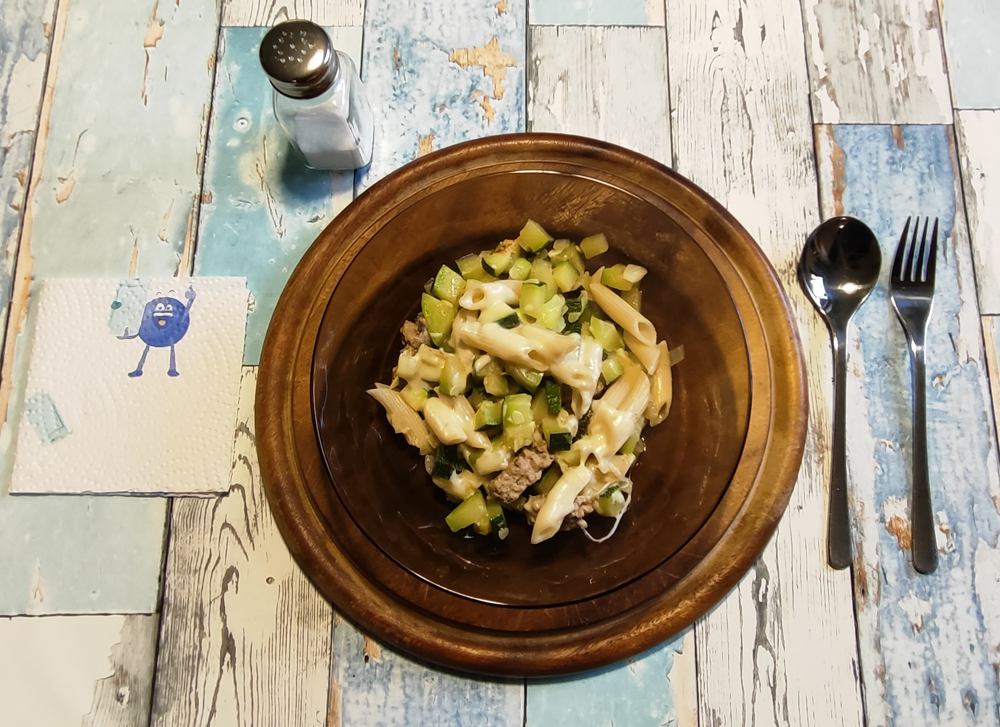

# Kurt hat gekocht &nbsp; – &nbsp; Zucchini-Hack-Bowl mit Brühe

 

### Zutaten für 2 Portionen

- Zucchini (ca. 700 g - 800 g) 
- 1 mittelgroße Zwiebel (ca. 100 - 150 g) 
- 150 g Hackfleisch (halb und halb) 
- 125 g (Trockengewicht, entspricht ¼ Packung) Dinkel-Penne 
- 3 Scheiben Käse ca. 120 g  – z.B. junger Gouda (Edamer oder Tilsiter gehen auch) 
- 3 Esslöffel Olivenöl 
- Gewürze: Salz, schwarzer Pfeffer, Rosenpaprika scharf

---

## Zubereitung

### Langfristvorbereitung

- **Pasta-Vorrat:** Eine Packung Dinkel-Penne (500 g) in Salzwasser kochen, abgießen, kalt abschrecken und in 4 Portionen aufgeteilt einfrieren.
- **Schonendes Auftauen:** Am Abend vor dem Verzehr eine Portion Penne in den Kühlschrank stellen.

*Hinweis: Das Gericht schmeckt natürlich auch mit frisch zubereiteten Nudeln.*

### Zubereitung am Verzehrtag

<table>
  <tr>
    <td></td>
    <td></td>
    <td></td>
    <td></td>
  </tr>
  <tr>
    <td></td>
    <td></td>
    <td></td>
    <td></td>
  </tr>
</table>

- Das Wasser mit dem Brühwürfel aufsetzen und auf kleiner Flamme langsam zum Sieden bringen. 
- Die Zucchini waschen und klein würfeln, die Zwiebel schälen und sehr fein würfeln. 
- Die Zucchiniwürfel und die Zwiebelwürfel mit dem Olivenöl in die Pfanne geben. Mit schwarzem Pfeffer würzen.  
- Das Hackfleisch nach Geschmack würzen (Salz, Pfeffer, Paprika ..) und in Flocken über dem Gemüse verteilen. 
- Mit Deckel auf mittlerer Flamme ca. 4 - 5 Minuten schmoren. 
- Mit den Nudeln und den Käsescheiben abdecken. 
- Weitere 3 - 4 Minuten bei mittlerer Hitze mit Deckel garen, bis der Käse beginnt, zu zerlaufen. 
- Die Pfanne vom Feuer nehmen. 
- Eine Portion vom Pfanneninhalt in eine Schüssel füllen und mit gut 100 ml (bei einer Schüsselgröße von ca. 500 ml) siedender Brühe aufgießen. 
- Servieren.

---

---
[← Zurück zur Übersicht](index.md)
