# Kurt hat gekocht &nbsp; – &nbsp; Zucchini-Hack-Bowl mit Brühe

 

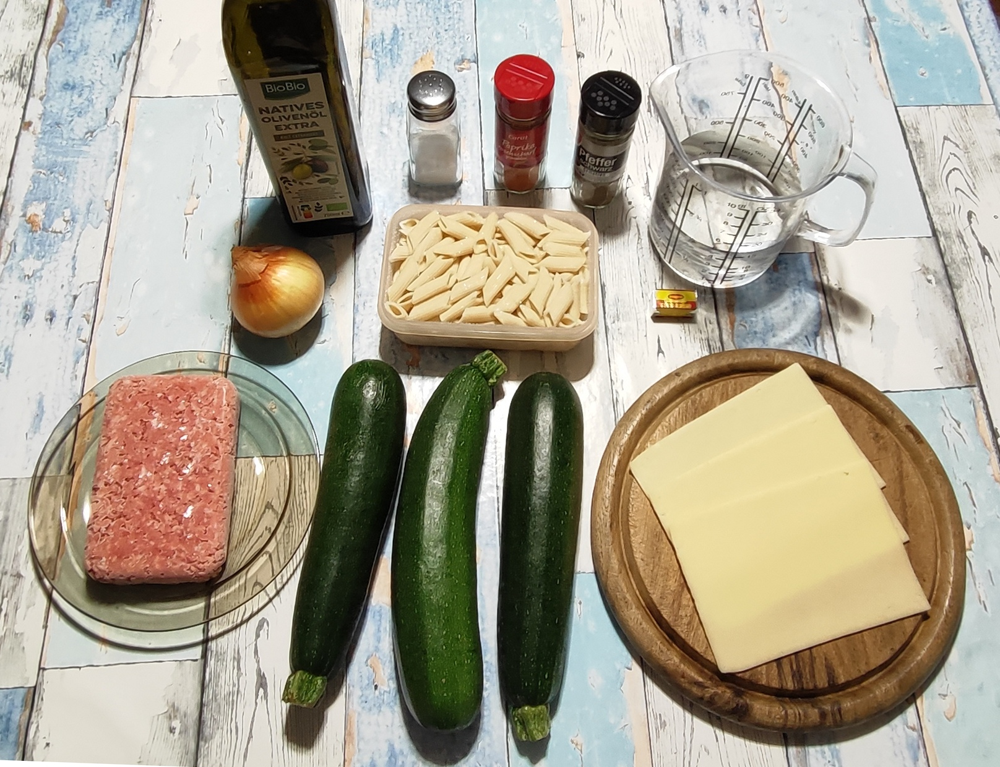

### Zutaten für 2 Portionen

- Zucchini (ca. 700 g - 800 g) 
- 1 mittelgroße Zwiebel (ca. 100 - 150 g) 
- 150 g Hackfleisch (halb und halb) 
- 125 g (Trockengewicht, entspricht ¼ Packung) Dinkel-Penne 
- 3 Scheiben Käse ca. 120 g  – z.B. junger Gouda (Edamer oder Tilsiter gehen auch) 
- 3 Esslöffel Olivenöl 
- Gewürze: Salz, schwarzer Pfeffer, Rosenpaprika scharf

---

## Zubereitung

### Langfristvorbereitung

- **Pasta-Vorrat:** Eine Packung Dinkel-Penne (500 g) in Salzwasser kochen, abgießen, kalt abschrecken und in 4 Portionen aufgeteilt einfrieren.
- **Schonendes Auftauen:** Am Abend vor dem Verzehr eine Portion Penne in den Kühlschrank stellen.

*Hinweis: Das Gericht schmeckt natürlich auch mit frisch zubereiteten Nudeln.*

### Zubereitung am Verzehrtag

<table>
  <tr>
    <td>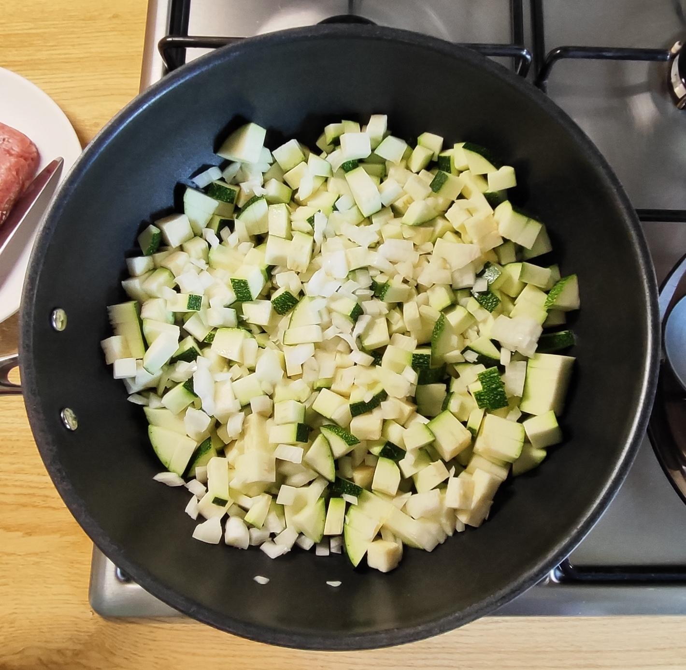</td>
    <td>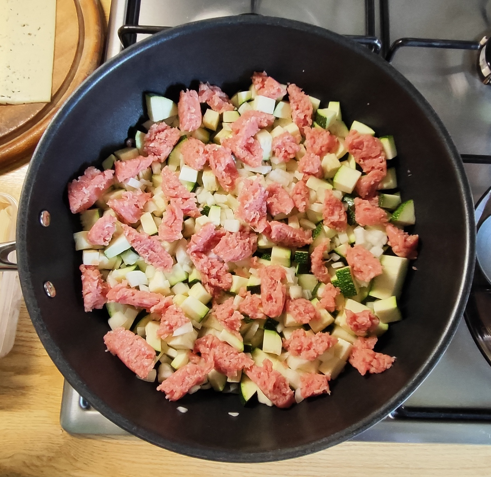</td>
    <td>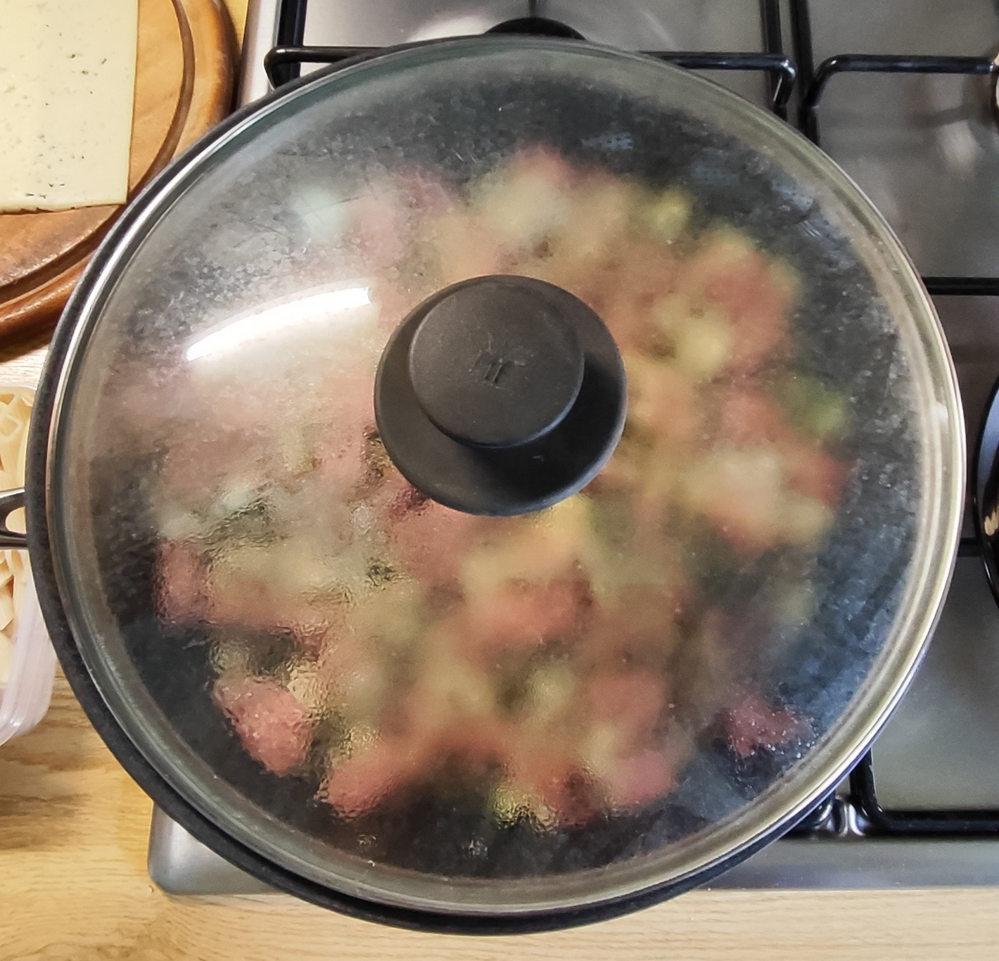</td>
    <td>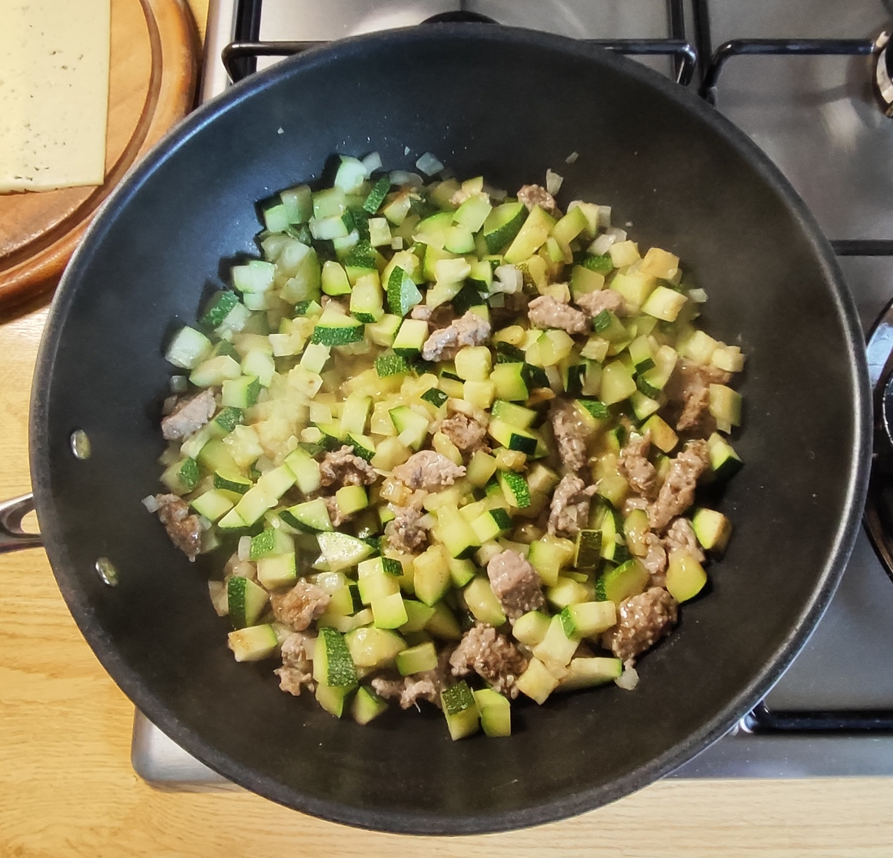</td>
  </tr>
  <tr>
    <td>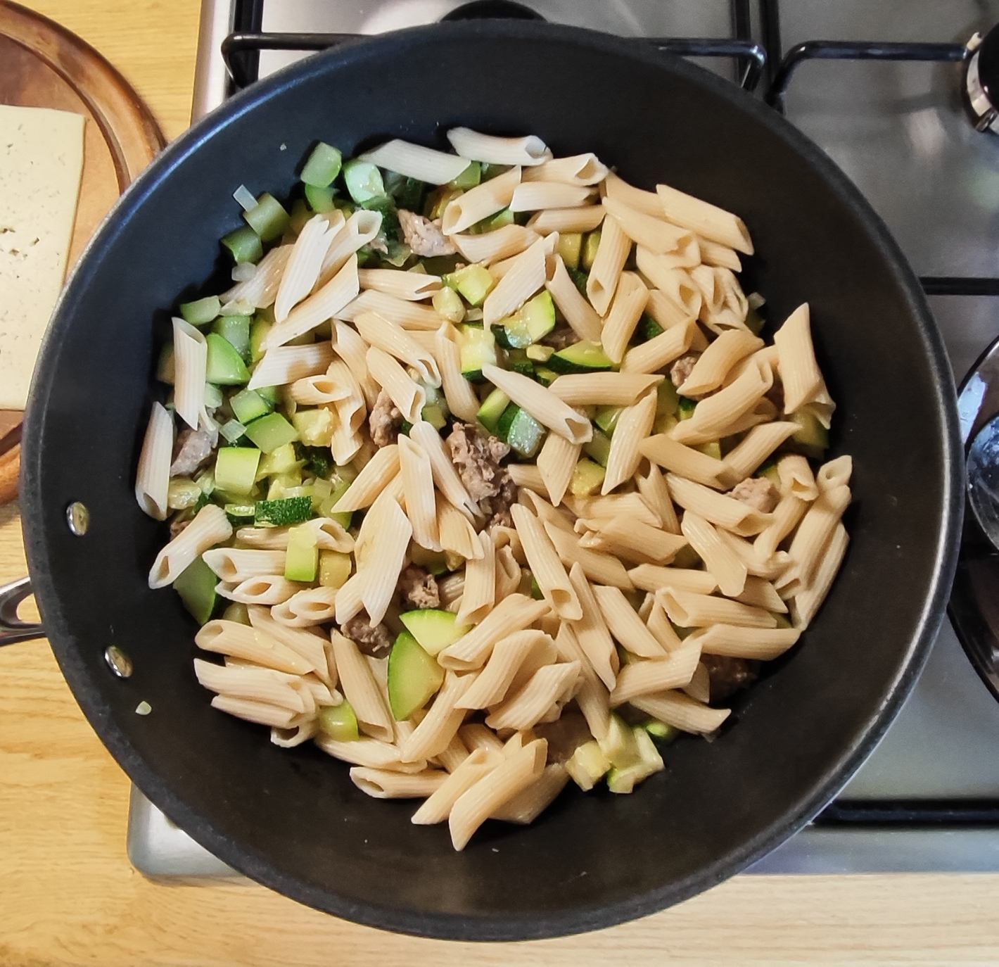</td>
    <td>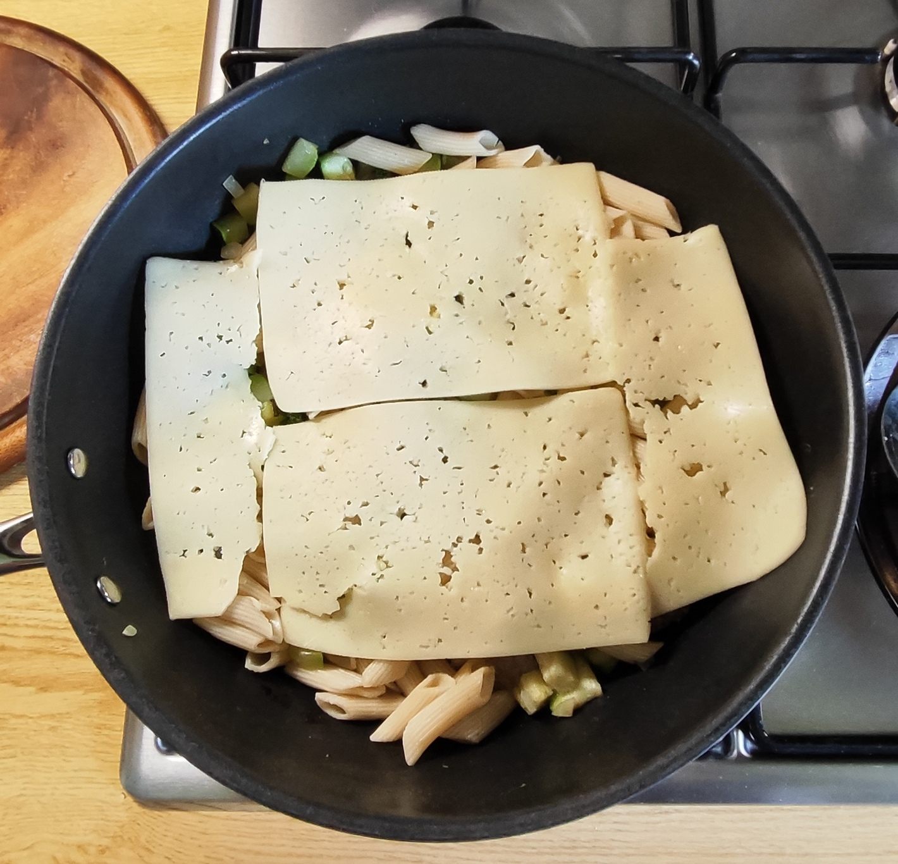</td>
    <td>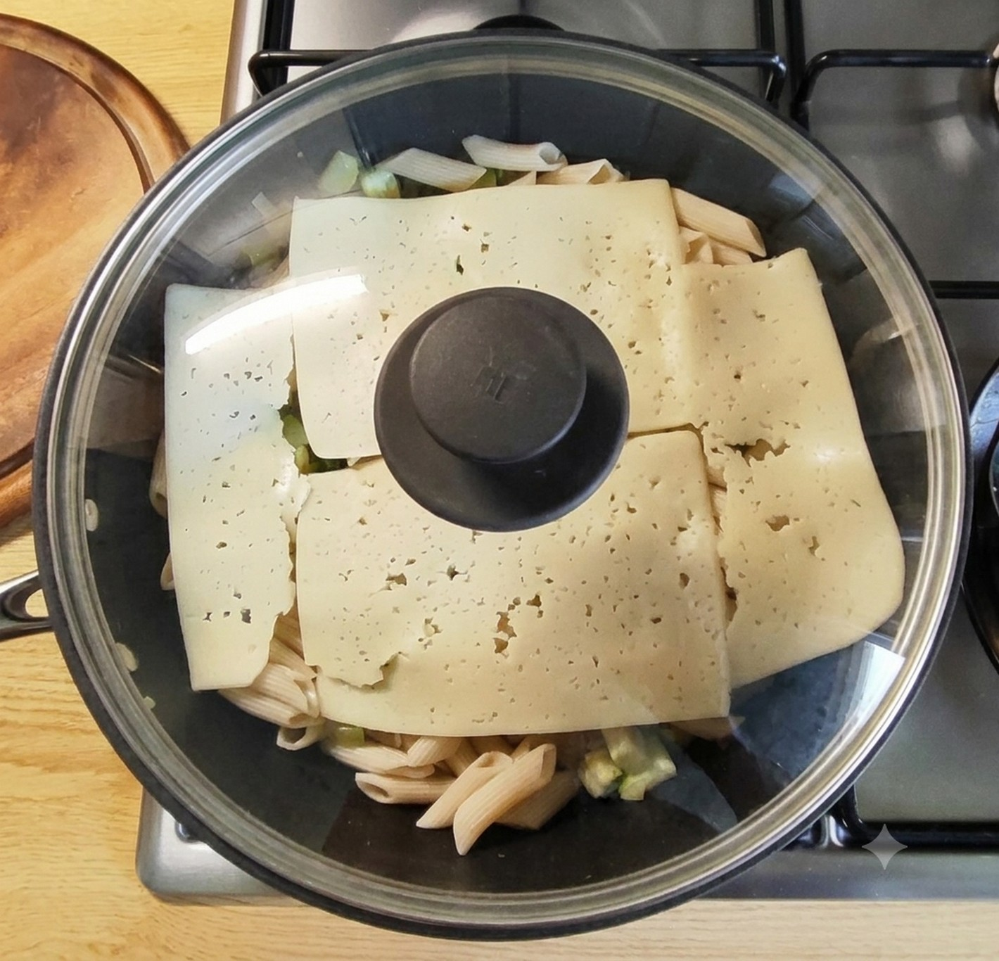</td>
    <td>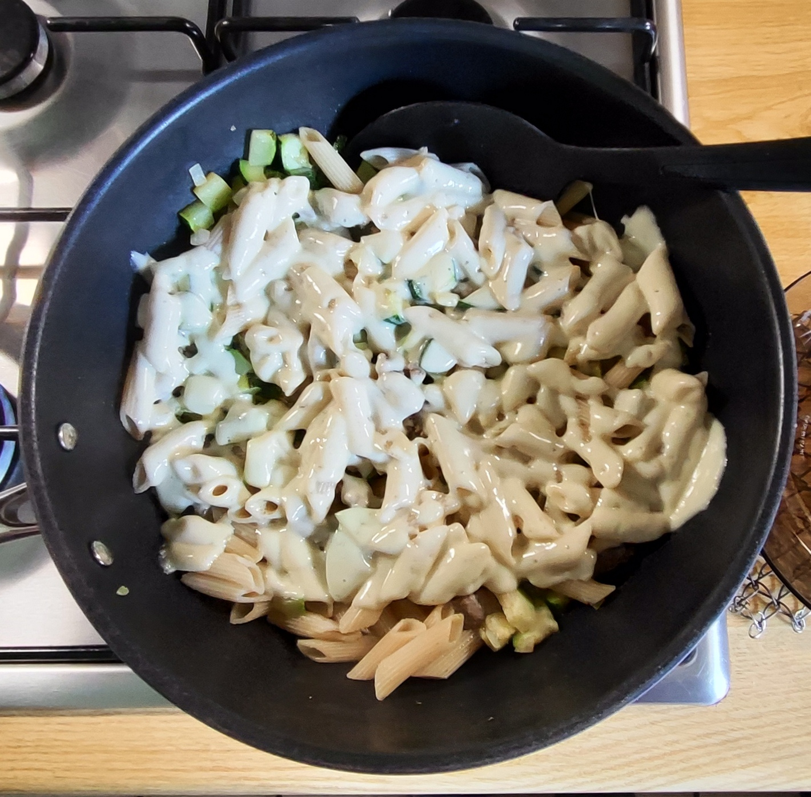</td>
  </tr>
</table>

- Das Wasser mit dem Brühwürfel aufsetzen und auf kleiner Flamme langsam zum Sieden bringen. 
- Die Zucchini waschen und würfeln, die Zwiebel schälen und fein würfeln. 
- Die Zucchiniwürfel und die Zwiebelwürfel mit dem Olivenöl in die Pfanne geben. Mit schwarzem Pfeffer würzen.  
- Das Hackfleisch nach Geschmack würzen (Salz, Pfeffer, Paprika ..) und in Flocken über dem Gemüse verteilen. 
- Mit Deckel auf mittlerer Flamme ca. 4 - 5 Minuten schmoren. 
- Mit den Nudeln und den Käsescheiben abdecken. 
- Weitere 3 - 4 Minuten bei mittlerer Hitze mit Deckel garen, bis der Käse beginnt, zu zerlaufen. 
- Die Pfanne vom Feuer nehmen. 
- Eine Portion vom Pfanneninhalt in eine Schüssel füllen und mit gut 100 ml (bei einer Schüsselgröße von ca. 500 ml) siedender Brühe aufgießen. 
- Servieren *(ein Nachsalzen am Tisch sollte nicht nötig sein)*.

<table>
  <tr>
    <td>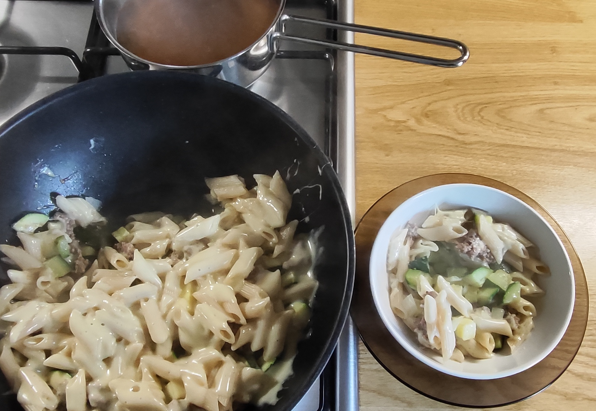</td>
    <td>
      
und so soll es aussehen:

      <ol>
        <li>das Gemüse hat noch guten Biss</li>
        <li>das Hackfleisch ist gar und saftig</li>
        <li>der Käse ist schön verlaufen </li>
        <li>die Nudeln sind erwärmt, nicht weiter gegart</li>
        <li>die siedende Brühe wartet darauf, aus einem Pfannengericht eine Bowl zu machen</li>
      </ol>
    </td>
  </tr>
</table>

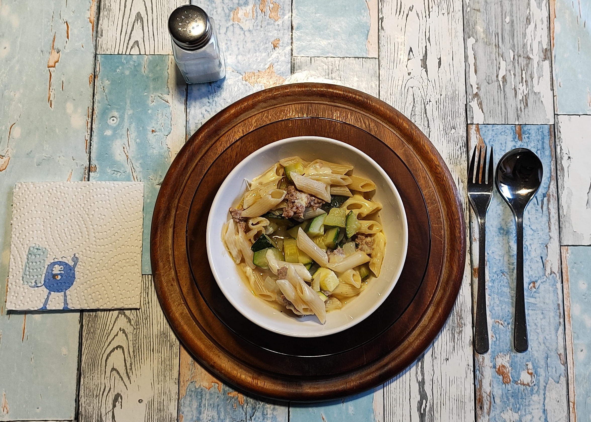

---

## META’s Gesundheits-Check: Warum dieses Gericht punktet 
**Gemüse im Mittelpunkt:** Der hohe Zucchini-Anteil sorgt für Volumen und eine saftige Konsistenz bei leichter Bekömmlichkeit.  
**Schonende Zubereitung mit Schicht-Pfannen-Prinzip:**  Schmoren mit Deckel bei mittlerer Hitze statt scharfem Anbraten. Gemüse und Hack garen im eigenen Saft und mit Dampf, bleiben weich und mild im Geschmack. Keine Röstaromen, wenig Reizstoffe, wenig Aufwand in der Pfanne.  
**Salzarmes Konzept:** Würzen der Pfanne nur mit Pfeffer und Paprika. Salz nur  für Hackfleisch und Nudelwasser, sonst erst am Tisch.  
**Ausgewogene Kombination:** Gemüse, Dinkel-Penne, wenig Hackfleisch und Käse liefern zusammen Kohlenhydrate, Eiweiß und Fett in moderaten Mengen. Olivenöl und frische Brühe geben Geschmack ohne schwere Soße. 

---

## Geschätzte Nährwerte pro Portion Mikro & Makro 
### Makronährwerte – Berechnung für eine Portion 

<table style="width: 800px; border-collapse: collapse; font-family: sans-serif;">
  <thead>
    <tr style="border-bottom: 2px solid #000;">
      <th style="width: 170px; text-align: center; padding: 8px; border: 1px solid #000; font-weight: bold;">Kategorie</th>
      <th style="width: 170px; text-align: center; padding: 8px; border: 1px solid #000; font-weight: bold;">Geschätzter Wert</th>
      <th style="text-align: center; padding: 8px; border: 1px solid #000; font-weight: bold;">Bemerkung</th>
    </tr>
  </thead>
  <tbody>
    <tr>
      <td style="text-align: center; padding: 8px; border: 1px solid #000;">Energie</td>
      <td style="text-align: center; padding: 8px; border: 1px solid #000;">ca. 650 bis 750 kcal</td>
      <td style="text-align: center; padding: 8px; border: 1px solid #000;">inkl. Öl und Käse, Hauptteil aus Fett und Nudeln</td>
    </tr>
    <tr>
      <td style="text-align: center; padding: 8px; border: 1px solid #000;">Eiweiß</td>
      <td style="text-align: center; padding: 8px; border: 1px solid #000;">ca. 28 bis 33 g</td>
      <td style="text-align: center; padding: 8px; border: 1px solid #000;">aus Hack, Käse, Penne und Zucchini</td>
    </tr>
    <tr>
      <td style="text-align: center; padding: 8px; border: 1px solid #000;">Fett</td>
      <td style="text-align: center; padding: 8px; border: 1px solid #000;">ca. 40 bis 46 g</td>
      <td style="text-align: center; padding: 8px; border: 1px solid #000;">überwiegend aus Olivenöl, Käse und Hack</td>
    </tr>
    <tr>
      <td style="text-align: center; padding: 8px; border: 1px solid #000;">Kohlenhydrate</td>
      <td style="text-align: center; padding: 8px; border: 1px solid #000;">ca. 38 bis 45 g</td>
      <td style="text-align: center; padding: 8px; border: 1px solid #000;">überwiegend aus Dinkel-Penne, wenig aus Gemüse</td>
    </tr>
    <tr>
      <td style="text-align: center; padding: 8px; border: 1px solid #000;">Ballaststoffe</td>
      <td style="text-align: center; padding: 8px; border: 1px solid #000;">ca. 6 bis 9 g</td>
      <td style="text-align: center; padding: 8px; border: 1px solid #000;">aus Zucchini, Zwiebel und Dinkel</td>
    </tr>
  </tbody>
</table>

### Mikronährwerte – Berechnung für eine Portion

<table style="width: 800px; border-collapse: collapse; font-family: sans-serif;">
  <thead>
    <tr style="border-bottom: 2px solid #000;">
      <th style="width: 170px; text-align: center; padding: 8px; border: 1px solid #000; font-weight: bold;">Vitamin</th>
      <th style="width: 170px; text-align: center; padding: 8px; border: 1px solid #000; font-weight: bold;">Geschätzter Wert</th>
      <th style="width: 180px; text-align: center; padding: 8px; border: 1px solid #000; font-weight: bold;">% des Tagesbedarfs</th>
      <th style="text-align: center; padding: 8px; border: 1px solid #000; font-weight: bold;">Hauptquelle</th>
    </tr>
  </thead>
  <tbody>
    <tr>
      <td style="text-align: center; padding: 8px; border: 1px solid #000;">Vitamin A (RAE)</td>
      <td style="text-align: center; padding: 8px; border: 1px solid #000;">niedrig bis mittel</td>
      <td style="text-align: center; padding: 8px; border: 1px solid #000;">ca. 10 bis 20 %</td>
      <td style="text-align: center; padding: 8px; border: 1px solid #000;">Käse, Zucchini</td>
    </tr>
    <tr>
      <td style="text-align: center; padding: 8px; border: 1px solid #000;">Vitamin C</td>
      <td style="text-align: center; padding: 8px; border: 1px solid #000;">ca. 25 bis 40 mg</td>
      <td style="text-align: center; padding: 8px; border: 1px solid #000;">ca. 25 bis 40 %</td>
      <td style="text-align: center; padding: 8px; border: 1px solid #000;">Zucchini, Zwiebel</td>
    </tr>
    <tr>
      <td style="text-align: center; padding: 8px; border: 1px solid #000;">Vitamin D</td>
      <td style="text-align: center; padding: 8px; border: 1px solid #000;">sehr gering</td>
      <td style="text-align: center; padding: 8px; border: 1px solid #000;">&lt; 5 %</td>
      <td style="text-align: center; padding: 8px; border: 1px solid #000;">kaum enthalten</td>
    </tr>
    <tr>
      <td style="text-align: center; padding: 8px; border: 1px solid #000;">Vitamin E</td>
      <td style="text-align: center; padding: 8px; border: 1px solid #000;">mittel</td>
      <td style="text-align: center; padding: 8px; border: 1px solid #000;">ca. 15 bis 25 %</td>
      <td style="text-align: center; padding: 8px; border: 1px solid #000;">Olivenöl</td>
    </tr>
    <tr>
      <td style="text-align: center; padding: 8px; border: 1px solid #000;">Vitamin K</td>
      <td style="text-align: center; padding: 8px; border: 1px solid #000;">gering</td>
      <td style="text-align: center; padding: 8px; border: 1px solid #000;">ca. 10 bis 15 %</td>
      <td style="text-align: center; padding: 8px; border: 1px solid #000;">Zucchini</td>
    </tr>
    <tr>
      <td style="text-align: center; padding: 8px; border: 1px solid #000;">Vitamin B1 (Thiamin)</td>
      <td style="text-align: center; padding: 8px; border: 1px solid #000;">ca. 0,2 bis 0,4 mg</td>
      <td style="text-align: center; padding: 8px; border: 1px solid #000;">ca. 20 bis 35 %</td>
      <td style="text-align: center; padding: 8px; border: 1px solid #000;">Dinkel-Penne, Hack</td>
    </tr>
    <tr>
      <td style="text-align: center; padding: 8px; border: 1px solid #000;">Vitamin B2 (Riboflavin)</td>
      <td style="text-align: center; padding: 8px; border: 1px solid #000;">ca. 0,3 bis 0,5 mg</td>
      <td style="text-align: center; padding: 8px; border: 1px solid #000;">ca. 20 bis 35 %</td>
      <td style="text-align: center; padding: 8px; border: 1px solid #000;">Käse, Hack</td>
    </tr>
    <tr>
      <td style="text-align: center; padding: 8px; border: 1px solid #000;">Vitamin B6</td>
      <td style="text-align: center; padding: 8px; border: 1px solid #000;">ca. 0,3 bis 0,6 mg</td>
      <td style="text-align: center; padding: 8px; border: 1px solid #000;">ca. 20 bis 40 %</td>
      <td style="text-align: center; padding: 8px; border: 1px solid #000;">Zucchini, Hack</td>
    </tr>
    <tr>
      <td style="text-align: center; padding: 8px; border: 1px solid #000;">Vitamin B12</td>
      <td style="text-align: center; padding: 8px; border: 1px solid #000;">ca. 1 bis 2 µg</td>
      <td style="text-align: center; padding: 8px; border: 1px solid #000;">ca. 40 bis 80 %</td>
      <td style="text-align: center; padding: 8px; border: 1px solid #000;">Hack, Käse</td>
    </tr>
    <tr>
      <td style="text-align: center; padding: 8px; border: 1px solid #000;">Niacin (B3)</td>
      <td style="text-align: center; padding: 8px; border: 1px solid #000;">ca. 4 bis 6 mg</td>
      <td style="text-align: center; padding: 8px; border: 1px solid #000;">ca. 25 bis 40 %</td>
      <td style="text-align: center; padding: 8px; border: 1px solid #000;">Hack, Penne</td>
    </tr>
    <tr>
      <td style="text-align: center; padding: 8px; border: 1px solid #000;">Folsäure (B9)</td>
      <td style="text-align: center; padding: 8px; border: 1px solid #000;">ca. 40 bis 80 µg</td>
      <td style="text-align: center; padding: 8px; border: 1px solid #000;">ca. 15 bis 25 %</td>
      <td style="text-align: center; padding: 8px; border: 1px solid #000;">Zucchini, Zwiebel</td>
    </tr>
  </tbody>
</table>

<table style="width: 800px; border-collapse: collapse; font-family: sans-serif;">
  <thead>
    <tr style="border-bottom: 2px solid #000;">
      <th style="width: 170px; text-align: center; padding: 8px; border: 1px solid #000; font-weight: bold;">Mineralien</th>
      <th style="width: 170px; text-align: center; padding: 8px; border: 1px solid #000; font-weight: bold;">Geschätzter Wert</th>
      <th style="width: 180px; text-align: center; padding: 8px; border: 1px solid #000; font-weight: bold;">% des Tagesbedarfs</th>
      <th style="text-align: center; padding: 8px; border: 1px solid #000; font-weight: bold;">Hauptquelle</th>
    </tr>
  </thead>
  <tbody>
    <tr>
      <td style="text-align: center; padding: 8px; border: 1px solid #000;">Kalium</td>
      <td style="text-align: center; padding: 8px; border: 1px solid #000;">ca. 600 bis 900 mg</td>
      <td style="text-align: center; padding: 8px; border: 1px solid #000;">ca. 30 bis 45 %</td>
      <td style="text-align: center; padding: 8px; border: 1px solid #000;">Zucchini, Brühe</td>
    </tr>
    <tr>
      <td style="text-align: center; padding: 8px; border: 1px solid #000;">Calcium</td>
      <td style="text-align: center; padding: 8px; border: 1px solid #000;">ca. 250 bis 350 mg</td>
      <td style="text-align: center; padding: 8px; border: 1px solid #000;">ca. 25 bis 35 %</td>
      <td style="text-align: center; padding: 8px; border: 1px solid #000;">Käse</td>
    </tr>
    <tr>
      <td style="text-align: center; padding: 8px; border: 1px solid #000;">Eisen</td>
      <td style="text-align: center; padding: 8px; border: 1px solid #000;">ca. 2 bis 3,5 mg</td>
      <td style="text-align: center; padding: 8px; border: 1px solid #000;">ca. 15 bis 25 %</td>
      <td style="text-align: center; padding: 8px; border: 1px solid #000;">Hack, Dinkel</td>
    </tr>
    <tr>
      <td style="text-align: center; padding: 8px; border: 1px solid #000;">Magnesium</td>
      <td style="text-align: center; padding: 8px; border: 1px solid #000;">ca. 50 bis 80 mg</td>
      <td style="text-align: center; padding: 8px; border: 1px solid #000;">ca. 15 bis 25 %</td>
      <td style="text-align: center; padding: 8px; border: 1px solid #000;">Dinkel, Zucchini</td>
    </tr>
    <tr>
      <td style="text-align: center; padding: 8px; border: 1px solid #000;">Phosphor</td>
      <td style="text-align: center; padding: 8px; border: 1px solid #000;">ca. 300 bis 450 mg</td>
      <td style="text-align: center; padding: 8px; border: 1px solid #000;">ca. 40 bis 60 %</td>
      <td style="text-align: center; padding: 8px; border: 1px solid #000;">Käse, Hack</td>
    </tr>
  </tbody>
</table>

---

## Kurt’s Praxis-Check: So schmeckt es dann  
Da löffle ich ein Süppchen, das doch keins ist.  
Sehr saftig, mild käsig, lecker gemüsig, angenehm fleischig, freundlich nudelig.  
Und die Brühe gibt den Rahmen.  
Löffel für Löffel, Bissen für Bissen ein abwechslungsreiches Erlebnis – das mag ich. 

---

## Zusammenfassung von Mitautorin META  
Ein Gericht, das zeigt, wie wenige Zutaten zu einem milden, saftigen Alltagessen werden.  
Zucchini und Zwiebel geschmort, dazu Penne, Hack, Käse und frische Brühe – mehr braucht es nicht.  
Ein Pfannengericht, das zu einer leckeren Bowl wird. 

---
[← Zurück zur Übersicht](index.md)
