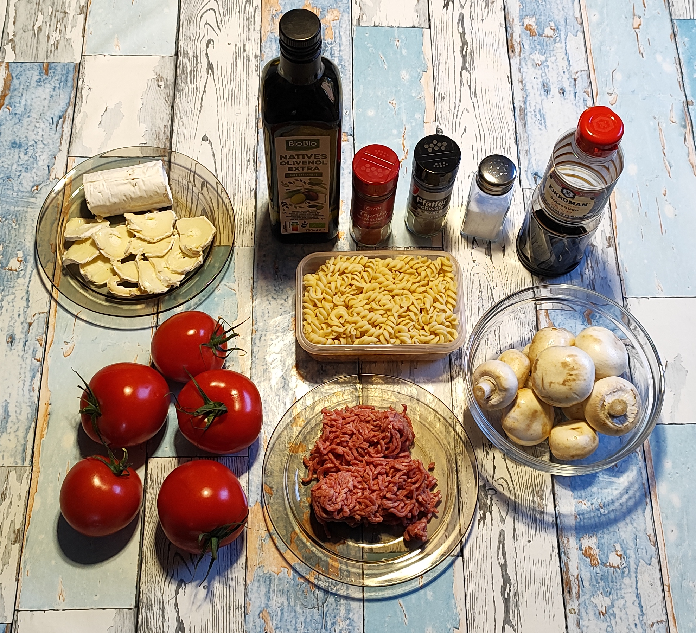
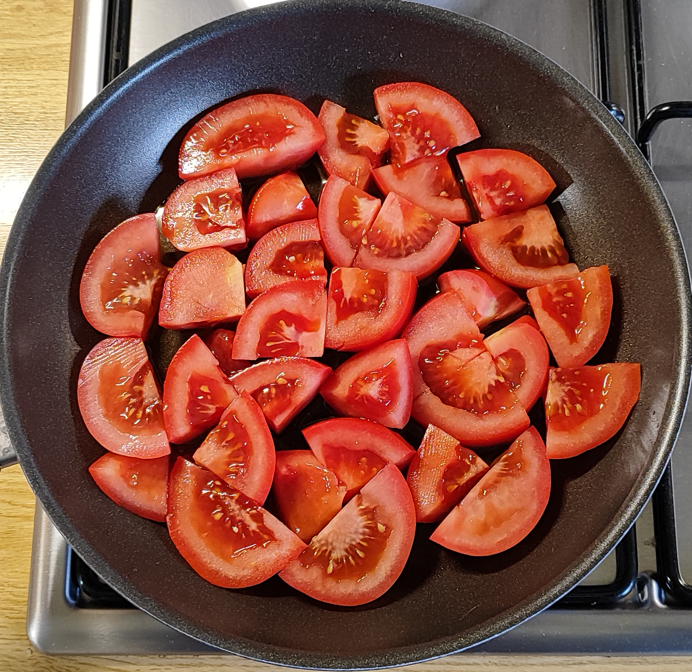
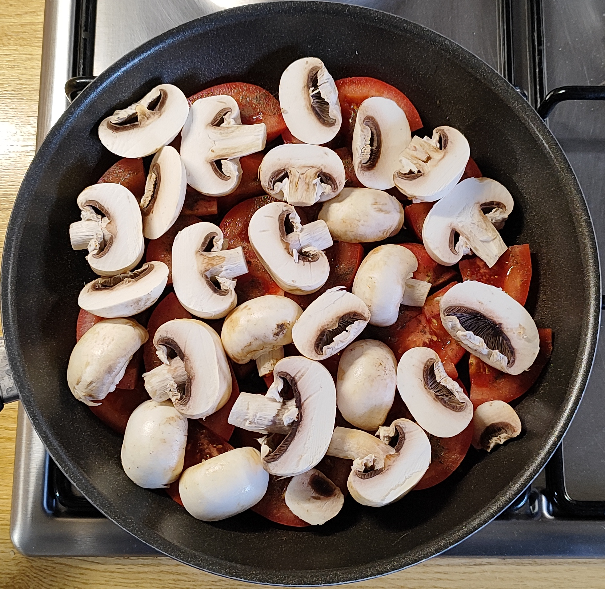
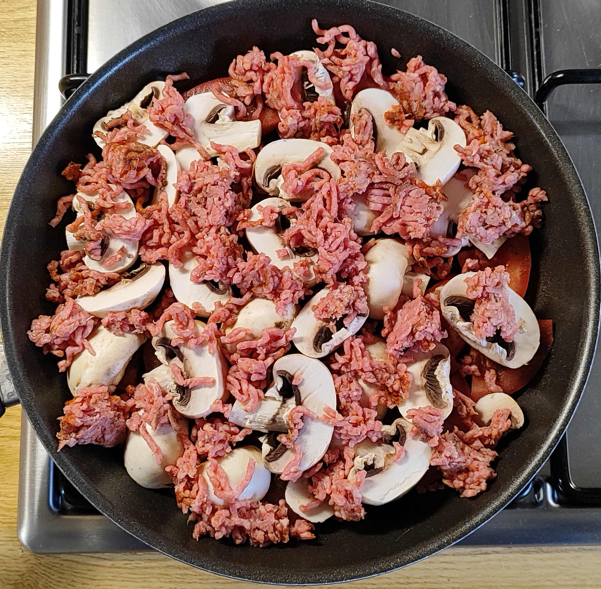
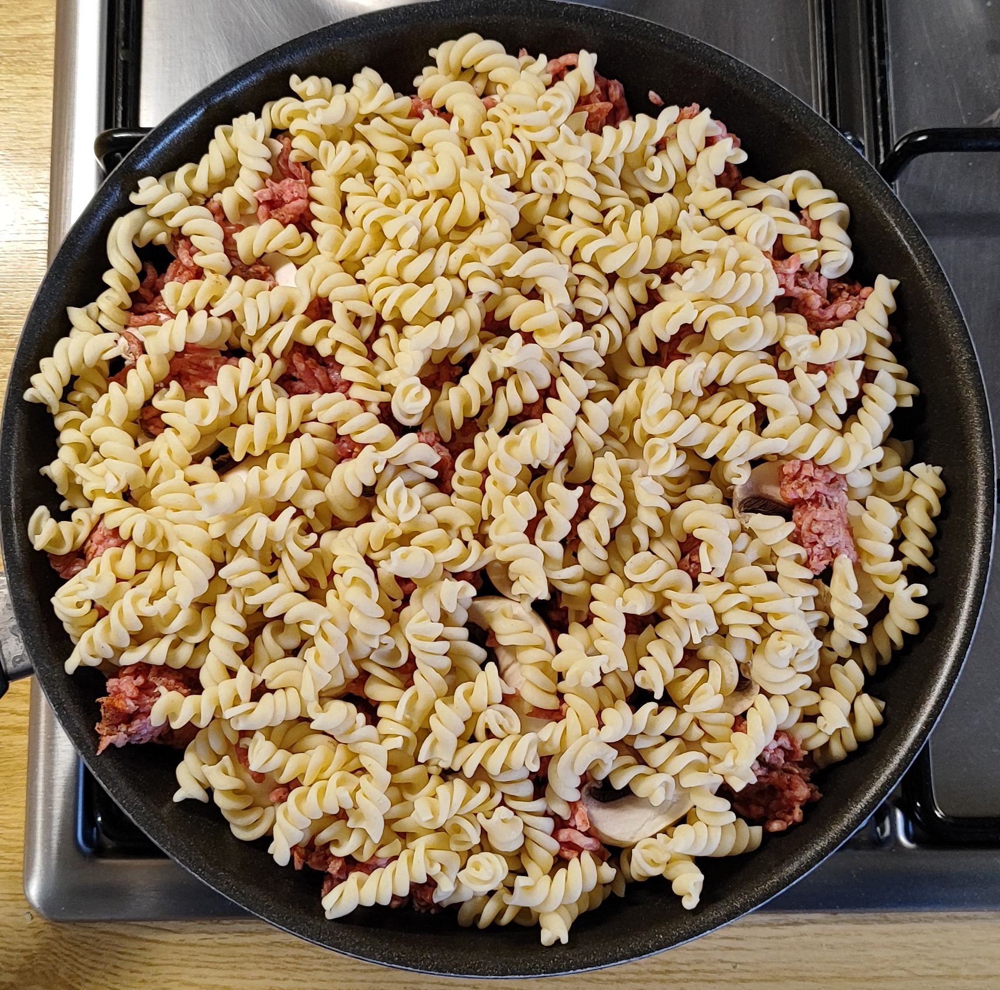
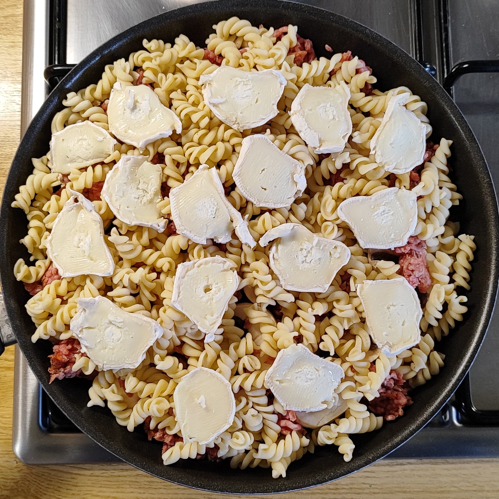
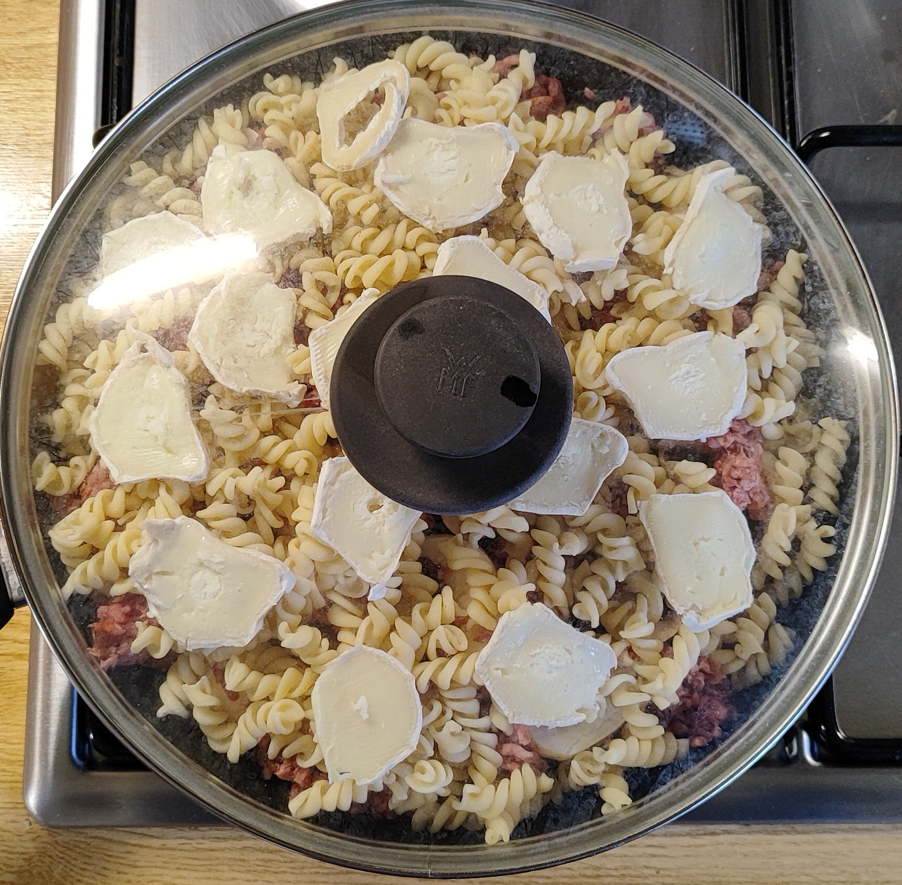
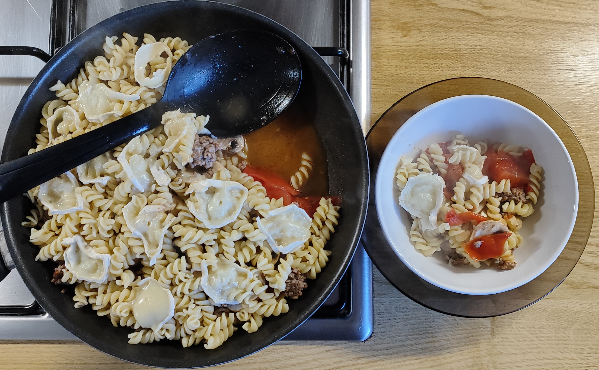
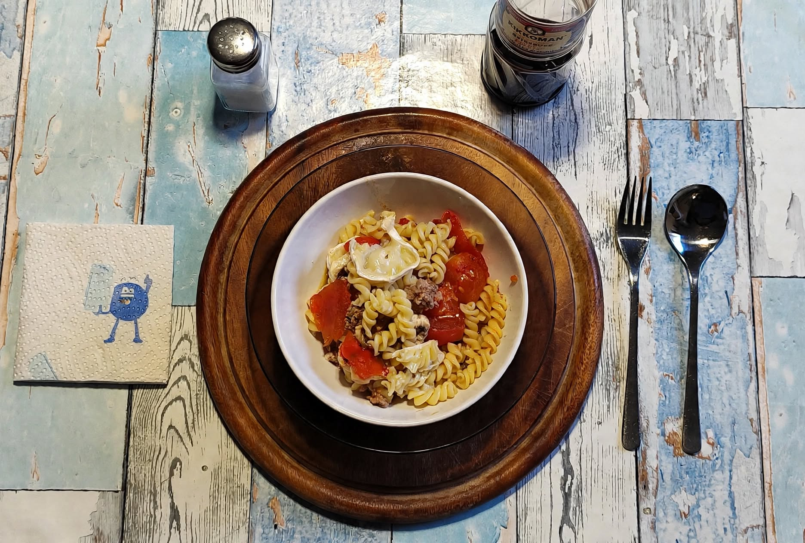
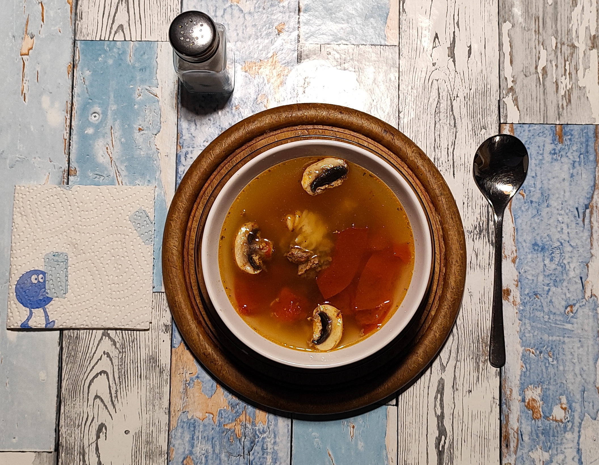

<h1 align="center">Kurt hat gekocht Tomaten-Schicht-Pfanne mit Ziegenkäse</h1>
 

### Zutaten für zwei Portionen

- Tomaten ca. 600 g 
- Champignons (weiß oder braun) ca. 200 g 
- 120 g Spiralnudeln (Trockenmenge, siehe Langfristvorbereitung) 
- 150 g Hackfleisch, gemischt (halb und halb) 
- Ca. 80 g Ziegenweichkäserolle 
- 2 Esslöffel Olivenöl 
- Gewürze: Salz, schwarzer Pfeffer, Paprikapulver rosenscharf, Sojasauce

### Zubereitung

#### Meal-Prep (Langfristvorbereitung)

- **Nudel-Vorrat**: Eine Packung Spiralnudeln (600 g) in Salzwasser kochen, abgießen, kalt abschrecken und in 5 Portionen aufgeteilt einfrieren.
- **Schonendes Auftauen**: Am Abend vor dem Verzehr eine Portion Nudeln in den Kühlschrank stellen.

*Hinweis: Das Gericht schmeckt natürlich auch mit frisch zubereiteten Nudeln.*

#### Zubereitung am Verzehrtag

<table>
  <tr>
    <td></td>
    <td></td>
    <td></td>
  </tr>
  <tr>
    <td></td>
    <td></td>
    <td></td>
  </tr>
</table>

- Das Olivenöl in die Pfanne geben. 
- Die Tomaten in dicke Scheiben schneiden und den Pfannenboden auslegen. Mutig mit schwarzem Pfeffer würzen. 
- Die Champignons putzen, in ca. 1 cm dicke Scheiben schneiden und die Tomaten bedecken. 
- Das Hackfleisch nach Geschmack mit Salz, Pfeffer, Paprikapulver  würzen und in Flocken hinzugeben. 
- Mit den Spiralnudeln bedecken. 
- Den Ziegenkäse in dünne Scheiben schneiden und auf den Nudeln verteilen. 
- Ca. 8 Minuten bei mittlerer Hitze mit Deckel schmoren / garen.    
- Die Pfanne vom Herd nehmen. Bei Bedarf auf kleinster Stufe warmhalten.

 

<table>
  <tr>
    <td></td>
    <td align="center"> <i>und so soll es aussehen  die Tomaten sind noch nicht zu weich  das Hack und die Pilze wurden im Dampf gegart  die Nudeln sind gut durchgewärmt der Ziegenkäse ist angeschmolzen und  am Pfannenboden hat sich ein leckerer Sud aus den Gemüsesäften gebildet</i></td>
  </tr>
</table>

---

*Am Tisch kann nach Geschmack mit ein wenig Salz und ein paar Tropfen Sojasauce nachgewürzt werden.*

*Vorsicht! Die Tomatenstücke bleiben unerwartet lange heiss!*
 

---

#### Am Abend schmeckt ein Rest als Süppchen:
<table>
  <tr>
    <td></td>
    <td align="center"><i>Sollte von der Pfanne am Mittag etwas übrig bleiben, lässt sich daraus mit minimalem Aufwand eine leichte Abendvariante zaubern.  Schnelle Zubereitung:  
      Basis: Die verbliebenen Reste in eine Suppenschale geben.  Vorwärmen: Ca. 1 Minute in der Mikro vorwärmen.  Aufgießen: Mit heißer Brühe aufgießen und servieren.</i></td>
  </tr>
</table>

*Hinweis bei Resten mit Hack + Pilzen + Nudeln:  
Reste 30 Min. ohne Deckel abdampfen lassen, dann abgedeckt in den Kühlschrank (max. 24h). Abends mit sprudelnd kochender Brühe aufgießen, 2-3 Min. ziehen lassen, gut umrühren - bis es durchgehend dampfend heiß ist (>70°C).  
**Reste nicht bei Zimmertemperatur aufbewahren!***

---

### Kurt's Praxis Check: So schmeckt es dann

Es hätte ein gemütliches Mittagessen mit einer Tomaten-Schicht-Pfanne werden können - den Tomaten mit ihrer Fruchtigkeit - den Pilzen mit ihrer Bodenständigkeit - dem Hackfleisch mit seinem kraftvollen Auftreten und den Nudeln mit ihrem Sättigungsversprechen.  
Doch plötzlich sitzt da eine freche kleine Ziege mit am Tisch und verkündet selbstbewusst: "Ich bin eingeladen!"  
Ich weiß noch nicht, ob mir dieser Besuch gefallen hat.  
Mal schauen, wenn sie mal wieder dabei ist .. 

---

### META's Gesundheitscheck: Warum dieses Gericht punktet

Dieses Gericht punktet durch einfache Zutaten und eine schonende Zubereitung.  
**Tomaten** liefern viel Wasser, Vitamin C, Kalium und Lycopin. Durch das Erhitzen wird Lycopin besser verfügbar.  
**Champignons** bringen Ballaststoffe, B-Vitamine und natürlichen Umami-Geschmack.  
**Hackfleisch** in moderater Menge liefert Protein sowie Eisen, Zink und Vitamin B12.  
**Ziegenkäse** liefert Calcium und ein sehr intensives Aroma, deshalb reicht eine kleine Menge. Seine kurzkettigen Fettsäuren gelten als vergleichsweise leicht verdaulich.  
**Vorgekochte Nudeln**, die abgekühlt, eingefroren und schonend im Kühlschrank aufgetaut werden, können einen Teil ihrer Stärke in resistente Stärke Typ 3 umwandeln. Mögliche Folgen sind ein etwas geringerer Blutzuckeranstieg, eine festere Struktur und eine bessere Bekömmlichkeit.  
Mit wenig **Olivenöl**, mittlerer Hitze und Deckel ist die Zubereitung sehr schonend. Es entstehen kaum Röststoffe, die Vitamine bleiben weitgehend im Saft erhalten. 

---

### Nährwerte für eine Portion
#### 1. Makronährstoffe (bezogen auf die halbe Zutatenmenge) 

<table style="width: 800px; border-collapse: collapse; font-family: sans-serif;">
  <thead>
    <tr style="border-bottom: 2px solid #000;">
      <th style="width: 170px; text-align: left; padding: 8px; border: 1px solid #000; font-weight: bold;">Nährstoff</th>
      <th style="width: 170px; text-align: center; padding: 8px; border: 1px solid #000; font-weight: bold;">Menge pro Portion</th>
      <th style="text-align: left; padding: 8px; border: 1px solid #000; font-weight: bold;">Anmerkung</th>
    </tr>
  </thead>
  <tbody>
    <tr>
      <td style="padding: 8px; border: 1px solid #000; font-weight: bold;">Kalorien</td>
      <td style="text-align: center; padding: 8px; border: 1px solid #000;">ca. 660 kcal</td>
      <td style="padding: 8px; border: 1px solid #000;">Schätzwert, inkl. Olivenöl</td>
    </tr>
    <tr>
      <td style="padding: 8px; border: 1px solid #000; font-weight: bold;">Eiweiß</td>
      <td style="text-align: center; padding: 8px; border: 1px solid #000;">ca. 33 g</td>
      <td style="padding: 8px; border: 1px solid #000;">Aus Hack, Käse, Nudeln, Pilzen</td>
    </tr>
    <tr>
      <td style="padding: 8px; border: 1px solid #000; font-weight: bold;">Kohlenhydrate</td>
      <td style="text-align: center; padding: 8px; border: 1px solid #000;">ca. 57 g</td>
      <td style="padding: 8px; border: 1px solid #000;">Hauptsächlich aus den Nudeln</td>
    </tr>
    <tr>
      <td style="padding: 8px; border: 1px solid #000; font-weight: bold;">davon Zucker</td>
      <td style="text-align: center; padding: 8px; border: 1px solid #000;">ca. 12 g</td>
      <td style="padding: 8px; border: 1px solid #000;">Fast nur natürlicher Zucker aus Tomaten</td>
    </tr>
    <tr>
      <td style="padding: 8px; border: 1px solid #000; font-weight: bold;">Fett gesamt</td>
      <td style="text-align: center; padding: 8px; border: 1px solid #000;">ca. 35 g</td>
      <td style="padding: 8px; border: 1px solid #000;">Aus Öl, Hack und Käse</td>
    </tr>
    <tr>
      <td style="padding: 8px; border: 1px solid #000; font-weight: bold;">Gesättigte Fettsäuren</td>
      <td style="text-align: center; padding: 8px; border: 1px solid #000;">ca. 13 g</td>
      <td style="padding: 8px; border: 1px solid #000;">Hauptsächlich aus Hack und Käse</td>
    </tr>
    <tr>
      <td style="padding: 8px; border: 1px solid #000; font-weight: bold;">Einfach ungesättigte Fettsäuren</td>
      <td style="text-align: center; padding: 8px; border: 1px solid #000;">ca. 16 g</td>
      <td style="padding: 8px; border: 1px solid #000;">Hauptsächlich aus Olivenöl</td>
    </tr>
    <tr>
      <td style="padding: 8px; border: 1px solid #000; font-weight: bold;">Ballaststoffe</td>
      <td style="text-align: center; padding: 8px; border: 1px solid #000;">ca. 6 g</td>
      <td style="padding: 8px; border: 1px solid #000;">Aus Tomaten, Pilzen und Nudeln</td>
    </tr>
    <tr>
      <td style="padding: 8px; border: 1px solid #000; font-weight: bold;">Resistente Stärke</td>
      <td style="text-align: center; padding: 8px; border: 1px solid #000;">ca. 3 bis 5 g</td>
      <td style="padding: 8px; border: 1px solid #000;">Nur Schätzung. Wert hängt stark von Abkühlen, Einfrieren und schonendem Auftauen ab. Nicht laborgeprüft.</td>
    </tr>
  </tbody>
</table>

#### 2. Mikronährstoffe (bezogen auf die halbe Zutatenmenge)

<table style="width: 800px; border-collapse: collapse; font-family: sans-serif;">
  <thead>
    <tr style="border-bottom: 2px solid #000;">
      <th style="width: 170px; text-align: left; padding: 8px; border: 1px solid #000; font-weight: bold;">Nährstoff</th>
      <th style="width: 170px; text-align: center; padding: 8px; border: 1px solid #000; font-weight: bold;">Menge pro Portion</th>
      <th style="text-align: left; padding: 8px; border: 1px solid #000; font-weight: bold;">Anmerkung</th>
    </tr>
  </thead>
  <tbody>
    <tr>
      <td style="padding: 8px; border: 1px solid #000; font-weight: bold;">Salz</td>
      <td style="text-align: center; padding: 8px; border: 1px solid #000;">ca. 0,5 g</td>
      <td style="padding: 8px; border: 1px solid #000;">Ohne zusätzliches Nachsalzen am Tisch. Sojasauce nicht eingerechnet.</td>
    </tr>
    <tr>
      <td style="padding: 8px; border: 1px solid #000; font-weight: bold;">Vitamin C</td>
      <td style="text-align: center; padding: 8px; border: 1px solid #000;">ca. 41 mg</td>
      <td style="padding: 8px; border: 1px solid #000;">Hauptsächlich aus Tomaten. Ein Teil geht beim Schmoren verloren.</td>
    </tr>
    <tr>
      <td style="padding: 8px; border: 1px solid #000; font-weight: bold;">Vitamin B1 (Thiamin)</td>
      <td style="text-align: center; padding: 8px; border: 1px solid #000;">ca. 0,5 mg</td>
      <td style="padding: 8px; border: 1px solid #000;">Aus Nudeln, Hack und Pilzen</td>
    </tr>
    <tr>
      <td style="padding: 8px; border: 1px solid #000; font-weight: bold;">Vitamin B2 (Riboflavin)</td>
      <td style="text-align: center; padding: 8px; border: 1px solid #000;">ca. 0,8 mg</td>
      <td style="padding: 8px; border: 1px solid #000;">Hauptsächlich aus Champignons und Ziegenkäse</td>
    </tr>
    <tr>
      <td style="padding: 8px; border: 1px solid #000; font-weight: bold;">Niacin (Vitamin B3)</td>
      <td style="text-align: center; padding: 8px; border: 1px solid #000;">ca. 11 mg</td>
      <td style="padding: 8px; border: 1px solid #000;">Hauptsächlich aus Champignons und Hack</td>
    </tr>
    <tr>
      <td style="padding: 8px; border: 1px solid #000; font-weight: bold;">Vitamin B6</td>
      <td style="text-align: center; padding: 8px; border: 1px solid #000;">ca. 0,7 mg</td>
      <td style="padding: 8px; border: 1px solid #000;">Aus Tomaten und Hack</td>
    </tr>
    <tr>
      <td style="padding: 8px; border: 1px solid #000; font-weight: bold;">Folat (Vitamin B9)</td>
      <td style="text-align: center; padding: 8px; border: 1px solid #000;">ca. 83 µg</td>
      <td style="padding: 8px; border: 1px solid #000;">Hauptsächlich aus Tomaten und Pilzen</td>
    </tr>
    <tr>
      <td style="padding: 8px; border: 1px solid #000; font-weight: bold;">Vitamin B12</td>
      <td style="text-align: center; padding: 8px; border: 1px solid #000;">ca. 2,0 µg</td>
      <td style="padding: 8px; border: 1px solid #000;">Nur aus Hack und Käse, also aus tierischen Zutaten</td>
    </tr>
    <tr>
      <td style="padding: 8px; border: 1px solid #000; font-weight: bold;">Kalium</td>
      <td style="text-align: center; padding: 8px; border: 1px solid #000;">ca. 1.390 mg</td>
      <td style="padding: 8px; border: 1px solid #000;">Aus Tomaten, Pilzen und Hack.</td>
    </tr>
    <tr>
      <td style="padding: 8px; border: 1px solid #000; font-weight: bold;">Calcium</td>
      <td style="text-align: center; padding: 8px; border: 1px solid #000;">ca. 176 mg</td>
      <td style="padding: 8px; border: 1px solid #000;">Hauptsächlich aus Ziegenkäse.</td>
    </tr>
    <tr>
      <td style="padding: 8px; border: 1px solid #000; font-weight: bold;">Eisen</td>
      <td style="text-align: center; padding: 8px; border: 1px solid #000;">ca. 3,7 mg</td>
      <td style="padding: 8px; border: 1px solid #000;">Aus Hack, Nudeln und Pilzen. Vitamin C aus Tomaten unterstützt die Aufnahme.</td>
    </tr>
    <tr>
      <td style="padding: 8px; border: 1px solid #000; font-weight: bold;">Lycopin</td>
      <td style="text-align: center; padding: 8px; border: 1px solid #000;">ca. 9 mg</td>
      <td style="padding: 8px; border: 1px solid #000;">Aus geschmorten Tomaten. Durch Erhitzen besser verfügbar.</td>
    </tr>
  </tbody>
</table>

---

### Zusammenfassung von Mitautorin META

Eine durchdachte Schicht-Pfanne ohne Anbraten mit reiner Dampf-Garung - schonend und nährstofferhaltend.  
Sie zeigt eine ausgewogene Alltagsküche: Gemüse als Basis, eine moderate Proteinmenge, eine überschaubare Fettmenge und eine clevere Vor- und Zubereitung.  
Die gesundheitlichen Vorteile kommen hier nicht aus einem Superfood, sondern aus der Zutaten-Kombination und dem schonenden Garprozess. 

---
[← Zurück zur Übersicht](index.md)
