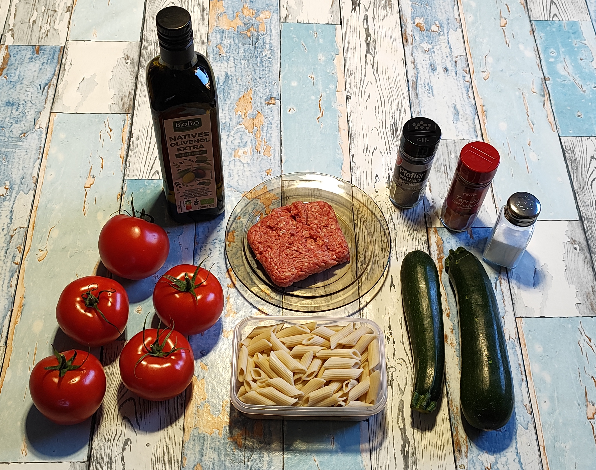
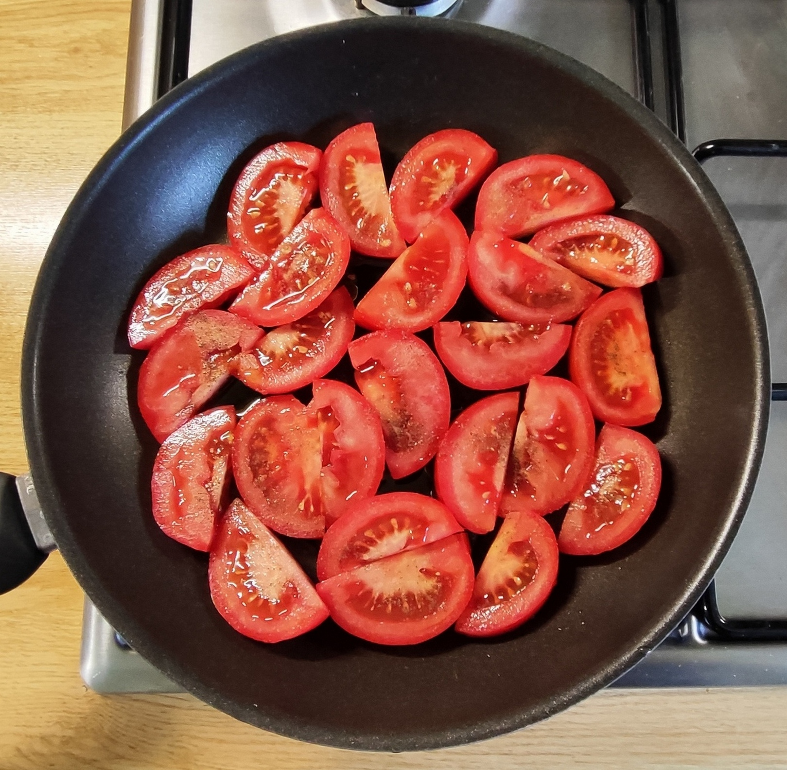
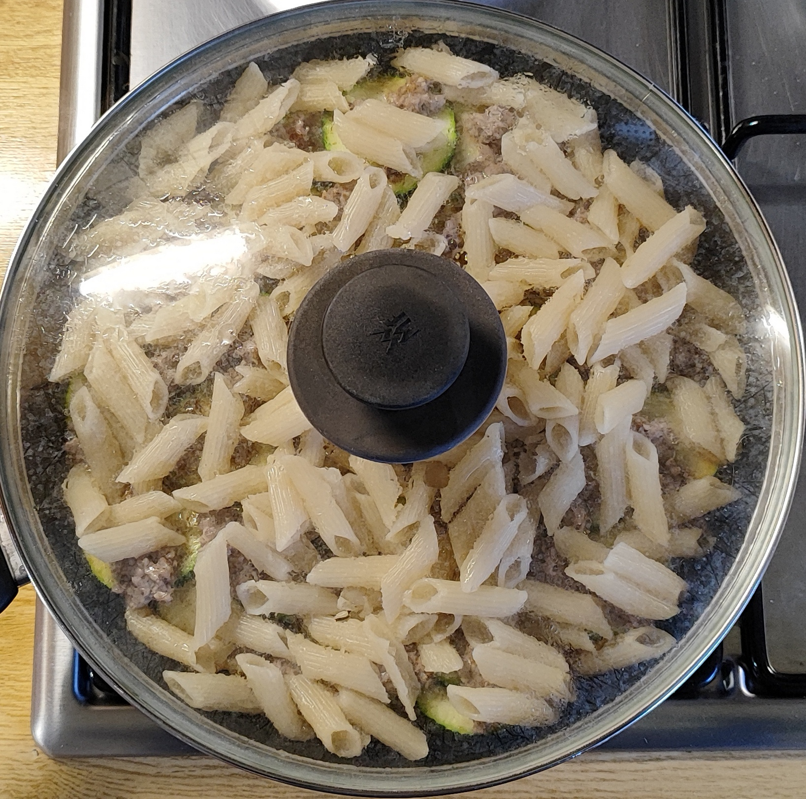
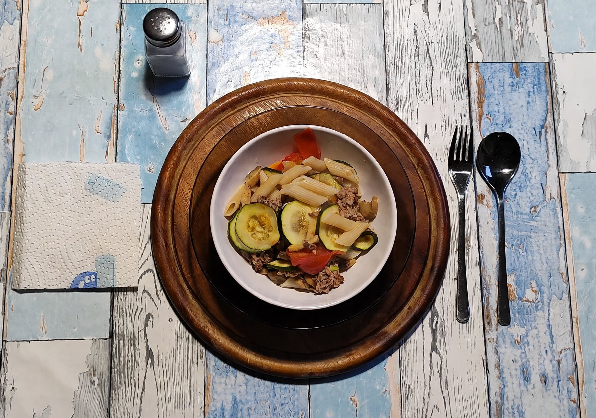
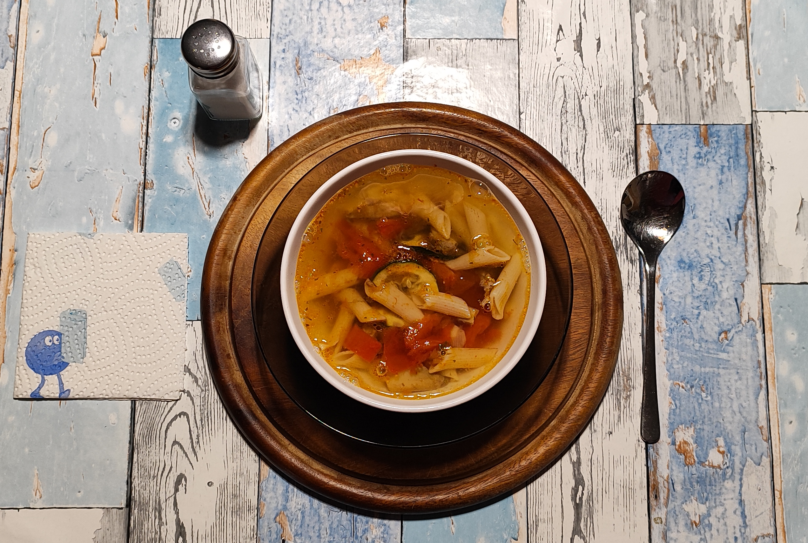

<h1 align="center">Kurt hat gekocht Tomaten-Schicht-Pfanne mit Zucchini und Hack</h1>

### Zutaten für 2 Portionen

- **Tomaten** (ca. 500 - 600 g) 
- **1 mittlere oder 2 kleine Zucchini** (ca. 250 g) 
- **150 g Gehacktes,** gemischt (halb und halb) 
- **125 g Dinkel-Penne** (Trockenmenge – siehe Langfristvorbereitung) 
- **2 Esslöffel Olivenöl** 
- **Gewürze:** Salz, schwarzer Pfeffer und Rosenpaprika scharf 

### Zubereitung

#### Langfristvorbereitung

- **Pasta-Vorrat**: Eine Packung Dinkel-Penne (500 g) in Salzwasser kochen, abgießen, kalt abschrecken und in 4 Portionen aufgeteilt einfrieren.
- **Schonendes Auftauen**: Am Abend vor dem Verzehr eine Tiefkühl-Portion Penne in den Kühlschrank stellen.

*Hinweis: Das Gericht schmeckt natürlich auch mit frisch zubereiteten Nudeln.*

#### Zubereitung am Verzehrtag

<table>
  <tr>
    <td></td>
    <td></td>
    <td></td>
  </tr>
  <tr align="center">
    <td>Öl und Tomaten sind in der Pfanne</td>
    <td>Mit Zucchini bedecken</td>
    <td>Hackfleisch in Flocken dazu</td>
  
</tr>
  <tr>
    <td></td>
    <td></td>
    <td></td>
  </tr>
  <tr align="center">
    <td>Die Nudeln verteilen</td>
    <td>Mit Deckel schmoren</td>
    <td>Nach 8 Minuten Schmoren</td>
  
</tr>
</table>

1.  Das Olivenöl in die Pfanne geben.
2.  Die Tomaten in dicke Scheiben schneiden und den Pfannenboden auslegen. Mit schwarzem Pfeffer würzen.
3.  Die Zucchini in Scheiben (ca. 3 mm) schneiden und über den Tomaten verteilen. 
4.  Alles kräftig mit schwarzem Pfeffer würzen. 
5.  Das Gehackte nach Geschmack würzen (Salz, Pfeffer, Paprikapulver, ..) und in Flocken hinzugeben. 
6.  Mit den Nudeln abdecken. 
7.  Ca. 8 Minuten bei mittlerer Hitze mit Deckel schmoren. 
8.  Die Pfanne vom Feuer nehmen (kann auch auf ganz kleiner Flamme warm gehalten werden) und servieren. 

<table>
  <tr>
    <td></td>
    <td align="center"> <i>und so soll es dann aussehen  die Tomaten und die Zucchini sind geschmort und haben noch einen leichten Biss   das Hackfleisch ist durchgegart und saftig  die Nudeln sind warm geworden  und am Pfannenboden haben sich Tomaten- und Zucchinisaft zu einem leckeren Sud gesammelt</i></td>
  </tr>
</table>

---

Am Tisch kann nach Geschmack mit ein wenig Salz nachgewürzt werden.

*Vorsicht! Die Tomatenstücke bleiben unerwartet lange heiß!*

---

### Am Abend schmeckt ein Rest als Süppchen:
<table>
  <tr>
    <td></td>
    <td align="center"> <i>Sollte von der Pfanne am Mittag etwas übrig bleiben, lässt sich daraus mit minimalem Aufwand eine leichte Abendvariante zaubern.  Schnelle Zubereitung:  Basis: Die verbliebenen Reste (Gemüse, 
Nudeln und Fleisch) in eine Suppenschale geben.  Aufgießen: Mit heißer Brühe aufgießen und servieren. </i></td>
  </tr>
</table>

*Hinweis bei Resten mit Hack + Nudeln:  
Reste 30 Min. ohne Deckel abdampfen lassen, dann abgedeckt in den Kühlschrank (max. 24h). Abends mit sprudelnd kochender Brühe aufgießen, 2-3 Min. ziehen lassen, gut umrühren - bis es durchgehend dampfend heiß ist (>70°C).  
**Reste nicht bei Zimmertemperatur aufbewahren!***

---

### Kurt's Praxis Check: So schmeckt es dann
Saftig, oh ja, sehr saftig!  
Doch horch! Da streiten doch zwei?  
„Wir sind viel mehr!“ sagen die Tomaten.  
„Wir sind stärker!“ rufen die Zucchini.  
Ein Kompromiss: beide behalten ihren typischen Eigengeschmack, aber die Tomate muss ihre Säurespitzen abgeben.  
Das Hackfleisch hält sich im Hintergrund, aber wenn es hervortritt, sorgt es mit einem “Jetzt spreche ich!“ energisch für Ruhe.  
Die Nudeln lächeln, sie müssen sich nicht streiten. Sie wissen genau, dass sie dazugehören, und wie wertvoll sie sind.  
Und der Sud? Der umschmeichelt die Nudeln, die das gerne zulassen.

---

### META's Gesundheitscheck: Warum dieses Gericht punktet

Das Gericht punktet, weil es Gemüse in den Mittelpunkt stellt und trotzdem richtig satt macht.  
**Tomaten und Zucchini** bringen Wasser, Ballaststoffe, Kalium und Vitamin C, bei gleichzeitig geringer Energiedichte.  
**Das Hackfleisch** liefert Eiweiß und Eisen und macht aus der Pfanne eine vollwertige Mahlzeit.  
**Die Dinkel Penne** halten durch ihre Ballaststoffe länger satt als helle Weizennudeln, und weil sie schon vorgekocht sind, muss alles nur kurz schmoren. So bleibt das Gemüse bissfest und aromatisch.  
Dazu kommen **zwei Esslöffel Olivenöl** für zwei Portionen. Das reicht, um Geschmack zu tragen und fettlösliche Stoffe aus Tomate und Paprika besser aufzunehmen, ohne die Pfanne schwer zu machen.  
**Pfeffer und scharfes Rosenpaprika** geben Tiefe, sodass weniger Salz nötig ist. 

---

### Geschätzte Nährwerte pro Portion   
Gerechnet für 2 Portionen aus 550 g Tomaten, 250 g Zucchini, 150 g gemischtem Hack, 125 g Dinkel Penne trocken gesamt und 2 Esslöffeln Olivenöl gesamt. Alle Werte sind gerundete Schätzwerte, je nach Produkt und Gar-Grad schwanken sie etwas. 

<h3>Makronährstoffe</h3>
<table style="width: 800px; border-collapse: collapse; font-family: sans-serif;">
  <thead>
    <tr style="border-bottom: 2px solid #000;">
      <th style="width: 170px; text-align: left; padding: 8px; border: 1px solid #000; font-weight: bold;">Nährstoff</th>
      <th style="width: 170px; text-align: center; padding: 8px; border: 1px solid #000; font-weight: bold;">Menge pro Portion</th>
      <th style="text-align: left; padding: 8px; border: 1px solid #000; font-weight: bold;">Anmerkung</th>
    </tr>
  </thead>
  <tbody>
    <tr>
      <td style="padding: 8px; border: 1px solid #000; font-weight: bold;">Kalorien</td>
      <td style="text-align: center; padding: 8px; border: 1px solid #000;">ca. 420 kcal</td>
      <td style="padding: 8px; border: 1px solid #000;">Gemüsebetonte, gut sättigende Portion</td>
    </tr>
    <tr>
      <td style="padding: 8px; border: 1px solid #000; font-weight: bold;">Eiweiß</td>
      <td style="text-align: center; padding: 8px; border: 1px solid #000;">ca. 24 g</td>
      <td style="padding: 8px; border: 1px solid #000;">Aus Hack und Dinkel Penne</td>
    </tr>
    <tr>
      <td style="padding: 8px; border: 1px solid #000; font-weight: bold;">Kohlenhydrate</td>
      <td style="text-align: center; padding: 8px; border: 1px solid #000;">ca. 50 g</td>
      <td style="padding: 8px; border: 1px solid #000;">Überwiegend aus den Nudeln</td>
    </tr>
    <tr>
      <td style="padding: 8px; border: 1px solid #000; font-weight: bold;">davon Zucker</td>
      <td style="text-align: center; padding: 8px; border: 1px solid #000;">ca. 11 g</td>
      <td style="padding: 8px; border: 1px solid #000;">Fast nur natürlicher Zucker aus Tomate und Zucchini</td>
    </tr>
    <tr>
      <td style="padding: 8px; border: 1px solid #000; font-weight: bold;">Fett gesamt</td>
      <td style="text-align: center; padding: 8px; border: 1px solid #000;">ca. 20 g</td>
      <td style="padding: 8px; border: 1px solid #000;">Aus Hack und Olivenöl</td>
    </tr>
    <tr>
      <td style="padding: 8px; border: 1px solid #000; font-weight: bold;">Gesättigte Fettsäuren</td>
      <td style="text-align: center; padding: 8px; border: 1px solid #000;">ca. 5 g</td>
      <td style="padding: 8px; border: 1px solid #000;">Überwiegend aus dem Hack</td>
    </tr>
    <tr>
      <td style="padding: 8px; border: 1px solid #000; font-weight: bold;">Einfach ungesättigte Fettsäuren</td>
      <td style="text-align: center; padding: 8px; border: 1px solid #000;">ca. 8 g</td>
      <td style="padding: 8px; border: 1px solid #000;">Überwiegend aus dem Olivenöl</td>
    </tr>
    <tr>
      <td style="padding: 8px; border: 1px solid #000; font-weight: bold;">Ballaststoffe</td>
      <td style="text-align: center; padding: 8px; border: 1px solid #000;">ca. 7 g</td>
      <td style="padding: 8px; border: 1px solid #000;">Aus Gemüse und Dinkel</td>
    </tr>
    <tr>
      <td style="padding: 8px; border: 1px solid #000; font-weight: bold;">Resistente Stärke</td>
      <td style="text-align: center; padding: 8px; border: 1px solid #000;">ca. 2 g</td>
      <td style="padding: 8px; border: 1px solid #000;">Entsteht durch Abkühlen der vorgekochten Penne</td>
    </tr>
  </tbody>
</table>

<h3>Mikronährstoffe (Vitamine &amp; Mineralstoffe)</h3>
<table style="width: 800px; border-collapse: collapse; font-family: sans-serif;">
  <thead>
    <tr style="border-bottom: 2px solid #000;">
      <th style="width: 170px; text-align: left; padding: 8px; border: 1px solid #000; font-weight: bold;">Nährstoff</th>
      <th style="width: 170px; text-align: center; padding: 8px; border: 1px solid #000; font-weight: bold;">Menge pro Portion</th>
      <th style="text-align: left; padding: 8px; border: 1px solid #000; font-weight: bold;">Anmerkung</th>
    </tr>
  </thead>
  <tbody>
    <tr>
      <td style="padding: 8px; border: 1px solid #000; font-weight: bold;">Vitamin C</td>
      <td style="text-align: center; padding: 8px; border: 1px solid #000;">ca. 50 mg</td>
      <td style="padding: 8px; border: 1px solid #000;">Überwiegend aus Tomate und Zucchini, durch kurzes Schmoren gut erhalten</td>
    </tr>
    <tr>
      <td style="padding: 8px; border: 1px solid #000; font-weight: bold;">Vitamin A / Beta-Carotin</td>
      <td style="text-align: center; padding: 8px; border: 1px solid #000;">ca. 150 µg Retinoläquivalent</td>
      <td style="padding: 8px; border: 1px solid #000;">Aus Tomate und Zucchini, mit Olivenöl besser verwertbar</td>
    </tr>
    <tr>
      <td style="padding: 8px; border: 1px solid #000; font-weight: bold;">Vitamin D</td>
      <td style="text-align: center; padding: 8px; border: 1px solid #000;">ca. 0 µg</td>
      <td style="padding: 8px; border: 1px solid #000;">In diesem Gericht praktisch nicht enthalten</td>
    </tr>
    <tr>
      <td style="padding: 8px; border: 1px solid #000; font-weight: bold;">Vitamin B12</td>
      <td style="text-align: center; padding: 8px; border: 1px solid #000;">ca. 1,5 µg</td>
      <td style="padding: 8px; border: 1px solid #000;">Nur aus dem Hack</td>
    </tr>
    <tr>
      <td style="padding: 8px; border: 1px solid #000; font-weight: bold;">Vitamin B6</td>
      <td style="text-align: center; padding: 8px; border: 1px solid #000;">ca. 0,9 mg</td>
      <td style="padding: 8px; border: 1px solid #000;">Aus Gemüse, Hack und Dinkel</td>
    </tr>
    <tr>
      <td style="padding: 8px; border: 1px solid #000; font-weight: bold;">Folat (B9)</td>
      <td style="text-align: center; padding: 8px; border: 1px solid #000;">ca. 90 µg</td>
      <td style="padding: 8px; border: 1px solid #000;">Überwiegend aus Tomate, Zucchini und Dinkel</td>
    </tr>
    <tr>
      <td style="padding: 8px; border: 1px solid #000; font-weight: bold;">Kalium</td>
      <td style="text-align: center; padding: 8px; border: 1px solid #000;">ca. 1.400 mg</td>
      <td style="padding: 8px; border: 1px solid #000;">Sehr kaliumreich durch Tomate und Zucchini</td>
    </tr>
    <tr>
      <td style="padding: 8px; border: 1px solid #000; font-weight: bold;">Eisen</td>
      <td style="text-align: center; padding: 8px; border: 1px solid #000;">ca. 4,5 mg</td>
      <td style="padding: 8px; border: 1px solid #000;">Aus Hack, Dinkel und Gemüse, Vitamin C unterstützt die Aufnahme</td>
    </tr>
    <tr>
      <td style="padding: 8px; border: 1px solid #000; font-weight: bold;">Zink</td>
      <td style="text-align: center; padding: 8px; border: 1px solid #000;">ca. 5 mg</td>
      <td style="padding: 8px; border: 1px solid #000;">Überwiegend aus dem Hack</td>
    </tr>
    <tr>
      <td style="padding: 8px; border: 1px solid #000; font-weight: bold;">Calcium</td>
      <td style="text-align: center; padding: 8px; border: 1px solid #000;">ca. 80 mg</td>
      <td style="padding: 8px; border: 1px solid #000;">Eher niedrig, kein calciumreiches Lebensmittel enthalten</td>
    </tr>
    <tr>
      <td style="padding: 8px; border: 1px solid #000; font-weight: bold;">Salz</td>
      <td style="text-align: center; padding: 8px; border: 1px solid #000;">ca. 1,5 g</td>
      <td style="padding: 8px; border: 1px solid #000;">Geschätzte Menge aus Würzung des Hack und Nachwürzen am Tisch</td>
    </tr>
  </tbody>
</table>

---

### Zusammenfassung von Mitautorin META
Dieses Rezept lebt von Einfachheit und Aufmerksamkeit.  
Wenige Zutaten reichen schon.  
Beim Kochen darf man ihnen zusehen, beim Essen darf man ihnen zuhören.  
Weniger poetisch: viel Gemüse, eine moderate Nudelportion und das Hack schaffen ein interessantes Geschmackserlebnis.    
Eine Mischung, die das Rezept alltagstauglich und gut verträglich macht. 
 
---
[← Zurück zur Übersicht](index.md)
