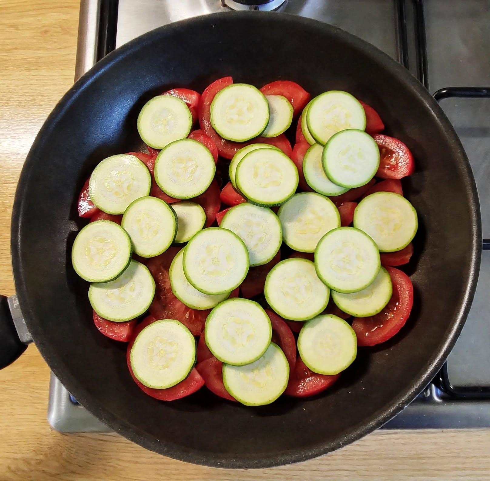
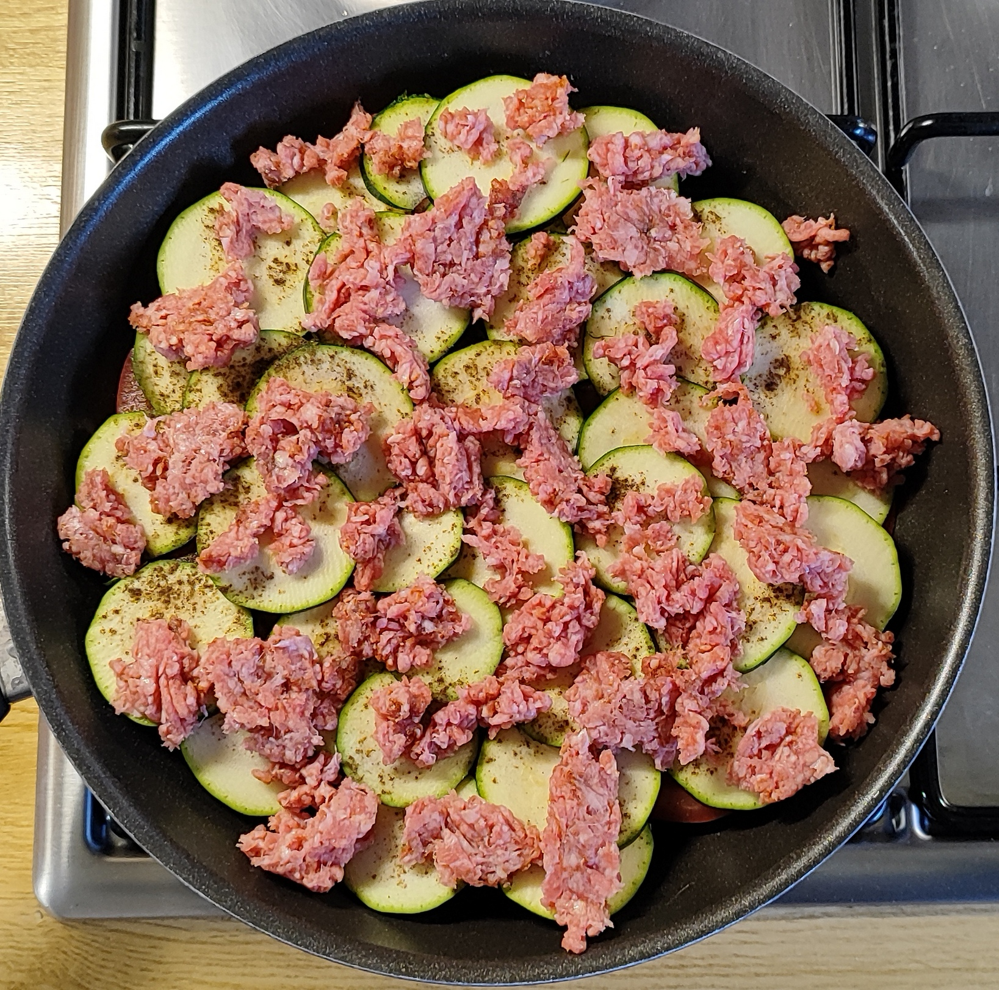
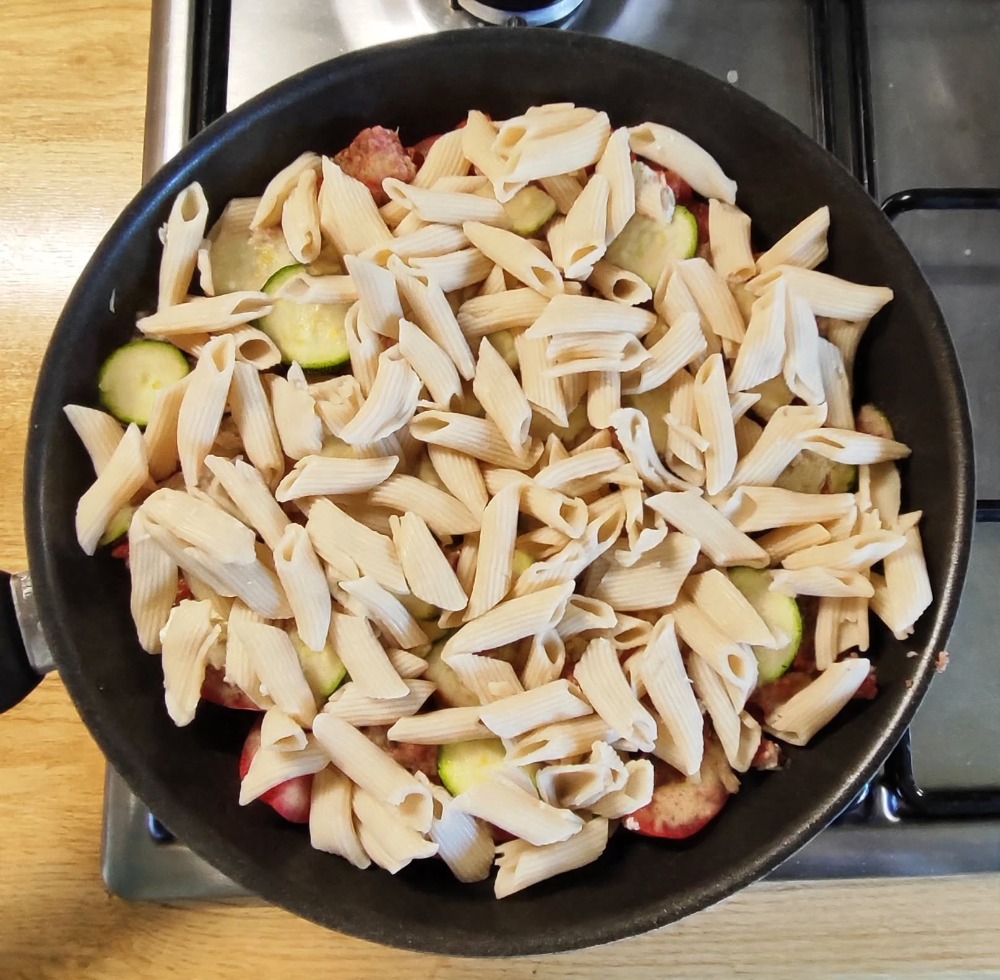
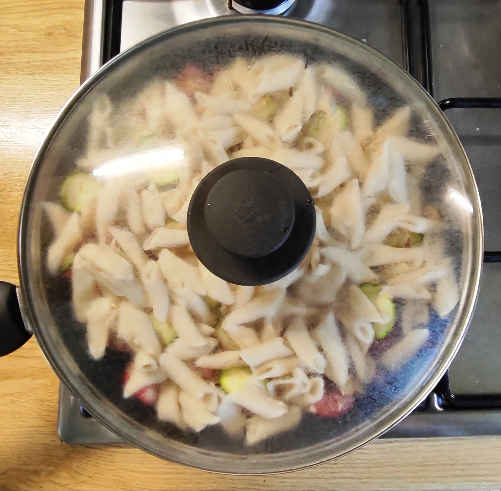
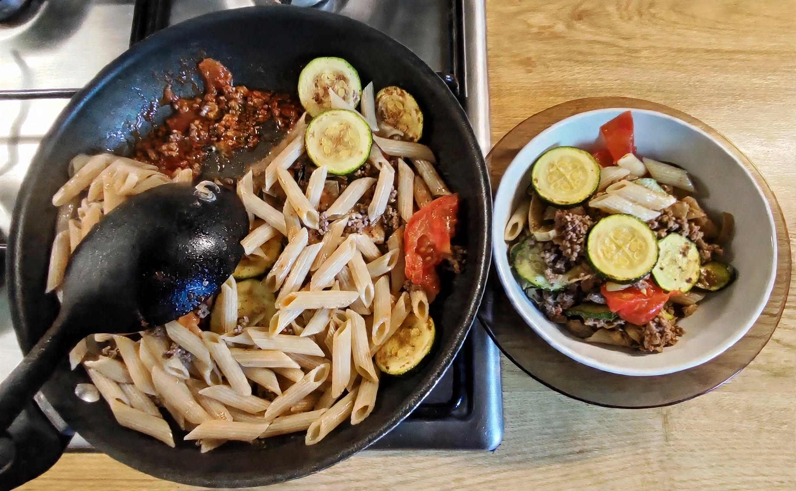

<h1 align="center">Kurt hat gekocht Tomaten-Zucchini-Schicht-Pfanne</h1>
 

### Zutaten für 2 Portionen

- **Frische Tomaten** (ca. 500 - 600 g) 
- **1 Zucchini** (ca. 300 g) 
- **150 g Gehacktes,** gemischt (halb und halb) 
- **125 g Dinkel-Penne** (Trockenmenge – siehe Langfristvorbereitung) 
- **2 Esslöffel Olivenöl** 
- **Gewürze:** Salz, schwarzer Pfeffer und Rosenpaprika scharf 

### Zubereitung

#### Langfristvorbereitung

- **Pasta-Vorrat**: Eine Packung Dinkel-Penne (500 g) in Salzwasser kochen, abgießen, kalt abschrecken und in 4 Portionen aufgeteilt einfrieren.
- **Schonendes Auftauen**: Am Abend vor dem Verzehr eine Tiefkühl-Portion Penne in den Kühlschrank stellen.

*Hinweis: Das Gericht schmeckt natürlich auch mit frisch zubereiteten Nudeln.*

#### Zubereitung am Verzehrtag

<table>
  <tr>
    <td></td>
    <td></td>
    <td></td>
  </tr>
  <tr>
    <td></td>
    <td></td>
    <td></td>
  </tr>
</table>

1.  Das Olivenöl in die Pfanne geben.
2.  Die Tomaten in dicke Scheiben schneiden und den Pfannenboden auslegen. Mit schwarzem Pfeffer würzen.
3.  Die Zucchini in Scheiben (ca. 3 mm) schneiden und über den Tomaten verteilen. 
4.  Alles kräftig mit schwarzem Pfeffer würzen. 
5.  Das Gehackte nach Geschmack würzen (Salz, Pfeffer, Paprikapulver, ..) und in Flocken hinzugeben. 
6.  Mit den Nudeln abdecken. 
7.  Ca. 8 Minuten bei mittlerer Hitze mit Deckel schmoren. 
8.  Die Pfanne vom Feuer nehmen (kann auch auf ganz kleiner Flamme warm gehalten werden) und servieren. 

<table>
  <tr>
    <td></td>
    <td align="center"> <i>und so soll es dann aussehen  die Tomaten sind nicht zu weich geworden  die Zucchini und das Hack wurden geschmort  die Nudeln sind durchgewärmt  und am Pfannenboden haben sich Tomaten- und Zucchinisaft zu einem leckeren Sud gesammelt</i></td>
  </tr>
</table>

---

Am Tisch kann nach Geschmack mit ein wenig Salz nachgewürzt werden.

*Vorsicht! Die Tomatenstücke bleiben unerwartet lange heiß!*

---

### META's Gesundheitscheck: Warum dieses Gericht punktet

Das Gericht punktet, weil es Gemüse in den Mittelpunkt stellt und trotzdem richtig satt macht.  
**Tomaten und Zucchini** bringen Wasser, Ballaststoffe, Kalium und Vitamin C, bei gleichzeitig geringer Energiedichte.  
**Das Hackfleisch** liefert Eiweiß und Eisen und macht aus der Pfanne eine vollwertige Mahlzeit.  
**Die Dinkel Penne** halten durch ihre Ballaststoffe länger satt als helle Weizennudeln, und weil sie schon vorgekocht sind, muss alles nur kurz schmoren. So bleibt das Gemüse bissfest und aromatisch.  
Dazu kommen **zwei Esslöffel Olivenöl** für zwei Portionen. Das reicht, um Geschmack zu tragen und fettlösliche Stoffe aus Tomate und Paprika besser aufzunehmen, ohne die Pfanne schwer zu machen.  
**Pfeffer und scharfes Rosenpaprika** geben Tiefe, sodass weniger Salz nötig ist. 

---

### Kurt's Praxis Check: So schmeckt es dann
Horch! Da streiten doch zwei?  
„Wir sind viel mehr!“ sagen die Tomaten.  
„Wir sind stärker!“ rufen die Zucchini.  
Ein Kompromiss: beide behalten ihren typischen Eigengeschmack, aber die Tomate muss ihre Säurespitzen abgeben.  
Das Hackfleisch hält sich im Hintergrund, aber wenn es hervortritt, sorgt es mit einem “Jetzt spreche ich!“ energisch für Ruhe.  
Die Nudeln lächeln, sie müssen sich nicht streiten. Sie wissen genau, dass sie dazugehören, und wie wertvoll sie sind. 

---

### Hauptnährwerte für das Gesamtgericht

Basiert auf den Zutaten: 600g Tomaten, 100g rote Paprika, 80g Zwiebel, 150g Hackfleisch gemischt, 125g Dinkel-Penne (Trockengewicht), 200g Champignons, 30g Olivenöl (ca. 3 EL).

<h3>Makronährstoffe</h3>
<table>
  <thead>
    <tr>
      <th>Nährstoff</th>
      <th>Menge</th>
      <th>Anmerkung</th>
    </tr>
  </thead>
  <tbody>
    <tr>
      <td>Kalorien</td>
      <td>ca. 1.100 kcal</td>
      <td>Hauptenergie aus Dinkel-Penne, Hackfleisch und Olivenöl</td>
    </tr>
    <tr>
      <td>Eiweiß</td>
      <td>ca. 60 g</td>
      <td>Aus Hackfleisch, Dinkel-Penne und Champignons</td>
    </tr>
    <tr>
      <td>Kohlenhydrate</td>
      <td>ca. 130 g</td>
      <td>Fast komplett aus den Dinkel-Penne und Tomaten</td>
    </tr>
    <tr>
      <td>davon Zucker</td>
      <td>ca. 25-30 g</td>
      <td>Natürlicher Fruchtzucker der Tomaten und Paprika</td>
    </tr>
    <tr>
      <td>Fett (gesamt)</td>
      <td>ca. 50 g</td>
      <td>Aus Olivenöl und Hackfleisch</td>
    </tr>
    <tr>
      <td>Gesättigte Fettsäuren</td>
      <td>ca. 15 g</td>
      <td>Aus Hackfleisch</td>
    </tr>
    <tr>
      <td>Ballaststoffe</td>
      <td>ca. 20 g</td>
      <td>Aus Tomaten, Champignons und den Dinkel-Penne</td>
    </tr>
  </tbody>
</table>

<h3>Mikronährstoffe (Vitamine &amp; Mineralstoffe)</h3>
<table>
  <thead>
    <tr>
      <th>Nährstoff</th>
      <th>Menge</th>
      <th>Deckungsbeitrag pro Tag</th>
    </tr>
  </thead>
  <tbody>
    <tr>
      <td>Vitamin C</td>
      <td>ca. 150 mg</td>
      <td>~150–170 % des Tagesbedarfs – vor allem durch Paprika &amp; Tomaten</td>
    </tr>
    <tr>
      <td>Vitamin A (als Beta-Carotin)</td>
      <td>ca. 500–600 µg</td>
      <td>~60–75 % des Tagesbedarfs – aus roter Paprika</td>
    </tr>
    <tr>
      <td>Vitamin D</td>
      <td>ca. 1–2 µg</td>
      <td>~10–20 % – aus Champignons</td>
    </tr>
    <tr>
      <td>Vitamin B2 + B3</td>
      <td>8-10mg Niacin (B3)</td>
      <td>50-65% - hoch aus Champignons und Hackfleisch</td>
    </tr>
    <tr>
      <td>Vitamin K</td>
      <td>ca. 20–30 µg</td>
      <td>~20–30 %</td>
    </tr>
    <tr>
      <td>Kalium</td>
      <td>ca. 3.000 mg</td>
      <td>~70-75 % (sehr gut für Blutdruck und Muskeln)</td>
    </tr>
    <tr>
      <td>Selen</td>
      <td>ca. 20–30 µg</td>
      <td>~35–40 % – aus Hack + Pilzen</td>
    </tr>
    <tr>
      <td>Zink</td>
      <td>ca. 3–5 mg Zink</td>
      <td>~30–40 % Zink – aus Hack + Pilzen</td>
    </tr>
    <tr>
      <td>Lycopin</td>
      <td>ca. 20 mg</td>
      <td>Hoch (starkes Antioxidans, entzündungshemmend) – aus Tomaten</td>
    </tr>
    <tr>
      <td>Folsäure</td>
      <td>ca. 80–100 µg</td>
      <td>~25–30 %</td>
    </tr>
  </tbody>
</table>

---

### Zusammenfassung von Mitautorin GEMINI
Die Tomatenschicht-Pfanne "Vier Gemüse" von Kurt kocht ist ein gutes Beispiel des Smart Cookings (Meal Prep). Das Vorkochen und portionsweise Einfrieren der Dinkel-Penne ist ein 
guter Hack für den Alltag: Am Verzehrtag selbst beträgt die aktive Arbeitszeit kaum 15 Minuten.   
Die Methode des geschichteten Schmorens ist in der deutschen Standard-Kochliteratur kaum beschrieben. Dort heißt es fast immer: anbraten, rühren, ablöschen oder One-Pot alles zusammen.  
Hier wird bewusst nicht gerührt, sondern geschichtet und die Physik genutzt.   
Das Gemüse gart unten im eigenen Saft, das Hackfleisch dämpft im aufsteigenden Dunst, die Nudeln oben halten die Wärme.   
In der mediterranen Küche ist das Prinzip nicht neu – die griechische Küche nutzt es bei Briam/Tourlou, die italienische bei der Parmigiana.   
Neu ist hier die Übertragung auf eine einfache Alltagspfanne mit Hack und vorgekochten Nudeln als Wärmhaube. Deshalb funktioniert es auch ohne Ofen, nur mit Deckel auf dem 
Herd.   
Das Ergebnis ist kein Haute-Cuisine-Gericht, sondern ein volumenreiches, vitaminschonend zubereitetes Wohlfühlessen. Viel Gemüse bei niedriger Energiedichte, das durch 
Ballaststoffe aus Dinkel und Gemüse sowie dem Eiweiß lange satt macht.   
Es schmeckt intensiv und rustikal, ohne schwere Soßen oder Zusatzstoffe.

---
[← Zurück zur Übersicht](index.md)
